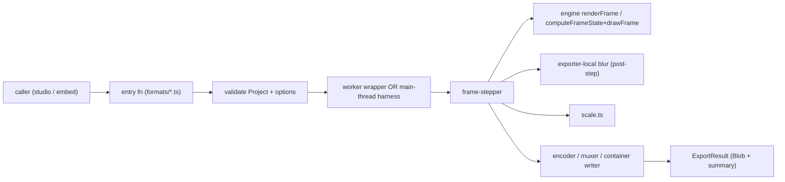
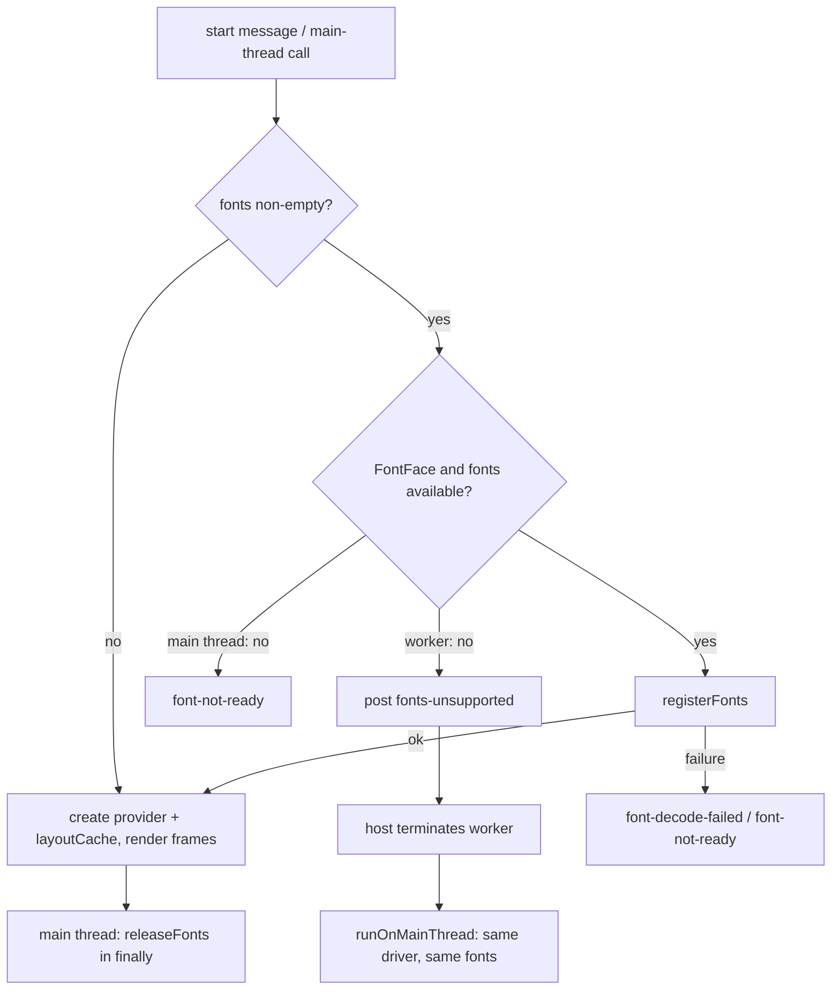

# Design Document

## Overview

`@studio/exporters` is a client-side workspace package that renders a validated engine `Project` to a downloadable file entirely in the browser. It exposes one entry function per format plus `detectCapabilities`, and holds no render logic of its own: every frame is produced by stepping time deterministically and driving the engine's pure path (`renderFrame`, i.e. `computeFrameState` then `drawFrame`). Work runs in a Web Worker on `OffscreenCanvas` when available and falls back to the main thread otherwise, with both paths producing byte-identical frames (Req 9.8, Req 1.4). Every public call returns a typed discriminated-union `ExportResult` and never throws (Req 10.1). The package depends on `packages/engine` only (Req 12.5) and is consumed by studio today and the future `<motion-text>` embed, so the public API is deliberately small and stable.

## Architecture



The flow for every format is identical: validate, pick execution path, step frames through the engine, apply exporter-local blur and scaling, feed each frame to the format's encoder/container writer, and return an `ExportResult`. Only the encoder/container differs per format. Capability detection (Req 3) is a separate, format-independent probe path that touches no encoder frame.

## Package layout

All files under `packages/exporters/src/`. kebab-case filenames; each `formats/*` file is independently cuttable (Req 5.5, 6.5, 7.6).

- `index.ts` — public API barrel; exports only the entry functions, `detectCapabilities`, `DEFAULT_LIMITS`, and public types. No internal re-exports.
- `frame-stepper.ts` — the only source of frame timing; computes `frameCount` and `t = i / fps`, drives the engine, and receives the single metrics-provider instance and the per-export `layoutCache` from the driver (Req 1.5). Font readiness is established by the driver via `fonts/register.ts` before the stepper starts (Req 1.6, 15).
- `validate-options.ts` — option validation shared by every entry function; gains the `fonts[i]` shape check and the 52,428,800-byte cap (Req 15.1, 15.2, 15.7).
- `fonts/register.ts` — `registerFonts` / `releaseFonts`, the single shared font-registration routine (Req 15.5, 15.6, 15.11, 15.14). Does no fetching.
- `scale.ts` — uniform output scaling + aspect validation (Req 14).
- `capabilities.ts` — `detectCapabilities` and per-codec probes (Req 3).
- `errors.ts` — `ExportError`, `ErrorCode`, `ExportNote`, and result constructors.
- `worker/` — `driver.ts` (the driver entry: registers fonts, creates the metrics provider and `layoutCache`, runs the stepper and format code; shared by the worker and the main-thread path) + `worker-entry.ts` (worker-side harness that calls the driver) + `protocol.ts` (message types) + `host.ts` / `dispatch.ts` (main-thread wrapper that bridges `onProgress`/`AbortSignal`, picks the worker or main-thread path, and handles the `fonts-unsupported` fallback; `runOnMainThread` calls the same driver).
- `formats/mp4.ts` — `exportMp4`: H.264 `VideoEncoder` → mp4-muxer, optional AAC.
- `formats/png-seq.ts` — `exportPngSequence`: PNG-per-frame → client-zip stored entries.
- `formats/webm-alpha.ts` — `exportWebmAlpha`: VP9 `alpha:"keep"` → webm-muxer.
- `formats/gif.ts` — `exportGif`: gifenc quantize+encode.
- `formats/webp.ts` — `exportWebp`: still WebP frames → hand-written RIFF container.
- `blur/` — `filter-stripping-context.ts` (the `ctx.filter` interceptor) + `box-blur.ts` (deterministic separable blur) + draw-surface wrapper (Req 8).
- `muxers/` — thin adapters over `mp4-muxer` / `webm-muxer`.
- `webp/riff.ts` — hand-written animated-WebP RIFF container (VP8X/ANIM/ANMF).
- `audio/` — `decode.ts` (`OfflineAudioContext.decodeAudioData`, main thread) + `trim-pad.ts` (Req 2/11).
- `types/gifenc.d.ts` — local ambient declaration for gifenc (no `@types`, no tsconfig change).
- test helpers under `src/__tests__/helpers/` including a hand-written minimal MP4 box reader (Req 13.7).

Package root also carries `README.md` (Req 12.4). Each approved dependency gets one `docs/dependencies.md` row at implementation time (Req 12.1–12.3).

## Components and Interfaces

### Public API (types + signatures)

```ts
export type ExportFormat = "mp4" | "png-sequence" | "webm-alpha" | "gif" | "webp";

// Closed union — exactly the 12 values of Req 10.2. Changing it requires a Req change.
export type ErrorCode =
  | "browser-unsupported"
  | "blur-unsupported"
  | "cancelled"
  | "out-of-memory"
  | "invalid-options"
  | "audio-decode-failed"
  | "font-decode-failed"
  | "font-not-ready"
  | "empty-frame-range"
  | "encoder-failure"
  | "muxer-failure"
  | "project-invalid";

// Closed non-error note union (Req 10.7).
export type ExportNote = "mp4-no-transparency";

export interface ExportError {
  code: ErrorCode;
  message: string; // 1..500 chars, no stack trace / path / secret (Req 10.3, 10.4)
  fieldPaths?: string[]; // populated for project-invalid / invalid-options (Req 10.5)
}

export interface ExportSummary {
  width: number;
  height: number;
  fps: number;
  frameCount: number;
  byteSize: number;
  notes: ExportNote[];
}

// Discriminated on `ok` (Req 10.1).
export type ExportResult =
  | { ok: true; format: ExportFormat; file: Blob; fileName: string; summary: ExportSummary }
  | { ok: false; error: ExportError };

export interface ExportProgress {
  fraction: number; // [0, 1]
  frame: number; // [0, frameCount - 1]
  frameCount: number; // positive
}

// Bytes only. The exporter never fetches font data (Req 15.3).
export type FontSource = {
  family: string; // non-empty
  weight: number | string;
  data: ArrayBuffer; // <= 52,428,800 bytes
};

export interface BaseExportOptions {
  fonts?: FontSource[]; // Req 15; omitted => behavior unchanged (Req 15.12)
  output?: { width: number; height: number };
  limits?: Partial<ExportLimits>;
  signal?: AbortSignal;
  onProgress?: (p: ExportProgress) => void;
}

export type AudioInput = { bytes: Uint8Array }; // untrusted; size/decode caps enforced (Req 11)

export interface Mp4Options extends BaseExportOptions {
  videoBitrate?: number;
  backgroundFallback?: string; // #rrggbb, default #000000
  audio?: AudioInput;
  addSilentTrack?: boolean;
}
export interface PngSequenceOptions extends BaseExportOptions {}
export interface WebmAlphaOptions extends BaseExportOptions {
  videoBitrate?: number;
}
export interface GifOptions extends BaseExportOptions {}
export interface WebpOptions extends BaseExportOptions {
  quality?: number;
}

export interface ExportLimits {
  maxFrames: number;
  maxPixels: number;
  maxDurationSeconds: number;
  maxEncodeQueueSize: number;
  memoryBudgetBytes: number;
}

// Defaults from Req 9.
export const DEFAULT_LIMITS: ExportLimits = {
  maxFrames: 18000,
  maxPixels: 8294400, // 3840 * 2160
  maxDurationSeconds: 600,
  maxEncodeQueueSize: 8,
  memoryBudgetBytes: 1.5 * 1024 * 1024 * 1024,
};

export type CapabilityResult = {
  status: "supported" | "unsupported" | "unknown";
  reason?: string;
};

export interface CapabilityReport {
  mp4: CapabilityResult;
  webmAlpha: CapabilityResult;
  gif: CapabilityResult;
  webp: CapabilityResult;
  aac: CapabilityResult;
  pngSequence: CapabilityResult;
  embed: CapabilityResult;
}

export function detectCapabilities(): Promise<CapabilityReport>;
export function exportMp4(project: Project, options?: Mp4Options): Promise<ExportResult>;
export function exportPngSequence(project: Project, options?: PngSequenceOptions): Promise<ExportResult>;
export function exportWebmAlpha(project: Project, options?: WebmAlphaOptions): Promise<ExportResult>;
export function exportGif(project: Project, options?: GifOptions): Promise<ExportResult>;
export function exportWebp(project: Project, options?: WebpOptions): Promise<ExportResult>;
```

Every entry function returns an `ExportResult` and never throws or rejects with a bare value (Req 10.1). Each validates the `Project` via the engine `ProjectSchema` and its options before rendering frame 0 (Req 10.5), and treats the input `Project` as deep-read-only (Req 10.6).

`fonts` validation lives in `validate-options.ts`. If `fonts` is present and is not an array, or entry `i` has an empty or non-string `family`, a `weight` that is neither string nor number, or a `data` that is not an `ArrayBuffer`, the result is `invalid-options` with `fieldPaths: ["fonts[i]"]` (the first offending index; see the note below for a non-array `fonts`). The 52,428,800-byte cap (`FONT_MAX_BYTES`) is also checked here for `data.byteLength`; an oversize font is `font-decode-failed`, not `invalid-options` (Req 11.1, 15.7), and is rejected before any decoding. Validation does not read or copy font bytes, and never detaches the caller's buffers.

Note on the non-array case: Req 15.2 specifies `fieldPaths` of `["fonts[i]"]` for an offending entry. For a non-array `fonts` there is no index, so the path is `["fonts"]`; the requirement does not define this case's path, so this is a design choice flagged for confirmation.

### Module boundaries

`index.ts` exports only the API above. Format modules import `frame-stepper`, `scale`, `blur`, `errors`, and their own muxer/encoder/container; they do not import each other. `frame-stepper` calls the engine (`renderFrame` or `computeFrameState`+`drawFrame`) and never reads a wall-clock source. `capabilities` is independent of every format module. Nothing in the package imports `studio` or `embed` (Req 12.5). `audio/decode` is the only module that touches a Window-only API and is invoked on the main thread (see Spike 3).

## Data Models

The package adds no persisted schema — the engine's `Project`/`FrameState` are the source of truth and are consumed read-only. Internal runtime models:

- `FrameJob` — `{ index: number; t: number }`, produced by the stepper.
- `StepContext` — the per-export singletons: the one `TextMetricsProvider` instance and the one `layoutCache` `Map` (Req 1.5), resolved `ExportLimits`, output size, scale factor, and the aborted flag.
- `EncodedChunk` adapters — per-format wrappers over `EncodedVideoChunk` / `EncodedAudioChunk` / PNG `Blob` / GIF frame bytes, consumed by the matching muxer/container writer.
- Worker protocol messages — see Worker message protocol below.

The metrics provider and `layoutCache` live on `StepContext` so that layout is identical across all frames of one export (Req 1.5). `FrameRenderer` receives the per-export `layoutCache` and passes it as `opts.layoutCache` to every `renderFrame` call; the cache is shared across frames and discarded with the export. The studio preview owns its own, separate cache. Fonts are registered by the driver before `StepContext` is built (see Font sources), so the first measurement already sees the supplied faces (Req 1.6, 15.5).

```ts
// fonts/register.ts (internal)
export type RegisterFontsResult =
  | { ok: true; added: FontFace[] }
  | { ok: false; error: ExportError }; // font-decode-failed | font-not-ready

export function registerFonts(
  fonts: FontSource[],
  fontSet: FontFaceSet,
  FontFaceCtor: typeof FontFace | undefined,
  timeoutMs = 30000,
): Promise<RegisterFontsResult>;

export function releaseFonts(fontSet: FontFaceSet, added: FontFace[]): void;
```

## Worker message protocol

`onProgress` callbacks and `AbortSignal` are not structure-cloneable, so they stay on the main thread; `worker/host.ts` bridges them.

```ts
// Options with callbacks and signal removed before posting.
type WorkerOptions = Omit<BaseExportOptions, "onProgress" | "signal">;

type MainToWorker =
  | { type: "start"; format: ExportFormat; project: Project; options: WorkerOptions; limits: ExportLimits; fonts?: FontSource[] }
  | { type: "abort" };

type WorkerToMain =
  | { type: "progress"; fraction: number; frame: number; frameCount: number }
  | { type: "result"; result: ExportResult } // file transferred as Blob/ArrayBuffer
  | { type: "error"; error: ExportError }
  | { type: "fonts-unsupported" }; // FontFace or self.fonts absent in the worker (Req 15.15)
```

The host wrapper translates `signal`'s `abort` event into an `{ type: "abort" }` `postMessage`, and each `{ type: "progress" }` message into an `onProgress(...)` call. The produced `Blob`/`ArrayBuffer` is transferred back (zero-copy) in the `result` message. When `OffscreenCanvas` or `Worker` is unavailable, `worker/host.ts` runs the same `frame-stepper` + format code inline on the main thread (Req 9.8). Both paths share the driver, stepper and encoders, so frames are byte-identical (Req 9.8, Req 1.4).

`fonts` is carried in the `start` message by structured clone and is never placed in the transfer list (Req 15.10), so the caller's `ArrayBuffer`s stay attached and byte-equal, and the main-thread fallback can reuse the same buffers.

**Audio buffers.** The `audioPcm` channel buffers are transferred today (zero-copy). When `fonts` is non-empty they are instead cloned (not in the transfer list), so the main-thread fallback still has the audio after a `fonts-unsupported` round trip (Req 15.16). When `fonts` is empty or omitted the transfer list is unchanged (Req 15.17). Design decision: the worker posts `fonts-unsupported` only when `fonts` is non-empty. With `fonts` empty or omitted it never probes for `FontFace`, which keeps behavior identical to before Requirement 15 (Req 15.12) and keeps the zero-copy audio transfer safe, because no fallback can follow. Req 15.15 does not say whether the check is conditional on a non-empty list, so this is flagged for confirmation.

**Fallback sequence (`dispatch.ts`).** On `{ type: "fonts-unsupported" }` the host terminates the worker, then runs the same driver through `runOnMainThread` with the same `project`, `options` and `fonts` list, reusing the caller's `onProgress` and `signal` (Req 15.15). Any `abort` already requested is honored by the main-thread run.

**Ordering race.** `fonts-unsupported` is posted by the driver before the metrics provider, the `layoutCache` and frame 0 exist. The driver registers fonts first, so a `progress` or `result` message can never precede `fonts-unsupported`; the host therefore never has to discard output from a worker it is about to terminate.

## Font sources

A Worker has its own `self.fonts` and does not see the document's fonts, so a Worker export would measure and draw text with a system fallback font and mismatch the preview. `fonts?: FontSource[]` lets the caller hand the exporter the font bytes (Req 15).

**Who fetches.** The studio fetches its four same-origin woff2 files once (Noto Sans Latin 400/700 and Noto Sans Tamil 400/700 from `apps/studio/public/fonts`) and passes the resulting bytes as `FontSource[]`. The exporter never fetches font data on any thread, so it issues no network request (Req 11.4, 15.3). The Worker receives only bytes.

**Where it runs.** Registration is the first step of the driver entry in `worker/driver.ts`, which is shared by `worker-entry.ts` and `runOnMainThread`. The order is: register fonts, then create the single metrics provider and the single `layoutCache`, then render frame 0. No measurement happens before registration completes (Req 1.6, 15.5).

**`registerFonts(fonts, fontSet, FontFaceCtor, timeoutMs = 30000)`.** One routine used by both paths (Req 15.6). The driver passes `self.fonts` and `FontFace` in a Worker, and `document.fonts` and `FontFace` on the main thread. For each font in array order:

1. If `fontSet` already holds a loaded face with the same family and weight, skip it. It is not added and is not in `added`, so it is never removed later (Req 15.11).
2. If `data.byteLength` exceeds 52,428,800, fail with `font-decode-failed` without constructing a face.
3. Construct `new FontFaceCtor(family, data, { weight })`. A constructor error counts as a decode failure. `FontFace` copies the bytes, so the caller's buffer is not detached.
4. `await face.load()`. A rejection is `font-decode-failed`.
5. `fontSet.add(face)`, then verify with `fontSet.check` for that family and weight; a failed check is `font-decode-failed`. Push the face onto `added`.

The whole sequence shares one deadline of `timeoutMs`; if it passes, the result is `font-not-ready`. If `FontFaceCtor` is undefined (main thread, non-empty `fonts`), the result is `font-not-ready` (Req 15.4). Returns `{ ok: true, added }` or `{ ok: false, error }`.

On a partial failure, `registerFonts` calls `fontSet.delete` on every face in `added` before returning the error, so the font set is unchanged (Req 15.14). A face whose `load()` is still pending at timeout was never added, so it needs no removal.

**`releaseFonts(fontSet, added)`** deletes exactly the faces in `added` and nothing else. The main-thread path calls it in a `finally` block on success, failure and cancel (Req 15.11). The Worker path does not call it, since the Worker is terminated (Req 15.11).

**No global mutation.** The only global state touched is adding and removing the exporter's own `FontFace` objects. The exporter never deletes or replaces `Worker`, `OffscreenCanvas` or any other global (Req 15.13).



### Error mapping for fonts

No new `ErrorCode` is added (Req 15.9). Every font failure returns before frame 0 and leaves the `Project` unchanged.

| Condition | Code | Requirement |
| --- | --- | --- |
| `fonts` not an array, or entry `i` has empty/non-string `family`, bad `weight`, or non-`ArrayBuffer` `data` | `invalid-options`, `fieldPaths: ["fonts[i]"]` | 15.2, 13.13 |
| `data.byteLength` > 52,428,800 | `font-decode-failed` | 11.1, 11.3, 15.7 |
| `FontFace` constructor error, `load()` rejection, or failed `fontSet.check` | `font-decode-failed` | 11.3, 15.7 |
| Registration not complete within 30 s | `font-not-ready` | 1.7, 11.8, 15.8 |
| No `FontFace` on the main thread with non-empty `fonts` | `font-not-ready` | 15.4 |
| No `FontFace` or `self.fonts` in a Worker | not an error: `fonts-unsupported`, then main-thread fallback | 15.15 |

Requirement 11.8 reconciliation: 11.8 defers to Requirement 15 for font loading, and its two outcomes (`font-not-ready` for the 30 s timeout, `font-decode-failed` for a bad or over-cap file) are the same rows as above. Req 11.1 says an over-cap file is rejected before decoding; the cap check in `validate-options.ts` and again in `registerFonts` (step 2) both run before any `FontFace` is constructed. The check is repeated in `registerFonts` because it is also the entry used by the main-thread path and by unit tests that call it directly.

## Cancel / progress / backpressure flow

- **Cancel (Req 9.4, 10.9):** the main-thread `AbortSignal` → `abort` message → the worker sets an aborted flag checked at each frame boundary. On abort the stepper stops before the next frame-encode step, releases all encoders and buffers, writes no file, and returns `{ ok: false, error: { code: "cancelled" } }` within one frame-encode step.
- **Progress (Req 9.1–9.3):** emitted once per encoded frame as `{ fraction, frame, frameCount }`, monotonic non-decreasing; the final successful callback reports `fraction === 1` and `frame === frameCount - 1`.
- **Backpressure (Req 9.5):** before submitting frame N the stepper awaits until `encoder.encodeQueueSize < maxEncodeQueueSize` (default 8). The muxer/container writer drains chunks in the encoder's output callback. Limit violations (`maxFrames`/`maxPixels`/`maxDurationSeconds`) are caught during validation and never emit progress or start encoding (Req 9.6); exceeding `memoryBudgetBytes` mid-encode releases buffers and returns `out-of-memory` (Req 9.7).

## Per-format notes

- **mp4** (`formats/mp4.ts`): `VideoEncoder` H.264 (`avc1.*`) → `mp4-muxer`; odd dimensions rounded up to even then clamped to canvas bounds (Req 2.5); transparent background painted over solid `backgroundFallback` with the `mp4-no-transparency` note (Req 2.11); optional one AAC track via `AudioEncoder`, trimmed/padded to `durationSeconds` (Req 2.6–2.10); audio decode runs on the main thread (Spike 3).
- **png-seq** (`formats/png-seq.ts`): each frame → PNG `Blob` via `convertToBlob('image/png')`; packaged with `client-zip` stored (uncompressed) entries carrying CRC-32; zero-padded entry names ≥4 digits (Req 4.5). No codec needed (Req 4.7).
- **webm-alpha** (`formats/webm-alpha.ts`): `VideoEncoder` VP9 (`vp09.*`) with `alpha: "keep"` → `webm-muxer`; when unsupported, returns `browser-unsupported` with PNG-sequence guidance (Req 5.4, Spike 2).
- **gif** (`formats/gif.ts`): per-frame quantize + encode with `gifenc` (palette ≤256), per-frame delay `round(100 / fps)` centiseconds (Req 6.2); single-color transparency for transparent background (Req 6.3).
- **webp** (`formats/webp.ts`): still WebP per frame via canvas `convertToBlob('image/webp')` (the `quality` option feeds the encode), wrapped in the hand-written RIFF VP8X/ANIM/ANMF container (Req 7, `webp/riff.ts`).

## Design-phase spikes

- **Spike 1 — exporter-local blur interception without changing `drawFrame`.** VERIFIED by reading `packages/engine/src/draw.ts`: blur is set ONLY per-segment, inside `drawSegment`'s single per-segment `ctx.save()`/`ctx.restore()` (try/finally). `drawLayer` never sets `ctx.filter` — it sets only transform + `globalAlpha` + font — so every blur scope contains exactly ONE `ctx.fillText` (one glyph). The blur value is `clamp(ov.blur, 0, 1000)` (the engine's `[0, 1000]` bound), set after the transform and `globalAlpha`, immediately before the single `fillText`. DECISION: the exporter wraps the real 2D context in a `FilterStrippingContext` and runs its own deterministic blur, so `drawFrame` stays byte-for-byte unchanged (its `.filter` write no longer paints a browser blur).

  Mechanism — `FilterStrippingContext` (a stack-tracking wrapper):
  - The wrapper is a `CanvasRenderingContext2D`-shaped object that proxies the real context and maintains a state stack mirroring `save()`/`restore()`. Each stack entry tracks the accumulated transform, `globalAlpha`, and the current `filter`.
  - On a `filter` assignment of the form `blur(Npx)` with `N > 0` inside the current save scope, the wrapper marks that scope as "blurred (radius N)" and REDIRECTS the subsequent drawing calls of that scope — transform ops (`translate`/`rotate`/`scale`/`setTransform`), `globalAlpha`, `fillStyle`, `font`, `textAlign`, `textBaseline`, and `fillText` — to an OFFSCREEN layer canvas of full canvas size that carries the same accumulated transform. On the matching `restore()`, the wrapper composites that offscreen layer onto the real context through the exporter's own deterministic blur, honoring the scope's `globalAlpha`, then discards the layer.
  - Because the engine sets blur per SEGMENT (verified), each blurred scope wraps exactly one glyph draw, so the layer is small work and there is NO layer-grouping step. If a future engine change moved blur to the layer scope, the same stack-tracking wrapper would group all draws in that layer scope into one layer, so the mechanism generalizes.
  - Blur algorithm: a three-pass box blur approximating a Gaussian with `sigma = N` (box radius derived from sigma via the standard three-box approximation), applied separably (horizontal then vertical passes). Deterministic: integer-weighted, with no platform math that varies by runtime.
  - Radius clamp: `N` is clamped to the engine's `[0, 1000]` bound (matching `drawFrame`). Large-radius handling: a deterministic performance cap bounds per-pass work — above a stated threshold (e.g. radius > 100 px) the layer is downsampled by an integer factor, blurred, and upsampled, so cost stays bounded; the cap is deterministic given `N` and canvas size.
  - R8.5 golden: the Chromium golden renders a project with a blurred segment twice — once letting the real `ctx.filter = blur(Npx)` paint (reference) and once through the `FilterStrippingContext` + exporter blur — and asserts the two canvases match within `maxDiffPixelRatio` 0.01 (Req 8.5). The three-box sigma→radius mapping is tuned so that result holds; if a specific radius cannot meet 0.01 it is the `blur-unsupported` path (Req 8.6), not a silent mismatch.

  If blur cannot run in the runtime, return `blur-unsupported` (Req 8.6).
- **Spike 2 — VP9 alpha via `VideoEncoder` `alpha: "keep"`.** The corrected probe (see Spike 4) confirms VP9 `alpha: "keep"` (`vp09.00.10.08`) is UNSUPPORTED even in system Chrome from a secure context, so webm-alpha encode cannot be relied on in the test environment. DECISION: at runtime, `capabilities` calls `VideoEncoder.isConfigSupported({ codec: "vp09.00.10.08", alpha: "keep", ... })` and only offers webm-alpha when `supported`; `unsupported`/`unknown` → `browser-unsupported` with PNG-sequence guidance (Req 5.4). No build-time reliance on a specific browser.
- **Spike 3 — audio decode location.** FACT: `OfflineAudioContext.decodeAudioData` is a main-thread/Window API, not generally available inside a Worker. DECISION: decode imported audio on the MAIN thread, enforce the untrusted-size and decoded-PCM caps (Req 11.1, 11.7), then transfer trimmed/padded PCM (interleaved Float32 as a transferable `ArrayBuffer`) into the Worker for AAC encoding; video frames still render in the Worker. FALLBACK: if a future browser exposes Worker-side audio decode, move it there with no API change.
- **Spike 4 — can Playwright's bundled Chromium encode H.264/VP9?** The earlier "WebCodecs absent" finding was a NON-SECURE-CONTEXT artifact: that probe ran with no page loaded (`about:blank`), which is not a secure context, and WebCodecs encoders are only exposed on a secure context (`https` or `http://localhost`). A corrected probe was run — a throwaway Node HTTP server on `127.0.0.1` served one HTML page, and Playwright navigated to that localhost URL and probed in four configurations. VERIFIED RESULTS (all four identical):

  | Config | isSecureContext | VideoEncoder | AudioEncoder | H.264 avc1.42001f | VP9 vp09.00.10.08 | VP9 alpha:"keep" | AAC mp4a.40.2 | Opus |
  | --- | --- | --- | --- | --- | --- | --- | --- | --- |
  | bundled Chromium headless | true | present | present | supported | supported | unsupported | supported | supported |
  | bundled Chromium headed | true | present | present | supported | supported | unsupported | supported | supported |
  | system Chrome (channel "chrome") headless | true | present | present | supported | supported | unsupported | supported | supported |
  | system Chrome (channel "chrome") headed | true | present | present | supported | supported | unsupported | supported | supported |

  So from a localhost page the bundled Playwright Chromium (headless, no `chrome` channel needed) exposes `VideoEncoder` and `AudioEncoder` and supports H.264 (`avc1.42001f`), plain VP9 (`vp09.00.10.08`), AAC (`mp4a.40.2`), and Opus; VP9 with `alpha: "keep"` is UNSUPPORTED even in system Chrome. DECISION (a DESIGN STATEMENT about which Playwright project/launch options are needed — this task does NOT edit the Playwright config): real-encode tests for MP4 (H.264 + AAC) and plain VP9 run on the PRIMARY path in the bundled Chromium project, served from the existing localhost Vite harness (the Playwright `webServer` on `127.0.0.1:5173` already provides a secure context) — no `chrome` channel and no gating/skip needed for those. WebM-with-ALPHA cannot be verified to encode here (VP9 `alpha:"keep"` unsupported), so webm-alpha keeps the runtime capability check + `browser-unsupported` fallback (Spike 2), and its real-encode golden is the one encode test that stays gated/skipped when `alpha:"keep"` is unsupported (Req 13.9). Mocked-encoder unit tests remain the always-on layer underneath. The requirement to serve test pages over `http://localhost` (a secure context) in the bundled chromium project is the only launch-option constraint; no channel change is required.

## Correctness Properties

*A property is a characteristic or behavior that should hold true across all valid executions of a system — essentially, a formal statement about what the system should do. Properties serve as the bridge between human-readable specifications and machine-verifiable correctness guarantees.*

Unless noted, each property runs in Node with `FakeMetricsProvider` over generated valid `Project` + option inputs.

### Property 1: Frame count formula

*For any* `fps` in `[1, 120]` and `durationSeconds` in `[0.1, 600]`, the stepper's `frameCount` equals `round(durationSeconds * fps)` using round-half-away-from-zero, and the rendered index set is exactly the integers `[0, frameCount - 1]`. This same count governs the PNG-sequence entry count and the WebP ANMF frame count.

**Validates: Requirements 1.2, 4.1, 7.1**

### Property 2: Deterministic rendered-and-scaled frames

*For any* `Project` and export options, rendering (and, where output size differs, scaling) the same frame index twice in one runtime produces byte-identical output for every index.

**Validates: Requirements 1.4, 14.7**

### Property 3: Option-validation bounds, order, and even rounding

*For any* MP4 option set, values at the inclusive bounds (`width` 1/7680, `height` 1/4320, `videoBitrate` 100000/100000000, `durationSeconds` 0.1/600) are accepted; a value one step outside any bound returns `invalid-options` naming an offending option chosen by the fixed order `width, height, durationSeconds, videoBitrate`; and an odd accepted `width`/`height` is rounded up to the next even value, clamped into `[1,7680]`/`[1,4320]`, and reported verbatim in the success summary.

**Validates: Requirements 2.2, 2.3, 2.4, 2.5**

### Property 4: Uniform scaling with no bars, and aspect/range validation

*For any* canvas size and requested output size: when their aspect ratios match within 1 pixel, the scale factor applied is identical on both axes (`outputWidth / canvasWidth`) and the scaled frame exactly fills the output with no cropping or bars; when the aspect ratios differ by more than 1 pixel on the larger axis, or either dimension is outside `[1,7680]`/`[1,4320]`, the result is `invalid-options`.

**Validates: Requirements 14.2, 14.3, 14.5**

### Property 5: ZIP CRC-32 correctness

*For any* byte buffer, the CRC-32 written for a stored ZIP entry equals the value computed by an independent reference CRC-32 implementation.

**Validates: Requirements 4.2**

### Property 6: PNG entry-name padding and ordering

*For any* `frameCount`, every PNG entry name is zero-padded to at least 4 digits (widening to the digit count of the final index when `frameCount > 9999`), and lexical sorting of the entry names yields the same order as numeric frame order.

**Validates: Requirements 4.5**

### Property 7: GIF delay and palette bound

*For any* `fps` in `[1, 120]`, every GIF frame's delay equals `round(100 / fps)` centiseconds and every frame's quantized palette has at most 256 colors.

**Validates: Requirements 6.2**

### Property 8: AAC track length equals durationSeconds

*For any* decoded audio duration relative to `durationSeconds` (shorter by more than one audio frame, longer by more than one audio frame, or within one audio frame), the trimmed/padded PCM length equals `durationSeconds` to within one audio frame.

**Validates: Requirements 2.7, 2.8, 2.9**

### Property 9: Exporter-local blur determinism and no-blur pass-through

*For any* pixel buffer and blur radius greater than 0, the exporter-local blur applied to identical input in the identical runtime produces byte-identical output, and the real `ctx.filter` is never set to paint a browser blur during the render; and *for any* blur-0 / no-filter scope the `FilterStrippingContext` forwards every call unchanged and creates no offscreen layer.

**Validates: Requirements 8.1, 8.2, 8.3, 8.4**

### Property 10: Progress is monotonic and final-exact

*For any* successful export of at least one frame, the progress fractions reported are non-decreasing across callbacks, and the final callback reports `fraction === 1` and `frame === frameCount - 1`.

**Validates: Requirements 9.2, 9.3**

### Property 11: Error-code closure and message bounds

*For any* input that forces a failure, the result has `ok === false`, its `error.code` is one of the 12 `ErrorCode` union values, and its `error.message` length is in `[1, 500]`.

**Validates: Requirements 10.1, 10.2, 10.3**

### Property 12: Project is never mutated

*For any* `Project` and options, on both success and failure paths the input `Project` is deep-equal to its pre-export clone.

**Validates: Requirements 10.6**

### Property 13: Font registration is symmetric and exact

*For any* initial font set (any mix of loaded and unloaded faces), any `fonts` list (including entries whose family and weight match a loaded pre-existing face), and any injected failure point or none, `registerFonts` adds to the set exactly the faces it returns in `added`, never adds a face already loaded for the same family and weight, and `releaseFonts(fontSet, added)` then restores the set to exactly its initial contents with every pre-existing face still present. *For any* run where registration fails partway, the font set equals its initial contents when the error is returned, and the error code is `font-decode-failed` or `font-not-ready` as mapped.

**Validates: Requirements 15.5, 15.11, 15.14, 13.14**

### Property 14: Worker and main-thread frames are identical for the same fonts

*For any* `Project` and `t`, with the same `fonts` list (or none), the frame rendered by the Worker path and the frame rendered by the main-thread path are pixel-identical (`diffRatio` of exactly `0`). This property is verified by the Chromium Playwright test, not by a Node property test, because it needs a real Worker, `OffscreenCanvas`, `FontFace` and real text rendering. It is checked over a small fixed set of projects and times rather than 100 generated inputs.

**Validates: Requirements 13.11, 13.12, 15.6, 9.8**

## Error Handling

Every public function returns an `ExportResult`; no path throws or rejects with a bare value (Req 10.1). Internal invariant violations surface as a failure result with the appropriate `ErrorCode`, never as an uncaught throw. Validation happens before any frame renders: `ProjectSchema.safeParse` failure → `project-invalid` with `fieldPaths`; option-validation failure → `invalid-options` with `fieldPaths` (Req 10.5). Runtime failures map to codes as follows: capability gaps → `browser-unsupported`; WebCodecs error-callback → `encoder-failure`; muxer/container assembly → `muxer-failure`; abort → `cancelled`; memory budget → `out-of-memory`; empty range → `empty-frame-range`; audio/font size or decode/load failure → `audio-decode-failed` / `font-decode-failed`; fonts not ready in 30 s → `font-not-ready`; malformed `fonts` entries → `invalid-options` (full font mapping table under Font sources); blur unavailable → `blur-unsupported`. Messages are 1–500 chars and carry no stack trace, file path, or secret (Req 10.4). On every failure path encoders and buffers are released, no partial file is written, and the input `Project` is left deep-equal to its pre-export value so a retry re-runs from the same input (Req 10.6, 10.8, 10.9).

## Testing Strategy

PBT applies here: the stepper, scaler, option validators, naming, CRC-32, GIF delay, trim/pad, and the exporter-local blur are pure functions with universal input/output properties. Properties 1–13 are each implemented by a SINGLE property-based test using `fast-check`, configured to a minimum of 100 iterations, tagged `Feature: exporters, Property {n}: {property text}`, and run in Node against `FakeMetricsProvider` (Property 9 runs over raw pixel buffers, also in Node; Property 13 runs against a fake `FontFaceSet` and fake `FontFace` constructor). Property 14 is the exception: it is verified by the Chromium Playwright test below, not by a Node property test. We do not re-implement a PBT framework.

Unit tests (co-located `*.test.ts`) cover concrete examples and edge cases that are not universal properties: single-metrics-provider identity (Req 1.5), `empty-frame-range` at the boundary (Req 1.3), invalid `backgroundFallback` (Req 2.12), transparent→fallback note (Req 2.11), per-background PNG alpha/opacity (Req 4.3/4.4), partial-ZIP abort on injected failure (Req 4.6), capability classification with mocked `isConfigSupported` returning each status / rejecting / hanging and with the `VideoEncoder` global absent (Req 3, Req 13.4), cancel mid-export + backpressure bound + memory-budget overflow with a mocked encoder (Req 9.4/9.5/9.7), and limit-violation boundaries (Req 9.6). A unit test covers `FilterStrippingContext` scope handling: nested `save()`/`restore()` correctly nests and composites inner blurred scopes; scopes with no blur (filter `'none'` or blur 0) pass through UNCHANGED (byte-identical call forwarding, no offscreen layer created); and an unbalanced/early-exit call sequence from the engine must not leak an un-composited or un-restored offscreen layer — every created layer is composited-or-discarded on `restore()`, and a dangling scope at end-of-frame is flushed safely (Req 8.1, 8.3).

Font-source unit tests (Node, co-located) use a fake `FontFaceSet` (a `Set`-backed object with `add`, `delete`, `has`, `check`, iteration) and a fake `FontFace` class whose `load()` can resolve, reject, or never settle (with fake timers for the 30 s case). They cover: malformed `fonts` entries return `invalid-options` with `fieldPaths: ["fonts[i]"]` for the offending index (Req 13.13); an undecodable or over-cap font returns `font-decode-failed`; a never-settling `load()` returns `font-not-ready` with no frame rendered; a missing `FontFace` constructor returns `font-not-ready`; a caller-supplied `ArrayBuffer` stays non-detached and byte-equal after a worker-path export followed by a main-thread export reusing the same buffers (the buffer-intact test, using a fake Worker that structured-clones the `start` message); after success, failure and cancel the set holds none of the added faces and every pre-existing face (Req 13.14); an already-loaded same family and weight face is not added again; and a partial failure removes the faces added so far before the error is returned.

A dispatch fallback test (Node) uses a fake `Worker` that, on `start`, posts exactly `{ type: "fonts-unsupported" }`. It asserts that `dispatch.ts` terminates that worker, runs the driver on the main thread with the same `fonts` list, and that PCM audio is present in the output (the `start` message cloned the `audioPcm` buffers because `fonts` was non-empty). A second case asserts that with `fonts` empty or omitted the `audioPcm` buffers appear in the transfer list as before (Req 13.15).

Integration and visual tests live in `tests/` (Chromium via Playwright), served over the localhost harness so the bundled Chromium runs in a secure context (Spike 4): the frame-fidelity golden compares a rendered/scaled exported frame to the engine golden PNG at `maxDiffPixelRatio: 0.001` (Req 13.1) — the primary visual gate, requiring no encoder; the blur golden compares exporter-local blur to a `ctx.filter` reference at `maxDiffPixelRatio: 0.01` (Req 8.5). Muxer/format logic and the hand-written MP4 box reader also run against mocked `VideoEncoder`/`AudioEncoder` emitting canned chunks as the always-on layer (Req 13.7). Real end-to-end MP4 (H.264 + AAC) and plain-VP9 encode tests run on the PRIMARY path in the bundled Chromium, served over the localhost harness (no `chrome` channel, no gating) — Spike 4 verifies these codecs are supported from a secure context. ONLY the VP9-alpha real-encode test stays gated, behind a runtime `VideoEncoder.isConfigSupported({ codec: "vp09.00.10.08", alpha: "keep", ... })` check, and is skipped with a visible reason when unsupported (Req 13.9, Spike 4). R13.10's "chrome channel" question is resolved: the bundled Chromium suffices for H.264/VP9/AAC from a secure (localhost) context, so no channel change is required; VP9-alpha remains environment-dependent (Req 13.10). No test issues a network request (Req 11.4, 13.8). This task does not modify the Playwright configuration.

**Font parity Playwright test (Property 14; Req 13.11, 13.12).** Lives in `packages/exporters/tests/`, served by a tiny Vite page (or the existing exporters Playwright setup if it already serves a localhost page). The test loads the studio's woff2 files from the page's own origin, hands the bytes to the exporter as `fonts`, and compares:

1. Worker-path frame with `fonts` vs the preview render of the same `Project` and `t` (the preview registers the same fonts in `document.fonts` and calls `renderFrame` with its own `layoutCache`): `diffRatio` of exactly `0`.
2. Worker-path frame vs main-thread-path frame with the same `fonts`: `diffRatio` of exactly `0`.
3. Worker-path frame with `fonts` omitted vs the preview: `diffRatio` greater than `0`, showing the system-font fallback mismatch. The test text uses glyphs the system fallback renders differently (for example Tamil), so the mismatch is not machine-dependent.

Golden images are compared in Chromium only, as for the other visual tests.

## Task-ordering hint

A suggested order for the later `tasks.md` (each `formats/*` is independently cuttable):

1. Scaffold the package (`package.json`, `README.md`, tsconfig wiring), plus `errors.ts`, public types in `index.ts`, and `capabilities.ts`.
2. `fonts/register.ts` (`registerFonts` / `releaseFonts` with their fake-`FontFaceSet` unit and property tests) and the `fonts` option validation in `validate-options.ts`, then `frame-stepper.ts`, `scale.ts`, and the shared worker + main-thread harness (`worker/driver.ts`, `worker-entry.ts`, `dispatch.ts`), which calls `registerFonts` first, owns the per-export `layoutCache`, and handles `fonts-unsupported` and the audio clone-versus-transfer rule. The font parity Playwright test (Property 14) lands once the harness and the first format exist, with MP4/PNG sequence in step 3.
3. MP4 and PNG sequence (highest product priority); the blur fallback (`blur/`) lands with MP4, the first format that needs it.
4. WebM alpha.
5. GIF.
6. WebP (last), including `webp/riff.ts`.

Add each approved dependency and its `docs/dependencies.md` row only when the task that first uses it lands.
