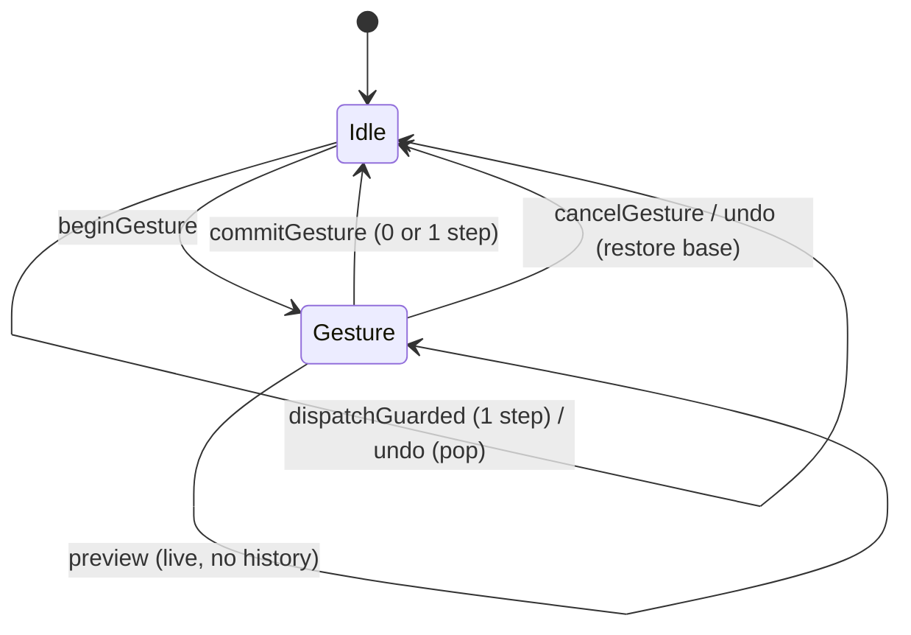

# Design Document

**Spec:** studio (the app)

## Overview

`studio` is a React + Vite single-page app in `apps/studio` that edits an engine
`Project`, previews it on a canvas via the engine's pure render path, and exports
it with `@studio/exporters`. It owns no render, schema, or encoding logic. The
design keeps a pure, DOM-free model layer (the single source of truth) separate
from a thin React shell that holds the only playback clock, so state is testable
and preview/export stay in parity. This document covers module layout, state,
the preview pipeline, fonts, the timeline, the export state machine, save/load,
CSP/security, performance measurement, correctness properties, the Playwright
plan, dependencies, and risks.

It also covers two build-time additions (Requirements 17 and 18): a
deterministic converter that turns the five `design/*.dc.html` exports into
committed, CSP-safe React components under `src/generated/`, and a hand-ported
subset of the design system under `src/ds/`. Neither is wired into the live
studio UI in this round; a dev-only smoke harness proves they render under the
strict CSP.

## Architecture

### Module layout (`apps/studio/src`)

```
apps/studio/src/
  model/            PURE. No DOM, no clock, no React.
    project.ts        new-project factory + ProjectDraft helpers (wraps engine Project)
    transitions.ts    pure (Project, action) -> Project reducers (layers, settings, effects, timeline)
    selectors.ts      pure derived reads (frameCount, layer by id, active layers at t, ...)
    timemap.ts        pure time<->pixel mapping for the timeline
    timeline.ts       pure frame-grid timing math (supersedes the old timeline/drag.ts)
    hit.ts            pure canvas hit boxes, hit test, client->canvas, anchor drag/nudge math
    actions.ts        the discriminated-union Action type
  ui/
    cssvars.ts        setCssVars(el, vars): CSSOM custom-property writer (CSP-safe positioning)
  playback/         The ONLY place allowed to read a clock.
    clock.ts          rAF loop; emits current time; play/pause/loop/scrub; owns requestAnimationFrame
    perf.ts           frame-interval instrument (mean + p95) for Requirement 13
  preview/
    PreviewCanvas.tsx owns the preview <canvas>, its CanvasMetricsProvider, the per-frame draw,
                      the pointer/keyboard handling, the selection outline overlay, and a
                      hit-test-only metrics provider
    draw.ts           thin: calls engine renderFrame(project, t, { ctx, metricsProvider })
  timeline/
    Timeline.tsx      ruler slider, rows, bars/handles (role=slider), playhead; pointer + key
                      handlers call model/timeline + model/timemap through the gesture API
  panels/
    SettingsPanel.tsx canvas size/presets, fps, duration, background + transparent toggle
    LayersPanel.tsx   add/edit/delete/reorder + per-layer font/size/weight/colour/align/position/timing
    EffectsPanel.tsx  preset picker from presetCatalog, param editors, granularity, remove
  fonts/
    fonts.ts          FontFace registration + readiness gate; manifest of bundled families
    fonts.css         @font-face rules (self-hosted woff2, no network)
  io/
    save.ts           serializeProject -> Blob download
    load.ts           file input -> parseProject -> typed result
  export/
    dialog.tsx        the export UI
    machine.ts        pure export state machine (idle/configuring/running/done/failed/cancelled)
    errors.ts         ErrorCode -> human message map (all 12 values)
  shell/
    App.tsx           composition root; wires store + playback + panels; holds no project state itself
    store.ts          tiny subscribe/getState store around the Project + UI state, plus the
                      undo history and the gesture API (kept in store.ts; ~60 lines. Move to
                      shell/history.ts only if store.ts grows past ~200 lines)
    StudioView.tsx    also owns the Ctrl/Cmd+Z handler
  tokens.css          design tokens extracted from design/ (no copied markup/scripts)
  main.tsx            React root
```

Intra-package imports use ESM paths with explicit `.js`/`.jsx`-less TS specifiers
per repo convention; the model layer is importable in Node for Vitest.

### Module layout additions (Requirements 17 and 18)

```
apps/studio/
  scripts/                          build-time Node tooling; plain .mjs, NOT bundled, NOT in src/
    dc-parse.mjs                      errors (DcConvertError), tokenizer, binding parser, structure pass
    dc-css.mjs                        style compiler and CSS scoper
    dc-emit.mjs                       JSX emitter, x-import prop table, asset registry
    dc-convert-lib.mjs                orchestrator and output rules; PURE: convertDc(source, options) -> { files };
                                      exports convertDc, DcConvertError, DS_COMPONENTS, slugOf, pascalCase;
                                      imports only node:crypto and its sibling dc-*.mjs modules
    dc-convert-lib.d.mts              hand-written types for the line above (see note 1)
    dc-io.mjs                         Node I/O shell: loadConfig, convertAll, readTree (see note 2)
    dc-io.d.mts                       hand-written types for dc-io.mjs
    dc-convert.mjs                    CLI: convertAll() then write files; npm script `dc:convert`
    dc-convert.config.json            per-file omitIf / replaceText / forbid, and the fixed screen order
  src/
    main.tsx                          does NOT import ./ds/ds.css (kept out of the live app until screens are wired)
    ds/
      ds.css                          hand-copied tokens (scoped .ds-root) + ui.css + 2 font families
      index.tsx                       the 12 ported components (+ one private Tooltip helper)
      dc-runtime.ts                   value types, scope, get(), coercions, dcVars(), mergeRefs()
      helpers.ts                      pure helpers for tests: stepNumber(), tokenizeCode()
      icons.ts                        ICONS as typed shape data (no markup strings); ICON_NAMES, isIconName()
    generated/<slug>/                 COMMITTED converter output
      <PascalName>.tsx   <slug>.css   assets/<files copied byte-for-byte>
    __tests__/dc/                     convert, synthetic, properties, render, dist-scan tests (.test.ts/.tsx)
                                      + css-util.ts (shared test helper)
    ds/*.test.ts(x)                   ds-css, dc-runtime, helpers, icons, components tests
  csp.ts                              shared STRICT_CSP_META + injectCspOnBuild() (moved, not changed)
  dc-harness/                         dev-only smoke harness; never part of dist/
    index.html   main.tsx   fixture.ts   harness.css      page 1: generated Studio Editor, no engine import
    parity.html  parity.ts                                page 2: loads ds.css, exposes the parity probe
  tests-dc/harness.spec.ts            Playwright spec for both harness pages (3 tests)
  vite.dc-harness.config.ts           Vite config for the harness build (root dc-harness, outDir ../dist-dc-harness)
  playwright.dc.config.ts             Playwright config for the harness (port 5276)
  README.md                           converter, DS port, Deviations (new; did not exist before)
  ds/fonts/                           InstrumentSans-*, DMMono-* woff2, their OFL texts, and README.md (bundled by Vite only where ds.css is imported)
```

Slugs and component names, in the fixed conversion order: `studio-editor`
(`StudioEditor`), `effects-library` (`EffectsLibrary`), `export-flow`
(`ExportFlow`), `error-states` (`ErrorStates`), `landing-page` (`LandingPage`).
The slug is the kebab-case of the file name without `.dc.html`; the component
name is its PascalCase form. The generated `landing-page` folder does not touch
the existing hand-written `src/landing/`.

Notes on the layout:

1. **`.d.mts`, not `.d.ts`.** With `moduleResolution: "Bundler"`, TypeScript maps
   `import "./x.mjs"` to `./x.d.mts`; a sibling `x.d.ts` is looked up only for
   `./x.js`. The hand-written declaration file therefore has to be
   `dc-convert-lib.d.mts`. It needs no `include` entry to be found through the
   import; one entry is added so the declaration files themselves are checked.
2. **Why `dc-io.mjs`.** `apps/studio` has no `@types/node` and `tsconfig.json` sets
   `types: []`, so a `.test.ts` under `src/` cannot import `node:fs` and still
   pass `tsc --noEmit`, and adding `@types/node` would add a dependency
   (Requirement 18.6). All file-system access that tests need (read the five
   inputs and their assets, read the committed `generated/` tree) therefore lives
   in `dc-io.mjs` behind hand-written types. Tests import `dc-io.mjs` and
   `dc-convert-lib.mjs`, never `node:*`. Everything is in memory: no test writes
   to disk or creates a temp directory.
3. **Scripts and config files.** `package.json` gains two scripts:
   `"dc:convert": "node scripts/dc-convert.mjs"` and
   `"test:dc": "playwright test -c playwright.dc.config.ts"`. The existing
   `"lint": "eslint src"` already covers `src/ds/` and `src/generated/`; it does
   not cover `scripts/`, which is exercised by its tests instead. `.gitignore`
   gains `dist-dc-harness/`.
4. **`tsconfig.json` `include`, minimal change.** Add `"csp.ts"`,
   `"vite.dc-harness.config.ts"`, `"playwright.dc.config.ts"`,
   `"dc-harness/**/*"`, `"tests-dc/**/*"`, and `"scripts/*.d.mts"`. Nothing else
   changes (`types: []` stays; `src/vite-env.d.ts` already references
   `vite/client`, which types `*.png` imports, `?raw`, and `import.meta.glob`).
   `vitest.config.ts` is unchanged: its `src/**/*.test.ts(x)` pattern already
   matches every new test.
5. **Shared CSP module, minimal `vite.config.ts` change.** Today `vite.config.ts`
   holds `STRICT_CSP_META` and `injectCspOnBuild()`. Both move, verbatim
   (including the comment block), to `csp.ts` and are exported. The only
   edits to `vite.config.ts` are: drop `type Plugin` from the `vite` import, delete
   the constant and the function, and add
   `import { injectCspOnBuild } from "./csp";`. The `plugins`, `build`, and
   `server` options are untouched. Production `dist/` is byte-identical because the
   injected string and the `</title>` replacement are the same characters, and
   because nothing imported by `src/main.tsx` reaches `src/ds/`, `src/generated/`
   or `dc-harness/` (Rollup bundles by reachability, so unreachable modules add
   nothing). Verification at implementation time: `vite build --outDir` to two
   temp directories, before and after the change, then `diff -r`. As built, the
   production `dist/` was verified byte-identical across all 20 files before and
   after the move. A unit test asserts that `STRICT_CSP_META + "; frame-ancestors 'none'"`
   equals the `Content-Security-Policy` value in `vercel.json`, so the meta, the
   header, and the harness cannot drift apart.

## Data Models

### State

- **One `Project` store** (`shell/store.ts`): holds the current `Project` plus a
  separate `UiState` (selected layer id, playhead time, loop flag, export-dialog
  state). The store is a minimal `getState` / `setState` / `subscribe` object; no
  state-management dependency.
- **Pure transitions**: every project mutation is `transitions.ts: (project,
  action) => project`. The store applies them; React never mutates the `Project`
  directly. Transitions validate against `ProjectSchema` (or a field-level guard)
  and return the unchanged input on an invalid action (surfacing an inline error
  via UI state, not by throwing).
- **Selection and playhead are NOT in the `Project`**: they live in `UiState`, so
  they never leak into saved JSON (Requirement 10.5). `serializeProject` only
  sees the `Project`.
- **React subscribes, it does not own frames**: components `useSyncExternalStore`
  over the store for structural state (layers, settings, selection). The PLAYHEAD
  during playback does NOT go through React state per frame — see Preview.

### Undo history and gestures (Requirement 16)

`Store` state becomes `{ project, ui, history }` where `history: Project[]`
(oldest first, newest last, capped at `HISTORY_LIMIT = 100`). History holds
`Project` values only; selection, playhead and loop stay in `UiState`.

**Structural sharing.** `Project` values are immutable and every accepted
transition returns a new object that keeps untouched subtrees by reference: the
history stores references, never `structuredClone`/JSON copies, and `mapLayer`
keeps untouched layers by reference (the canvas too, for a layers-only edit). A
transition whose result equals its input MUST return the same reference, for
EVERY action (see "No-op detection in `commit`" below), which is how
"unchanged" is detected with `!==`.

**Store API additions**

```ts
class Store {
  dispatchGuarded(action: Action): boolean;   // accepted => push previous project to history
  beginGesture(): void;                       // remember base = current project; commit any open gesture first
  preview(action: Action): boolean;           // apply live, NO history; no-op unless a gesture is open
  commitGesture(): boolean;                   // push base once if project !== base; true when a step was added
  cancelGesture(): void;                      // restore base, no history change
  undo(): boolean;                            // cancel an open gesture, else pop history
  canUndo(): boolean;
  historyLength(): number;                    // as built: number of undo steps
  setProject(project: Project): void;         // open / New / demo: replace project, history = []
}
```

| Event | project | history | gesture |
| --- | --- | --- | --- |
| `dispatchGuarded` accepted | new | `+ previous` (drop oldest above 100) | unchanged |
| `dispatchGuarded` rejected | same | same | unchanged |
| `beginGesture` | same | same | `base = project` |
| `preview(action)` accepted | new | same | open |
| `commitGesture`, `project !== base` | same | `+ base` (cap 100) | closed |
| `commitGesture`, `project === base` | same | same | closed |
| `cancelGesture` | `base` | same | closed |
| `undo`, gesture open | `base` | same | closed (a mid-drag Ctrl+Z is a cancel) |
| `undo`, no gesture | `history.pop()` | one shorter | closed |
| `setProject` | new | `[]` | closed |



**Selection fix-up after undo.** `undo` restores the project only. It then
sets `ui.selectedLayerId` to itself if that layer id still exists, otherwise to
`layers[0]?.id ?? null`, and clamps `ui.playhead` to the restored
`durationSeconds`. `cancelGesture` applies the same fix-up.

**Keyboard.** `StudioView` registers one `keydown` listener on `window`
(removed on unmount). It acts on `(ctrlKey || metaKey) && key.toLowerCase() === "z" && !shiftKey`
and returns early when `event.target` is an `HTMLInputElement`, `HTMLTextAreaElement`,
`HTMLSelectElement`, or has `isContentEditable`, so the browser's native text
undo keeps working in fields. Otherwise it calls `preventDefault()` and
`store.undo()`. Redo (Ctrl+Shift+Z / Ctrl+Y) is out of scope and is not bound.

**As built.**

- `shell/undo-key.ts` holds the pure Ctrl/Cmd+Z rules (`isUndoKey`,
  `isTextEntryTarget`, `shouldUndo`); `StudioView` registers the window `keydown`
  listener and uses them. They are unit-tested in `undo-key.test.ts`.
- The export-dialog case is `exportOpen` (the dialog is open), which is the
  state in which an export can run. The handler does nothing while it is true.
- `Store` exposes `canUndo()` and `historyLength()`. `dispatchGuarded` commits an
  open gesture first.
- `preview/hit-font.test.ts` asserts that the hit provider's font string equals
  the painter's.
- Playwright specs use the `ControlOrMeta` modifier, not `process.platform`,
  because the studio has no `@types/node`.
- **No-op detection in `commit` (as built, `model/transitions.ts`,
  `model/json-equal.ts`, `model/sharing.test.ts`).** The reducer detects no-ops
  for every action and shares structure. `commit(project, candidate)`
  `safeParse`s the candidate; an invalid candidate returns the original
  project. Otherwise `next = deepEqualJson(parsed, candidate) ? candidate :
  parsed`: the candidate itself is kept so untouched subtrees stay shared by
  reference, and the parsed copy is returned only when parsing changed it (for
  example a filled schema default such as `letterSpacing` 0 or `lineHeight`
  1.2), so defaults are never silently dropped. Then `deepEqualJson(next,
  project) ? project : next`, so any action whose result equals the input
  returns the SAME `Project` reference. `set-anchor` and `set-layer-timing`
  keep explicit early returns because they are cheaper on the drag hot path.
  `deepEqualJson` is a pure, dependency-free structural equality for plain JSON
  values (key order ignored).
- **Precondition.** `ProjectSchema.parse(p)` deep-equals `p` for every
  `Project` the studio can hold: the only schema defaults are the `TextLayer`
  `letterSpacing` and `lineHeight`, and every layer already carries them. A unit
  test covers `demo` and `newProject`; a fallback test shows a candidate
  missing `lineHeight` is committed with `lineHeight` 1.2.

**Gesture cancel, export, and no-ops (Requirement 16.10 to 16.16).**

- Ctrl/Cmd+Z during an open gesture calls `store.undo()`, which cancels the
  gesture and restores its base project. The key press adds no history step.
- Escape during a canvas or timeline drag, and `pointercancel` or
  `lostpointercapture` without `pointerup`, call `store.cancelGesture()`: the
  project returns to the base and history is unchanged. Escape with no open
  gesture is ignored by this handler.
- `undo` with empty history and no gesture returns `false` and leaves the same
  `Project` reference (no error, no notification).
- Both `undo` and `cancelGesture` clamp `ui.playhead` to the restored
  `durationSeconds`.
- While an export is running (export machine state `running`) the `keydown`
  handler returns early and does nothing; the export dialog owns focus.
- Every action (not only `set-anchor` and `set-layer-timing`) returns the input
  `Project` reference when its result equals the input (unit-tested, for example
  `set-text` with an unchanged value), so `!==` detects "unchanged" and no step
  is added.
- Typing in fields is NOT coalesced: each accepted edit is one step (decision;
  coalescing is out of scope).

**Why not undo inside `setUi`.** Selection and playhead changes are not
project edits and would flood the stack; keeping `history` project-only also
guarantees saved JSON and undo see the same data.

## Components and Interfaces

### Preview pipeline

- `PreviewCanvas` creates ONE `<canvas>` at the project canvas pixel size
  (`width`×`height`) and ONE `CanvasMetricsProvider(ctx)` bound to its 2D context.
  The provider (and thus its layout cache) is owned by the preview alone; exports
  create their own canvas + provider inside `@studio/exporters` (Requirement 1.1,
  9.3).
- The `playback/clock.ts` rAF loop computes `t` from elapsed real time (the only
  clock in the app) and calls `preview/draw.ts` directly with the current
  `Project` snapshot and `t`. Draw calls `renderFrame(project, t, { ctx,
  metricsProvider })`. This bypasses React's render cycle: a frame is a canvas
  draw, not a component re-render, so playback does not re-render React per frame.
  React re-renders only when structural state changes (a layer edited, etc.),
  which updates the snapshot the clock reads.
- **CSS fit**: the backing store stays at canvas pixels (preview pixels == export
  pixels, preserving parity); the element is scaled to fit its container via CSS
  `transform: scale(...)` / `max-width`, never by resizing the backing store.
- **Transparent background**: a CSS checkerboard sits behind the canvas element so
  transparency reads visually (Requirement 2.6); the canvas itself is cleared to
  transparent by the engine.
- **Parity test design** (Requirement 9): a Playwright test renders a fixed
  `Project` at a fixed frame index two ways — (1) the preview path
  (`renderFrame` into the preview canvas) and (2) the exporter's `FrameRenderer`
  (the same path exporters use) into its own canvas — composites both over the
  same opaque background, and asserts a per-channel diff ratio within the same
  tolerance the exporter golden uses (24/255 per channel, diffRatio <= 0.01).
  Each canvas uses its own `CanvasMetricsProvider`; no layout cache is shared.
  Because blur in both paths goes through the exporter's deterministic blur
  (the studio never sets a browser `ctx.filter` blur for final output), blurred
  frames stay in parity.

### Fonts

- **Bundled files** (self-hosted woff2; Noto Sans reused from the engine's
  vendored set, the 700 weights and the Tamil 400/700 added from the same
  OFL-1.1 source), family + weight 400 (normal) and 700 (bold) for BOTH families
  — four woff2 files:
  - `noto-sans-latin-400-normal.woff2`, `noto-sans-latin-700-normal.woff2` →
    family **"Noto Sans"** (Latin), OFL-1.1.
  - `noto-sans-tamil-tamil-400-normal.woff2`, `noto-sans-tamil-tamil-700-normal.woff2`
    → family **"Noto Sans Tamil"** (Tamil), OFL-1.1.
  Each family ships its OFL-1.1 licence file alongside the woff2. Copied into
  `apps/studio/src/fonts/` (or `public/fonts/`) at build time; no `@fontsource`
  runtime import, no CDN. These two families (weights 400/700) are the only
  `fontFamily` values offered in the layer font picker; the per-layer
  `fontWeight` control selects 400 or 700.
- **@font-face**: `fonts.css` declares both families with `font-display: block`
  and `src: url(...) format("woff2")` pointing at the bundled files.
- **Readiness gate** (`fonts/fonts.ts`): on startup the app constructs `FontFace`
  objects (or reads `document.fonts`), calls `.load()`, adds them to
  `document.fonts`, and awaits `document.fonts.ready` BEFORE the first preview
  frame (Requirement 6.3). The gate exposes `whenFontsReady(): Promise<FontStatus>`.
- **Error mapping**: the gate maps failure to the exporter error vocabulary used
  by the UI: a load timeout → `font-not-ready`; a decode failure (the woff2 fails
  to parse) → `font-decode-failed`. Export is blocked until the gate resolves
  ready; a non-ready gate shows the mapped message and does not start an export
  (Requirement 6.4, 6.5).

### Canvas hit testing (`model/hit.ts`, pure)

```ts
export type Rect = { x: number; y: number; w: number; h: number };
type Pt = { x: number; y: number };
type Size = { width: number; height: number };

/** Union of visible-cluster boxes, offset by anchor + positionOffset; null when none. */
export function layerBounds(layer: LayerState): Rect | null;
export function rectContains(r: Rect, x: number, y: number, pad: number): boolean;
/** Topmost layer id whose padded box contains (x, y); pad = 8 / displayScale. */
export function hitTest(state: FrameState, x: number, y: number, displayScale: number): string | null;
export function clientToCanvas(
  clientX: number, clientY: number,
  rect: { left: number; top: number; width: number; height: number },
  canvas: Size,
): Pt | null;
export function dragAnchor(args: {
  startAnchor: Pt; startPointer: Pt; pointer: Pt;
  shift: boolean; snap?: number; canvas: Size;
}): Pt;
export function nudgeAnchor(anchor: Pt, key: string, shift: boolean, canvas: Size): Pt | null;
```

Rules (all in CANVAS px):

- `layerBounds`: for each segment whose `text` does not match `/^[ \t\r\n]+$/`
  (visible cluster), box = `x: layoutX .. layoutX + width`,
  `y: layoutY - ASCENT_RATIO * height .. layoutY + (1 - ASCENT_RATIO) * height`. The union is shifted by
  `layer.anchor + layer.transform.positionOffset`. `effectOverrides`, `scale`,
  `rotation`, `blur`, and `opacity` are ignored, so the box does not wobble while
  the text animates and a fully transparent active layer keeps its box. No visible
  cluster returns `null`. The split is the named constant in `hit.ts`:

  ```ts
  // Share of the glyph box above the baseline. Tuned for Noto Sans; the
  // descent share is 1 - ASCENT_RATIO. FrameState carries only
  // height = ascent + descent, so the split is an approximation.
  export const ASCENT_RATIO = 0.8;
  ```
- `hitTest`: iterate `state.layers` from the last to the first (topmost painted
  wins), skip `null` bounds, return the first `layerId` with
  `rectContains(bounds, x, y, 8 / displayScale)`. `displayScale <= 0` or
  non-finite is treated as 1. A layer not active at `t` is not in `state.layers`,
  so it cannot be hit.
- `clientToCanvas`: `null` if `rect.width <= 0 || rect.height <= 0`; otherwise
  `x = (clientX - left) * canvas.width / rect.width` (same for y). Values are
  not clamped (a captured drag may leave the canvas); `dragAnchor` clamps.
- `dragAnchor`: `dx = pointer.x - startPointer.x`, `dy` likewise. With `shift`,
  zero the smaller `|d|` component (tie keeps x, zeroes y). Add to `startAnchor`,
  round to the grid `step = snap ?? 1` (`Math.round(v / step) * step`; a
  non-positive or non-finite `snap` falls back to 1), then clamp to
  `[0, canvas.width] x [0, canvas.height]`. Rounding happens before clamping;
  clamp bounds are whole numbers, so the result stays on the grid when
  `step = 1`. For `snap > 1`, the bound itself can be off-grid only when the
  canvas size is not a multiple of `snap`; this is accepted and the property
  (below) uses `snap` that divides both dimensions or `1`.
- `nudgeAnchor`: `ArrowLeft/Right/Up/Down` move by 1 (10 with `shift`), clamped
  to the canvas; any other key returns `null` (the handler then does nothing and
  does not call `preventDefault`).

#### Where the bounds come from (decision)

`FrameRenderer` (exporters) calls `renderFrame` and returns nothing, and it owns
its `CanvasMetricsProvider` privately, so the studio cannot read the last
painted `FrameState` or reuse that provider. Options:

| Option | Pro | Con |
| --- | --- | --- |
| A. Capture `FrameState` from the last paint | zero extra layout work | needs an exporters change (not allowed: studio owns no exporter code); stale while paused if nothing repainted |
| B. Studio computes its own `FrameState` with a hit-only provider (chosen) | no exporter change; works whenever the user clicks; same pure `computeFrameState` | one extra layout per distinct text/font (cached) |
| C. Share the renderer's provider | no duplicate layout | impossible without exposing it; would also couple cache lifetimes |

**Chosen: B.** `PreviewCanvas` creates a detached `document.createElement("canvas")`
(never attached, no markup, CSP-neutral), takes its 2D context, and wraps it in
its own `CanvasMetricsProvider`, plus its own `layoutCache` (`Map`). It is the
hit-test-only provider for that surface: one provider per canvas holds because the
provider is bound to its own canvas, and it is never shared with the paint
renderer or any export. On `pointerdown`, and when the overlay needs refreshing,
the studio calls
`computeFrameState(project, playhead, { metricsProvider: hitProvider, layoutCache: hitCache })`.

Why this agrees with the painter: layout geometry (`layoutX/Y`, `width`,
`height`) is a function of text, font family/size/weight, `align`,
`letterSpacing`, `lineHeight`, and the loaded font faces only. It does not depend
on which canvas measured it, and the engine's layout cache is keyed by those
inputs. The hit boxes also ignore every effect-driven property, so no state that
the painter alone has is needed.

**Font string equality.** The hit-only provider MUST set exactly the painter's
`ctx.font` string, `${fontWeight} ${fontSize}px ${fontFamily}`, the string the
engine `drawFrame` sets. A unit test asserts the hit provider's font string equals
the painter's for the same layer style (same weight, size, and family).

Trade-offs: (1) a one-time duplicate layout per layer text/font (about the cost
of one paint, then cached); (2) if fonts load late, the hit provider must be
discarded like the renderer is: `PreviewCanvas` rebuilds provider and cache on
`document.fonts` `loadingdone` (the existing `onFontsLoadingDone` callback) so
boxes never stay on fallback-font metrics; (3) the studio compares nothing
against the painter at runtime, so a Playwright drift guard stays. As built
(`tests/canvas-drag.spec.ts`, "the selection outline agrees with the drawn
text"), it reads the selection outline element (positioned from `layerBounds`)
and compares it with the drawn `#ffcc00` title ink bounding box, in client px,
with `s` = display scale and `fontSize` in client px: the outline CONTAINS the
ink within 2 canvas px per edge (`eps = 2 * s`); the left/right gaps (ink inside
outline) are at most `0.2 * fontSize`; the top/bottom gaps are at most
`0.6 * fontSize`. The guard cannot be 2 canvas px per edge on both sides: a pixel
ink box is never equal to the layout (advance + ascent/descent) box, since the
ink is inset by glyph side bearings horizontally (about 0.1 em) and by the gap
between cap height and the ascent/descent box vertically. The horizontal bound
also has to survive fallback-font metrics, which would shift the width by roughly
10 percent; tightening to 2 px per edge is not possible for ink-vs-layout boxes.

### Canvas interaction model (`preview/PreviewCanvas.tsx`)

- **Surface.** The `<canvas>` is `tabindex="0"`, `aria-label="Preview canvas.
  Arrow keys move the selected layer."`, with a focus-visible outline from
  `layout.css`. Pixel `width`/`height` come from the project via
  `useStoreState` (`useSyncExternalStore`), and `data-transparent` on the stage
  follows `project.background`, so New/Open/Settings changes resize the canvas and
  toggle the checkerboard (Requirement 3.17). The existing effect re-initialises
  on `width`/`height` change, and the hit provider is recreated with it.
- **Pointer events** on the canvas, using `setPointerCapture(pointerId)`:
  - `pointerdown` (primary button only): `clientToCanvas` with
    `getBoundingClientRect()`; `displayScale = rect.width / canvas.width`;
    build the hit `FrameState`; `hitTest`. Empty canvas: return with the
    selection untouched. Hit: `store.setUi({ selectedLayerId })`, pause the clock,
    `store.beginGesture()`, remember `{ pointerId, startPointer, startAnchor }`,
    add class `is-dragging`, `canvas.focus()`.
  - `pointermove`: with a drag active, `clientToCanvas` then `dragAnchor({ ...,
    shift: e.shiftKey, canvas })` and `store.preview({ type: "set-anchor", ... })`.
    Without a drag, only the hover class (`is-over-layer`, from `hitTest`) is
    toggled; no store write.
  - `pointerup`: release capture, `store.commitGesture()` (one history step iff
    the anchor changed), remove classes.
  - `pointercancel` and `lostpointercapture` without a prior `pointerup`:
    `store.cancelGesture()` restores the start anchor.
  - Touch: `touch-action: none` on the canvas so the browser does not claim the
    gesture; capture keeps events flowing when the finger leaves the canvas.
- **Keyboard** (`keydown` on the canvas): when a layer is selected,
  `nudgeAnchor(anchor, e.key, e.shiftKey, canvas)`; non-null result calls
  `preventDefault()` and `store.dispatchGuarded(set-anchor)` (one history step per
  key press; a clamped no-op returns the same project and adds none). Other keys
  are ignored.
- **Overlay.** A sibling `<div class="selection-outline" aria-hidden="true">` in
  the stage (decision: the outline is hidden during playback). In a `useLayoutEffect` (on project, playhead, selection, and a
  `ResizeObserver` size) it calls
  `setCssVars(el, { "--x": b.x * s, "--y": b.y * s, "--w": b.w * s, "--h": b.h * s })`
  with `s = displayScale` and the canvas-to-stage offset. The overlay is hidden
  (`hidden` class) when no layer is selected, the selection has no bounds at `t`,
  or playback is running. It is outside the canvas, so exports and parity are
  unaffected (Requirement 3.16).
- **Cursor** is a class on the canvas: default, `is-over-layer` (`cursor: grab`),
  `is-dragging` (`cursor: grabbing`).
- **Clock coordination.** Pausing on `pointerdown` uses the existing
  `PlaybackClock` pause; repaints during the drag use the existing store
  subscription (`!clock.isPlaying` path), so no per-move React render is needed
  beyond the store notifying subscribers.

### CSS custom property helper (`ui/cssvars.ts`)

```ts
export function setCssVars(
  el: { style: { setProperty(name: string, value: string): void } },
  vars: Record<string, string | number>,
): void;
```

- Every key MUST start with `--`; a key without it throws a typed `Error`
  (programmer error, caught in tests). Numeric values are written as
  `String(value)`; non-finite numbers throw. Unit-bearing values are written as
  strings by the caller (e.g. `"12px"`), but the CSS prefers unitless variables
  multiplied in the rule.
- Components call it from `useLayoutEffect` on a ref, so the first paint already
  has the values. The parameter type is a minimal structural type so tests can
  pass a fake element (jsdom is unavailable).
- `layout.css` consumes the variables, for example
  `.tl-bar { left: calc(var(--from) * 1%); width: calc(var(--len) * 1%); }`,
  `.tl-playhead { left: calc(var(--at) * 1%); }`,
  `.selection-outline { left: calc(var(--x) * 1px); top: calc(var(--y) * 1px); width: calc(var(--w) * 1px); height: calc(var(--h) * 1px); }`.
  Timeline variables (`--from`, `--len`, `--at`) hold percentages of the axis;
  selection-outline variables (`--x`, `--y`, `--w`, `--h`) remain CSS px
  (unitless numbers multiplied by `1px`).

**Why this satisfies the strict CSP.** With `style-src 'self'` (no
`'unsafe-inline'`), CSP blocks inline `<style>` elements, `style="..."`
attributes in markup, and `setAttribute("style", ...)`. It does not restrict
CSSOM mutation (`el.style.setProperty`, `el.style.left = ...`). So dynamic
geometry goes through CSSOM custom properties, and the static rules that read
them live in a bundled stylesheet served from `'self'`. JSX has no `style` prop
(this tightens the earlier note that React's `style` prop is acceptable: React
sets individual `style` properties through the CSSOM, which is allowed, but the
spec forbids it for the app to keep one auditable mechanism). Verification:
`csp.spec` runs the representative session including a canvas drag, an arrow
nudge, and a timeline drag against `vite preview`, and asserts zero
`securitypolicyviolation` events other than the single named Zod eval probe. The
inline-style guard is ESLint core `no-restricted-syntax` in
`apps/studio/eslint.config.js` with the selector
`JSXAttribute[name.name='style']` (and a second selector for
`JSXAttribute[name.name='dangerouslySetInnerHTML']`), applied to
`apps/studio/src/**/*.tsx`. It is NOT `eslint-plugin-react` and adds no
dependency; there is no static audit test alternative.

### Timeline interaction model (`model/timeline.ts`, `model/timemap.ts`, pure)

```ts
export function toFrames(seconds: number, fps: number): number;   // round-half-away-from-zero(seconds * fps)
export function toSeconds(frames: number, fps: number): number;   // round(frames / fps, 1e-6)
export type Timing = { startSeconds: number; endSeconds: number };
export type TimingKind = "move" | "start" | "end";
export function dragTiming(kind: TimingKind, start: Timing, deltaFrames: number, fps: number, durationSeconds: number): Timing;
export function nudgeTiming(kind: TimingKind, timing: Timing, frames: number, fps: number, durationSeconds: number): Timing;
export type AxisGeometry = { axisWidthPx: number; durationSeconds: number; fps: number };
export function pxToSeconds(px: number, geometry: AxisGeometry): number;  // xToTime then snapToFrame, clamped to [0, last frame]
export function snapToFrame(seconds: number, fps: number): number;       // toSeconds(toFrames(seconds, fps), fps)
```

Definitions and exact rules. Let `N = floor(durationSeconds * fps + 1e-9)` be
the last whole frame that fits inside the duration (so `toSeconds(N) <=
durationSeconds`; plain rounding could overshoot, e.g. 0.1 s at 25 fps rounds to
3 frames = 0.12 s). `toFrames` rounds half away from zero:
`Math.sign(v) * Math.floor(Math.abs(v) + 0.5)` with `v = seconds * fps`.

1. **Snap on entry.** `s0 = clamp(toFrames(start.startSeconds), 0, N - 1)`,
   `e0 = clamp(toFrames(start.endSeconds), s0 + 1, N)`. Layers whose stored times
   are off-grid (typed in the numeric inputs, loaded from a file, or kept from an
   earlier fps) are snapped on the first timeline interaction, even when
   `deltaFrames` is 0. Nothing is rewritten until an interaction commits.
2. **`move`:** `len = e0 - s0`; `s = clamp(s0 + d, 0, N - len)`; `e = s + len`.
   Length in frames is preserved.
3. **`start`:** `s = clamp(s0 + d, 0, e0 - 1)`; `e = e0`. Only the start changes,
   the layer keeps at least 1 frame, and the start never passes the out-point.
4. **`end`:** `e = clamp(e0 + d, s0 + 1, N)`; `s = s0`.
5. Output seconds are `toSeconds(s)`, `toSeconds(e)`. `d` is truncated to an
   integer (`Math.trunc`) and a non-finite `d` is 0.
6. **Duration shorter than one frame** (`N < 1`; possible because the schema
   allows `durationSeconds` 0.1 with `fps` 1): no valid on-grid timing of at
   least 1 frame exists, so `dragTiming` returns its input (`start`) unchanged
   (approved decision). The
   timeline rows render disabled (`aria-disabled`); the numeric inputs remain
   the way to edit. `N = 1` yields `{0, 1/fps}` for every kind.
7. **fps change.** `dragTiming` always uses the current `fps`; a layer's stored
   seconds are not rewritten when fps changes. They are re-snapped the next
   time that layer is dragged or nudged (rule 1).
8. `snapToFrame(seconds, fps)` clamps below at 0 only; `pxToSeconds` also clamps
   to `toSeconds(N)`. Ruler clicks use `pxToSeconds`; the playhead uses the same.

`timemap.ts` (existing `timeToX` / `xToTime`, inverse within one pixel) supplies
the pixel conversion. A bar drag turns pointer motion into frames with
`deltaFrames = toFrames(xToTime(px, w, dur) - xToTime(startPx, w, dur), fps)`,
computed from the pointer-down position each move (not accumulated), so there is
no drift.

### Timeline component (`timeline/Timeline.tsx`)

- **Ruler** is a `role="slider"` element (`aria-label="Playhead"`, `aria-valuemin=0`,
  `aria-valuemax=duration`, `aria-valuenow`/`aria-valuetext` in seconds). Click
  or drag scrubs via `pxToSeconds`; ArrowLeft/Right move 1 frame (10 with Shift).
  The playhead element is positioned with `--at`.
- **Rows**: one per layer. Each row has a bar (`move`), a start handle, and an
  end handle, each a focusable `role="slider"` with `aria-label` such as
  `"Title, move"`, `"Title, start"`, `"Title, end"`; `aria-valuemin`/`aria-valuemax`
  are the range the part can take (in seconds, from `dragTiming` bounds),
  `aria-valuenow` is the part's time in seconds (start, end, or start for the
  bar), and `aria-valuetext` is `"1.20 seconds"`.
- **Layout**: positions are PERCENT of the axis, not px. Bars use `--from` (start
  percent) and `--len` (length percent); the playhead uses `--at` (percent).
  All set with `setCssVars` in `useLayoutEffect`; `layout.css` multiplies by `1%`.
  This removes the need to measure the track width for layout. Pointer math
  still reads the track rect at event time.
- **Pointer drag**: `pointerdown` on a part calls `setPointerCapture`,
  `store.beginGesture()`, selects the layer, and records `startPx` and the
  layer's timing. `pointermove` computes `deltaFrames`, calls `dragTiming`, and
  `store.preview({ type: "set-layer-timing", ... })`. `pointerup` calls
  `store.commitGesture()`: one `set-layer-timing` step. `pointercancel` calls
  `store.cancelGesture()`.
- **Keyboard**: ArrowLeft/Right on a focused part call `nudgeTiming(kind, timing,
  ±1 or ±10, ...)` and `store.dispatchGuarded(set-layer-timing)`: one step per
  press. Other keys are ignored.
- The numeric start/duration inputs in the Layers panel stay as the
  non-pointer alternative (Requirement 5.9, 12.6).

### Export dialog state machine (`export/machine.ts`, pure)

States and transitions (pure reducer; the dialog component renders them, the
shell drives side effects):

```
idle ──open──▶ configuring ──start──▶ running ──success──▶ done
                   ▲                     │  │
                   │                     │  └──error────▶ failed
                   └───reset──(done/failed/cancelled)    │
                                         └──cancel──▶ cancelled
```

- **configuring**: the dialog has a `CapabilityReport` from `detectCapabilities()`
  (called once on open). Formats offered are exactly MP4, PNG sequence, GIF
  (Requirement 8.1); a format whose `CapabilityResult.status === "unsupported"`
  is disabled with its `reason`. Per-format option fields are seeded from the
  project (MP4: `videoBitrate`, `backgroundFallback`, output size; PNG/GIF: output
  size).
- **running**: the shell calls the chosen `@studio/exporters` entry
  (`exportMp4`/`exportPngSequence`/`exportGif`) with `{ onProgress, signal }`.
  `onProgress.fraction` drives the progress bar. An `AbortController` is created
  per run; `signal` is passed to the exporter; Cancel calls `controller.abort()`.
- **done**: holds the `ExportResult` success; the dialog offers the produced
  `file` for download under `result.fileName`. If the project background is
  `transparent` and the format is MP4, the `mp4-no-transparency` note (read from
  `result.summary.notes`) is shown (Requirement 8.8).
- **failed**: holds the `ExportError`; the dialog shows `errors.ts`'s message for
  that `ErrorCode` (never a raw exception).
- **cancelled**: reached when the result is the `cancelled` error; no file.

**ErrorCode → message map** (`export/errors.ts`) covers ALL 12 values:

| ErrorCode | User-facing message (summary) |
| --- | --- |
| `browser-unsupported` | This format isn't supported by your browser. Try MP4 or PNG sequence. |
| `blur-unsupported` | This browser can't render the blur effect for export. |
| `cancelled` | Export cancelled. |
| `out-of-memory` | Ran out of memory — try a smaller size, fewer frames, or a shorter duration. |
| `invalid-options` | An export setting is out of range. (shows offending field from `fieldPaths`) |
| `audio-decode-failed` | Audio couldn't be decoded. (not reachable in v1 — no audio UI) |
| `font-decode-failed` | A font failed to load; can't export. |
| `font-not-ready` | Fonts aren't ready yet; try again in a moment. |
| `empty-frame-range` | This project has no frames to export. |
| `encoder-failure` | Encoding failed. Try again or pick another format. |
| `muxer-failure` | Writing the file failed. Try again or pick another format. |
| `project-invalid` | The project is invalid and can't be exported. |

The map is exhaustive by a `Record<ErrorCode, string>` keyed on the imported
union, so a change to `ErrorCode` fails to compile (property/unit guard).

### Save / load (`io/`)

- **Save**: `serializeProject(project)` → `Blob([json], { type: "application/json" })`
  → object-URL anchor download named `<project>.json`. The versioned
  `schemaVersion` is part of the serialized `Project` (Requirement 7.2). No
  network.
- **Load**: a hidden `<input type="file" accept="application/json,.json">`; on
  change, read the file text, call `parseProject(text)`. On a `ParseError`
  (invalid JSON, size-limit, or schema failure) show a specific message and leave
  the current project unchanged (Requirement 7.4). On success, replace the store's
  `Project` and reset `UiState` selection/playhead; panels re-render from the
  store (Requirement 7.5). The file is validated before any field is read
  (Requirement 11.4).

### CSP and security

- **No inline scripts.** Vite emits the entry as an external
  `<script type="module" src>` (no inlined script), so the CSP needs no
  `'unsafe-inline'` for scripts. The source `index.html` carries NO CSP meta; a
  build-only Vite plugin (`transformIndexHtml`, `apply: "build"`) injects the
  strict CSP meta into the EMITTED `index.html` only. The Vite DEV server runs
  with NO CSP (HMR needs inline styles + eval); the authoritative CSP check runs
  against `vite preview` of the production build (and the `vercel.json` header in
  prod). The one runtime `new Function("")` is Zod's guarded, caught `allowsEval`
  probe (see Deviations / Requirement 11.3), not app code.
- **Exact CSP** (served as an HTTP header in production and mirrored as a
  `<meta http-equiv>` for local static serving):

  ```
  default-src 'none';
  script-src 'self';
  style-src 'self';
  img-src 'self' data: blob:;
  media-src 'self' blob:;
  font-src 'self';
  connect-src 'self' blob:;
  worker-src 'self' blob:;
  base-uri 'none';
  form-action 'none';
  frame-ancestors 'none'
  ```

  Notes: there is NO `'unsafe-inline'` for scripts or styles. `index.html` and
  any server-rendered string contain no inline `<script>`, no `<style>` element,
  and no `style="..."` attribute; no code path injects `style` or `script`
  markup. Dynamic styling is applied ONLY through the CSSOM, specifically
  `ui/cssvars.ts` `setCssVars` (`el.style.setProperty` on `--` custom
  properties, read by static rules in `layout.css`), which CSP allows without
  `'unsafe-inline'`. JSX contains no `style` prop. `blob:` is
  required for the worker (`@studio/exporters` builds its worker from a bundler
  URL) and for export output object-URLs. `connect-src 'self'` with no remote
  origins, combined with the no-network test, enforces "no runtime network"
  (`img-src`/`font-src` are `'self'` only — no CDN).
- The injected META omits `frame-ancestors` (browsers ignore it in a meta —
  header-only); `vercel.json` sets the FULL CSP (incl. `frame-ancestors 'none'`)
  as an HTTP header for production, which is where clickjacking protection
  applies. design/ is excluded from the build input entirely (see risks).
- **No `innerHTML` with user text**: all user text is rendered via React text
  children (auto-escaped) or canvas `fillText`; `errors.ts` strings are static.
- **`design/` not served/bundled**: `apps/studio` has its own Vite `root`; the
  repo-root `design/` is outside it and is never imported. A unit/build check
  greps the build output and the source import graph for `design/` and
  `support.js` and fails if referenced (Requirement 11.5).

### Performance measurement (Requirement 13)

- `playback/perf.ts` records `requestAnimationFrame` timestamps during a fixed
  play window and computes the mean and 95th-percentile inter-frame interval. It
  lives only in the shell (it reads the animation clock).
- **Method**: load the standard 1280×720 / 5-layer / one-effect-each fixture,
  play for 10 s, collect intervals. PASS when mean interval ≤ `1000/fps` ms
  (33.3 ms at 30 fps) and p95 ≤ 1.5× that (50 ms). The measured numbers are
  reported (not just pass/fail) so regressions are visible. Runs as a Playwright
  test on CI's headed Chromium (indicative) and is confirmed manually on a
  mid-range laptop.

### Design-source converter (Requirement 17)

`convertDc(source, options)` is a pure function of its arguments. It reads no
file, no clock, and no randomness, and keeps no module-level state.

```ts
// scripts/dc-convert-lib.d.mts (hand-written)
export interface DcFileConfig {
  source: string;                                   // "Studio Editor.dc.html"
  omitIf: readonly OmitRule[];
  replaceText: readonly ReplaceRule[];
  forbid: readonly ForbidRule[];
}
export interface ConvertOptions {
  fileName: string;                                 // base name only; slug and PascalName derive from it
  config: DcFileConfig;                             // already merged with the global forbid list
  assets: Readonly<Record<string, Uint8Array>>;     // key = path as written in src="…", e.g. "assets/neontype-logo.png"
}
export type OutputFiles = Readonly<Record<string, string | Uint8Array>>;  // keys relative to src/generated/
export function convertDc(source: Uint8Array | string, options: ConvertOptions): { files: OutputFiles };
export class DcConvertError extends Error {
  readonly file: string; readonly line: number; readonly code: DcErrorCode;
}
```

`dc-io.mjs` supplies the file reads: `convertAll(appDir)` loads the config, reads
each `design/*.dc.html` in config order, resolves the `src` paths the converter
asks about, calls `convertDc`, and returns one merged map. The CLI writes that map
only after all five conversions succeeded and removes files under
`src/generated/` that are not in the map, so a failed run never leaves a mix of
old and new output.

#### What the five real files contain that the requirements did not spell out

Reading the inputs showed constructs that Requirements 17 and 18 do not name. Each
row says how this design handles it. Rows marked "amend" need a requirements
edit; the requirements file is not changed by this design pass.

| # | Finding in the real files | Handling in this design |
| --- | --- | --- |
| 1 | The four non-editor files carry a second `<script src="_ds/…/_ds_bundle.js">` inside `<helmet>`, besides the `support.js` script in `<head>`. | Both are dropped and recorded. Allowed `src` base names: `support.js`, `_ds_bundle.js`. Any other `<script>` is an error. Amend 17.3.10. |
| 2 | `<input ref="{{ searchRef }}">` and `<div ref="{{ gridRef }}">` bind React refs. | `ref` is a supported attribute: whole-value binding, narrowed by `asRef` (object with `current` only). |
| 3 | `<x-import … dc-props="{{ fullWidth }}">`, where the data value is `{ style: { width: '100%' } }`. | A spread of data props would reintroduce a `style` prop. `dc-props` is accepted and DROPPED; it is listed in the generated file header as "not applied". The Button keeps its natural width (a visible difference, listed in "Design versus implementation differences"). |
| 4 | `<x-import … Icon style="color:…;margin-top:1px">` and `Button style="margin-right:auto"` (7 uses), and one `style="{{ w.iconStyle }}"` whose data value is an object. | A static `style` on an `x-import` becomes a scoped class passed as `className` (Button, Icon, IconButton accept `className`; any other component with `style` is an error). The object-valued binding is not a supported style form; Error States gets `replaceText` rules, approved by the owner, that rewrite it to a class per variant through a `data-variant` attribute (see "Config semantics"). |
| 5 | Event attributes beyond the two named in 17.3.8: `onPointerDown`, `onKeyDown`, `onMouseEnter`, `onMouseLeave`, `onFocus`, `onBlur`. | Allow-list of event attributes: `onClick onChange onInput onKeyDown onPointerDown onMouseEnter onMouseLeave onFocus onBlur`. Any other `on*` is an error. |
| 6 | Data values are not only JSON: `preview`, `heroStage`, `heroPlayhead`, `embedPreview` are React elements the dropped script built with `h()` and `style` objects; `searchRef`/`gridRef` are `createRef()` objects; handlers take values (`v => …`), not events. | `DcValue` includes `ReactElement`, `RefObject`, and functions typed `(...args: never[]) => unknown`. A generated component renders whatever node the caller supplies; the harness fixture supplies `null`. |
| 7 | `@keyframes` defined in the helmet (`mt-type`, `mt-caret`, …) are also referenced by name from data-built elements. | After prefixing (Requirement 17.5) those names no longer match. Each generated module exports `<NAME>_KEYFRAMES: Readonly<Record<string, string>>` (original name to prefixed name) so a caller can build the `animation` value. |
| 8 | Landing Page has four `href="Studio Editor.dc.html"` links. | `replaceText` rule with `expect: 4`: `href="Studio Editor.dc.html"` becomes `href="#studio" onClick="{{ onOpenStudio }}"`. The target is the fragment `#studio` (approved by the owner); `onOpenStudio` is an optional function from the data (absent means no handler, via `asHandler`); no routing this round (Requirement 17.8). |
| 9 | Export Flow has `data-screen-label="Review bar"`, introduced by the comment "Review state selector (not product UI)". | `omitIf` rule, approved by the owner (comments are dropped, so the config is the only record). |
| 10 | `<dc-import name="Studio Editor" playing="{{ false }}" …>` passes props to the imported screen. | The slot ignores them. They configure the backdrop, which the caller builds with its own `data`. Listed in the header as "not forwarded". |
| 11 | The `icon` and `name` names used include `check` and `minus`, and the DS components use `chevron-down` internally. `viewport` in the requirement's list is a `<meta name="viewport">`, not an icon. | Port set is 27 icons (see "Design-system port"). Amend 18.3. |
| 12 | The embed URL in Export Flow (`https://embed.example.com/…`) and `style="…"` text appear only inside the dropped data script. | Nothing to do: dropped text is never scanned for output rules. This is why `forbid` applies to OUTPUT only. |

#### Pipeline

Each stage consumes the previous stage's value and either returns its result or
throws `DcConvertError` with `file` and `line` (1-based, counted after CRLF to LF
normalisation). No stage guesses.

| Stage | Input | Output |
| --- | --- | --- |
| (a) read + hash | `source` bytes | `sha256` hex of the raw bytes; UTF-8 text with BOM removed and CRLF to LF |
| (b) tokenize + build tree | text after `replaceText` | `Node` tree with line numbers |
| (c) structure pass | tree | `{ helmetCss, root, droppedScripts, backdropSlots }` |
| (d) binding parser | attribute and text strings | `Binding` values (`path`, `literal`, `index`) |
| (e) style compiler | style attributes, `root`, keyframe names | `ClassRule` registry and per-element class + vars |
| (f) CSS scoper | `helmetCss` | scoped CSS text and the keyframe-name map |
| (g) JSX emitter | `root`, registries | `<PascalName>.tsx` text |
| (h) asset copier | image references | `assets/*` bytes (byte-for-byte) and import names |
| (i) file writer | all of the above | `{ files }` with a fixed key order; output rules applied |

**(a) Read and hash.** `sha256` over the raw bytes (before normalisation) is
printed in the header of every generated file, and nothing else is hashed into a
header. `replaceText` rules run next, on the normalised text (see "Config
semantics"), so line numbers in later errors refer to the rewritten text; a rule
that changes the line count is reported with its own line in the error.

**(b) Tokenizer and tree builder (supported grammar).** The tokenizer is strict and
about 200 lines; it accepts exactly:

- `<!DOCTYPE html>` (case-insensitive) before `<html>`, and nothing else starting
  with `<!`. `<!-- … -->` comments are dropped; an unterminated comment is an error.
- Start tags `<name attr="value" …>` and end tags `</name>`. Names match
  `[A-Za-z][A-Za-z0-9-]*`. Attribute names match `[A-Za-z_:][A-Za-z0-9_:.-]*`.
  Values are DOUBLE-quoted only; a valueless, single-quoted, or unquoted attribute
  is an error, with one exception: valueless attributes are accepted on `<script>`
  start tags (the data script carries `data-dc-script`), because a script is
  dropped and never emitted. `{{ … }}` may appear inside a value.
  Self-closing `/>` is an error (none occur).
- Void elements, which take no end tag: `meta link img input br hr`. Any other
  element must be closed in order; a mismatched or missing end tag is an error
  naming the open tag's line.
- Raw-text elements `<style>` and `<script>`: content is read verbatim up to the
  first case-insensitive `</style` or `</script`; an unterminated one is an error.
  The content of a `<script>` is never parsed or retained.
- Entities in text and attribute values: `&amp; &lt; &gt; &quot; &#39;` and numeric
  `&#N;` / `&#xH;`. Any other `&name;` is an error (none occur in the markup).
- Element allow-list: `html head body x-dc helmet meta title link style script`
  (structure), `div span p a ul ol li section aside header nav main footer figure
  figcaption h1 h2 h3 label button input img` (HTML), `svg path circle rect`
  (SVG), and `sc-if sc-for x-import dc-import` (directives). An element not on
  the list is an error.
- The screen root (the single element under `<x-dc>` after the structure pass)
  must be a plain element: `sc-if`, `sc-for`, `x-import`, or `dc-import` as the
  root is an error.
- Attribute allow-list per rule, in the emitter (`for` is in the plain-attribute
  list and is emitted as `htmlFor`): `class for tabindex id role title
  alt src href type name placeholder value checked disabled width height rel`,
  `aria-*`, `data-*`, SVG `viewBox preserveAspectRatio fill stroke stroke-width
  stroke-linecap stroke-linejoin stroke-dasharray d x y cx cy r rx`, `ref`,
  `style`, `style-hover`, `style-focus`, `style-active`, the event attributes of
  finding 5, and `hint-*` (dropped). Anything else is an error.

**(c) Structure pass.**

1. Find `<x-dc>` inside `<body>`; exactly one, else error.
2. Inside it, `<helmet>` must be the first element child. Its `<style>` text nodes
   are concatenated in order as `helmetCss`. `<meta>`, `<title>`, and `<link>` are
   dropped without inspection. A `<script>` inside `<helmet>` or `<head>` is dropped
   when its `src` base name is `support.js` or `_ds_bundle.js`, else it is an error.
3. After `</helmet>` there must be exactly one element child (the screen root);
   zero or several is an error.
4. The `<script type="text/x-dc" data-dc-script>` after `</x-dc>` is dropped. Its
   `type` must be `text/x-dc`; any other inline script is an error. It is never
   executed, parsed, embedded, or imported. Its `data-props` attribute (design-tool
   metadata) is discarded with it.
5. `<dc-import name="…">` positions are recorded; the `name` value is ignored.
6. The `omitIf` rules run here, on the tree, before any later stage sees the
   omitted elements.

**(d) Binding parser.** A binding is `{{`, optional spaces, one expression,
optional spaces, `}}`. An expression is exactly one of: a dotted path
(`[A-Za-z_][A-Za-z0-9_]*(\.[A-Za-z_][A-Za-z0-9_]*)*`), a number
(`-?\d+(\.\d+)?`), `true`, `false`, `null`, or `$index`. Everything else (strings,
operators, calls, ternaries, `!`, brackets, an unterminated `{{`) is an error
naming the file, line, and the offending text. Where bindings may appear:

| Position | Allowed form |
| --- | --- |
| text node | any mix of static text and bindings |
| attribute value (not `style*`) | the WHOLE value is one binding; static text mixed with a binding is an error |
| `style` value | inside declaration values (stage e) |
| `style-hover/focus/active` | none: a binding there is an error (none occur) |
| `sc-if value`, `sc-for list` | the whole value, one binding |
| tag names, attribute names | never |

**(e) Style compiler**, **(f) CSS scoper**, and **(g) JSX emitter** are specified in
the next three subsections. **(h) Asset copier:** each `` must be a
relative path with no `..`, no leading `/`, and no `scheme:`; the bytes are looked
up in `options.assets` (a missing key is an error) and copied unchanged to
`<slug>/assets/<base name>`. Two different sources with the same base name are an
error. **(i) File writer:** builds the `files` object in the fixed order
`<slug>/<slug>.css`, `<slug>/<PascalName>.tsx`, then assets by sorted name, and
applies the output rules (the built-in invariants and the config `forbid` list).

**Deterministic-output checklist.** The same bytes in, the same bytes out:

- [ ] All registries (classes, imports, assets, keyframes, bindings) are emitted
      in code-unit sorted order (`a < b`, never `localeCompare`).
- [ ] Output newlines are LF; every file ends with exactly one `\n`; indentation is
      two spaces; no tabs.
- [ ] No date, time, version string, absolute path, host name, or random value in
      any file; the header holds only the source base name and the input sha256.
- [ ] Class names come from the hash of the normalised declaration text, never from
      a counter or traversal order.
- [ ] Custom property numbers (`--dc-N`) are assigned in order of appearance within
      one style value, which depends only on that text.
- [ ] Strings are emitted with `JSON.stringify` plus escaping of U+2028 and U+2029;
      numbers with `String(n)`.
- [ ] No global state: counters and caches are created inside `convertDc`.
- [ ] A hash collision between two different declaration texts in one screen is an
      error, not a silent merge.

#### Style compilation (stage e)

Every `style` attribute becomes classes in the screen's CSS; nothing is written to
the DOM `style` attribute at build time. The element then carries
`className={…}` and, if it has dynamic parts, a `ref`.

**Normalised declaration text.** Split the value on `;` at paren depth 0 and
outside quotes; drop empty pieces; per declaration, lowercase the property name,
write `prop:value` with no space around the colon, collapse runs of whitespace in
the value to one space, and leave the value's case untouched. Join with `;`
(no trailing `;`). Bindings are replaced by their variable form before hashing,
so the hash depends on the compiled text.

**Class names and rules.** `hash6` is the first six lowercase hex digits of the
SHA-256 of the normalised text, where the hashed text is `base` plus, for each of
`style-hover`, `style-focus`, `style-active` that is present, a newline and
`hover:`, `focus:`, `active:` followed by its normalised text. Identical hashed
text shares one class `dc-<slug>-s<hash6>`. Rule shapes, in this order in the
output file, after the scoped helmet CSS and sorted by class name:

```css
.dc-<slug> .dc-<slug>-s<hash6> { <base declarations> }
.dc-<slug> .dc-<slug>-s<hash6>:hover { … }
.dc-<slug> .dc-<slug>-s<hash6>:focus { … }
.dc-<slug> .dc-<slug>-s<hash6>:active { … }
```

**Hover specificity decision.** The real files put `style-hover` on elements that
also have a static `style` (for example the top-bar buttons). The base rule has
specificity (0,2,0) and `:hover` adds a pseudo-class, giving (0,3,0), so a hover
rule beats its own base rule by specificity and not only by order. That is why
the doubled-class trick (`.cls.cls:hover`) and `!important` are both unnecessary
and are not used. Order is still fixed (base, hover, focus, active) so that
`:focus` and `:active`, which tie with each other at (0,3,0), resolve with the
later state winning, as an author would expect.

**Why the base class carries a root prefix (cascade fidelity).** A real inline
`style` beats stylesheet rules. A bare `.cls` (0,1,0) would lose to helmet rules
such as `button,input,select{font:inherit;color:inherit}` once those are prefixed
the usual way (`.dc-x button`, (0,1,1)), which would silently invert the cascade
for every button. Two measures together keep the original outcome: the scoper
prefixes helmet selectors with `:where(.dc-<slug>)` (zero specificity, so each
helmet selector keeps its original specificity), and style classes use
`.dc-<slug> .cls` (0,2,0). A style class then beats every helmet selector whose
original specificity is below (0,2,0). The scoper computes the original
specificity of each helmet selector and FAILS the build for one at or above
(0,2,0), rather than let it override a style class that the original would have
overridden. All helmet selectors in the five files are (0,1,1) or lower.

**Worked examples from the real files.**

1. Static (Studio Editor, the divider `<span>` in the top bar):

   ```html
   <span style="width:1px;height:20px;background:#2D343F"></span>
   ```
   ```css
   .dc-studio-editor .dc-studio-editor-s3206a2 { width: 1px; height: 20px; background: #2D343F; }
   ```
   ```tsx
   <span className="dc-studio-editor-s3206a2" />
   ```
   The hash6 for this text is `3206a2`, so the class is
   `dc-studio-editor-s3206a2`. Every other element with the same text reuses it.

2. Dynamic, whole value (Studio Editor, an element with `style="opacity:{{ c.op }}"`). The compiled
   text is `opacity:var(--dc-0)`, whose hash6 is `8bd9ad`:

   ```css
   .dc-studio-editor .dc-studio-editor-s8bd9ad { opacity: var(--dc-0); }
   ```
   ```tsx
   <div className="dc-studio-editor-s8bd9ad" ref={dcVars({ "--dc-0": get(s1, "c.op") })}>…</div>
   ```

3. Mixed static and dynamic, with a unit glued to a binding (Studio Editor, an
   excerpt of the line-2 text style):

   ```html
   style="transform:translateY(calc(-50% + {{ l2dy }}cqw)) scale({{ l2s }});opacity:{{ l2op }}"
   ```
   ```css
   .dc-studio-editor .dc-studio-editor-s3e3061 {
     transform: translateY(calc(-50% + calc(var(--dc-0) * 1cqw))) scale(var(--dc-1));
     opacity: var(--dc-2);
   }
   ```
   ```tsx
   ref={dcVars({ "--dc-0": get(scope, "l2dy"), "--dc-1": get(scope, "l2s"), "--dc-2": get(scope, "l2op") })}
   ```
   Static declarations stay literal in the class. Each binding gets the next
   number. Rules for what replaces the `{{ … }}`:

   | Binding position in the value | Emitted CSS | Why |
   | --- | --- | --- |
   | followed immediately by a unit, `[A-Za-z%]+` (`{{ l2dy }}cqw`, `{{ d.fh }}px`) | `calc(var(--dc-N) * 1<unit>)` | `var(--x)cqw` is invalid CSS; multiplying a unitless number by `1cqw` is valid. The bound value MUST be unitless. |
   | the whole value (`opacity:{{ c.op }}`) | `var(--dc-N)` | the value already carries any unit |
   | an argument inside a function (`scale({{ l2s }})`) | `var(--dc-N)` | substituted as tokens |
   | static text on both sides but no unit (`1px solid {{ c }}`) | `var(--dc-N)` in place | substituted as tokens |

   A string such as `'33.3%'` (the `phLeft` binding in `left:{{ phLeft }}`) is a
   whole value, so it needs no unit handling. A computed `transform` string
   (`transform:{{ r.tf }}`) and a duration string (`animation-delay:{{ s.d }}`)
   are likewise whole values.

4. Hover, focus, and active (Studio Editor, the project-name input, which also has
   a static `style`). The hashed text is the base, then `hover:` and `focus:`
   lines, giving hash6 `eff4b5`:

   ```css
   .dc-studio-editor .dc-studio-editor-seff4b5 { width: 220px; height: 28px; padding: 0 8px; … }
   .dc-studio-editor .dc-studio-editor-seff4b5:hover { border-color: #5E6776; background: #161A20; }
   .dc-studio-editor .dc-studio-editor-seff4b5:focus { border-color: #2DD3F0; background: #1C2129; outline: none; }
   ```
   An element with `style-hover` but no `style` gets a class with only the pseudo
   rules.

5. Keyframe references inside a style value are rewritten to the prefixed name when
   the name is defined in the same file's helmet (Effects Library:
   `animation:mt-caret 1s steps(1,end) infinite`). Names defined elsewhere
   (`fx-rise` in `ui.css`) stay as written.

**Runtime helper.** `dcVars(vars)` in `ds/dc-runtime.ts` returns a ref callback:

```ts
export function dcVars(
  vars: Readonly<Record<string, DcValue>>,
): (el: HTMLElement | SVGElement | null) => void;
```

For each entry: a finite number is written as `String(value)`; a string is written
as given; anything else (`undefined`, `null`, `NaN`, `Infinity`, a boolean, an
object) removes that property with `el.style.removeProperty`. Valid entries go
through `setCssVars` from `ui/cssvars.ts`, so the CSSOM-only mechanism and its
`--` name check are shared with the rest of the app, and CSP allows it. Each
render may create a new callback. Inside an `sc-for` the callback is created in the map body, so every list item has its own callback ref and sets its own custom properties (owner-approved, Deviation 2). That is idempotent: React 19 calls the old
callback with `null` and then the new one with the element; the callback returns
`undefined` (no cleanup function), so React makes that `null` call, which the
helper ignores. Properties already set persist across renders, and a binding that
later becomes `undefined` is removed. Setting happens in the commit phase before
paint. A string value is written verbatim; a value that tries to load a resource
(`url(…)`) is blocked by the CSP, not by the helper.

**Why not a React `style` object.** Requirement 11.2 forbids any JSX `style`
attribute or prop, and `eslint.config.js` enforces it with
`JSXAttribute[name.name='style']`. The originally requested mapping (dynamic
`style` to a React style object) would violate both. React writes style objects
through the CSSOM, which the CSP allows, so the rejection is about keeping one
auditable mechanism, not about a CSP failure. This deviates from the original
request and was flagged as Deviation 2; the owner approved it.

#### CSS scoping (stage f)

The root class is `.dc-<slug>`; the root element is `<div className="ds-root
dc-<slug>">`. Supported grammar: qualified rules, `@keyframes`, and `@media` /
`@container` with a body of supported rules (recursively). `@supports`, `@import`,
`@font-face`, `@layer`, `@page`, `@property`, and nested rules (`&`) are errors
naming the line. Comments are dropped. Declarations are kept verbatim except for
whitespace and keyframe-name rewriting.

| Source selector | Output selector | Notes |
| --- | --- | --- |
| `html,body{margin:0;height:100%}` | `.dc-studio-editor{margin:0;height:100%}` | `html`, `body`, `:root` each map to the root; a list that collapses to one selector is deduplicated, in order |
| `*{box-sizing:border-box}` | `:where(.dc-studio-editor), :where(.dc-studio-editor) *{…}` | the root and everything under it; zero specificity, as `*` |
| `button,input,select{font:inherit}` | `:where(.dc-studio-editor) button, :where(.dc-studio-editor) input, :where(.dc-studio-editor) select{…}` | comma lists are split at paren depth 0 and prefixed one by one |
| `button:focus-visible,input:focus-visible{…}` | `:where(.dc-studio-editor) button:focus-visible, …` | attribute, class, and pseudo selectors pass through unchanged after the prefix |
| `a{color:#FF85E0}a:hover{color:#FFADEA}` | `:where(.dc-studio-editor) a{…}` and `:where(.dc-studio-editor) a:hover{…}` | |
| `[data-fx],[data-fx] *{animation:none!important}` inside `@media (prefers-reduced-motion: reduce)` | same selectors prefixed, same `!important`, inside the same `@media` | the block is kept; `!important` still beats a style class, as it beat an inline style |
| `@keyframes mt-type{…}` | `@keyframes dc-effects-library-mt-type{…}` | every `animation` / `animation-name` reference in helmet rules and style classes is rewritten at identifier boundaries, outside `var()` and strings |
| `body > div`, `html body`, `body.dark` | error | `html`, `body`, and `:root` are accepted only as a whole selector in a list; any other use is an error naming the line (none occur) |
| `:root{--x:1}` | `.dc-x{--x:1}` | custom properties land on the root |

`container-type` and `cqw` units are preserved: they appear in style values, which
are copied into classes unchanged, so the element that declares `container-type`
is the query container exactly as in the source. The root is never made a
container by the converter.

**Specificity consequences.** (1) Because the prefix is `:where()`, a helmet
selector keeps its source specificity and the relative order of helmet rules is
unchanged. (2) Rules that target the root itself (`html`, `body`, `:root`) become
`.dc-<slug>` (0,1,0), up from (0,0,1); only two root rules competing with each
other could notice, and both are converted the same way. (3) Style classes are
(0,2,0) and (0,3,0) with a pseudo-class, as above. (4) The design-system `ui-*`
classes in `ds.css` are NOT re-scoped; a style class and a `ui-*` rule of equal
specificity resolve by order. Every generated file therefore imports
`../../ds/index.js` (which imports `ds.css`) before its own `./<slug>.css`, so the
screen's CSS comes later in the bundle. (5) `:where()` needs Chromium 88 or later;
the product targets current Chromium, and the goldens are Chromium-only.

**Scoper check (unit test).** A small test helper parses the emitted CSS
independently of the scoper (a tokenizer of about 30 lines) and asserts: braces
are balanced; every top-level selector starts with `.dc-<slug>` or
`:where(.dc-<slug>)`; every `@keyframes` name starts with `dc-<slug>-`; every
`@media` / `@container` body satisfies the same rules; and no selector contains a
bare `html`, `body`, or `:root`. It runs on the five real outputs and on the
Property 12 generator's output.

#### JSX emission (stage g)

**Component contract.**

```tsx
// src/generated/studio-editor/StudioEditor.tsx (shape; GENERATED, do not edit)
// Source: Studio Editor.dc.html
// sha256: <64 hex of the input bytes>
// Not forwarded: dc-import props (playing, keyframe-editor, warning)  [only when present]
import type { JSX } from "react";
import { Fragment } from "react";                       // only when an sc-for needs it
import { Button, Icon } from "../../ds/index.js";       // only the components used, sorted
import { asBool, asHandler, asNode, asString, childScope, dcVars, get, noop,
         rootScope, truthy, asList, type DcProps } from "../../ds/dc-runtime.js";  // only those used
import neontypeLogo from "./assets/neontype-logo.png";  // only when an  exists
import "../../ds/ds.css";                               // ALWAYS, even with no DS component
import "./studio-editor.css";                           // always last

export const STUDIO_EDITOR_BINDINGS: readonly string[] = ["easeOpts", "loop", "noLoop", "paused", "playing", "projectName", …];  // sorted
export const STUDIO_EDITOR_KEYFRAMES: Readonly<Record<string, string>> = {};

export function StudioEditor({ data, backdrop }: DcProps): JSX.Element {
  const scope = rootScope(data);
  return (
    <div className="ds-root dc-studio-editor">
      …
    </div>
  );
}
```

`DcProps = { data: DcData; backdrop?: ReactNode }`. The component is a pure render
function of `data` and `backdrop`: no DOM read, no clock, no randomness, no state
and no hooks. `@types/react` 19 has no global `JSX` namespace, hence
`import type { JSX } from "react"`. `.ds-root` on the root supplies the scoped
design-system tokens that the screen's `var(--color-…)` references need.
`<NAME>_BINDINGS` lists ROOT names only: the first path segment of each binding
(`ch.on` contributes nothing when `ch` is a loop variable; `$index` and loop
variables are excluded), sorted and unique; the harness fixture is checked
against it. Every generated component imports `../../ds/ds.css` before its own
CSS, even when it uses no DS component, so the `.ds-root` scoped tokens that the
screen's `var(--color-…)` references need are always present.

**Scope.** `Scope = { readonly vars: DcData; readonly parent: Scope | null }`.
`rootScope(data)` has no parent; `sc-for` creates `childScope(scope, { [as]: item,
$index: i })`. `get(scope, "a.b.c")` resolves the first segment by walking from the
innermost scope outward, then walks the remaining segments through own enumerable
properties of objects and integer indices of arrays. It returns `undefined` for any
missing step, never throws, and never reads inherited properties
(`get(scope, "constructor")` and `"__proto__"` are `undefined`).

**Rules.**

| Source | Emitted |
| --- | --- |
| `<sc-if value="{{ p }}">…</sc-if>` | `{truthy(get(scope, "p")) ? (…) : null}`. `truthy` is JavaScript truthiness: the strings `'0'` and `'false'` are truthy, exactly as in JS; `0`, `""`, `null`, `undefined`, `NaN`, `false` are falsy. Several children are wrapped in `<Fragment>`. |
| `<sc-for list="{{ l }}" as="x">…</sc-for>` | `{asList(get(scope, "l")).map((item, i) => { const s1 = childScope(scope, { x: item, $index: i }); return (<Fragment key={i}>…</Fragment>); })}`. `asList` returns `[]` for a non-array. The key is the index. `s1`, `s2`, … name nesting depth; an inner `as` shadows an outer one. `as` must match `[A-Za-z_][A-Za-z0-9_]*` and not be `$index`. |
| text `{{ p }}` | `{asNode(get(scope, "p"))}`: string, number, a React element (or an array of them) render; `null`, `undefined`, booleans, and plain objects render nothing |
| static text | `{"…"}` (JSON string) when it contains any of `{ } < > &` or leading/trailing space that matters; otherwise bare JSX text. Whitespace-only text containing a newline is dropped; a whitespace-only text without a newline becomes `{" "}`. Other runs of whitespace collapse to one space (HTML semantics). |
| `class` | `className` |
| `for`, `tabindex` | `htmlFor`, `tabIndex` |
| `stroke-width`, `stroke-linecap`, `stroke-linejoin`, `stroke-dasharray` | `strokeWidth`, `strokeLinecap`, `strokeLinejoin`, `strokeDasharray`; `viewBox` and `preserveAspectRatio` are already React names |
| `aria-*`, `data-*`, other allowed names | unchanged |
| attribute `"literal"` | the string literal |
| attribute `{{ true }}`, `{{ 14 }}`, `{{ null }}` | `{true}`, `{14}`, `{null}` (typed literals) |
| attribute `{{ p }}` on a string attribute (other than the ARIA attributes in the next rows) | `{asString(get(…))}` or `{asText(get(…))}` (undefined when missing) |
| attribute `{{ p }}` on `disabled`, `checked`, `readOnly`, `hidden` | `{asBool(get(…))}` |
| attribute `{{ p }}` on `aria-hidden`, `aria-selected`, `aria-busy`, `aria-modal`, `aria-expanded`, `aria-disabled` | `{asBooleanish(get(…))}` (`boolean \| "true" \| "false" \| undefined`, as React's ARIA types require) |
| attribute `{{ p }}` on `aria-checked`, `aria-pressed` | `{asTristate(get(…))}` (as `asBooleanish`, plus `"mixed"`) |
| attribute `{{ p }}` on `aria-current` | `{asCurrent(get(…))}` (React's `aria-current` union) |
| event attribute `{{ p }}` | `{asHandler(get(…))}`: a function value (wrapped as a `DcHandler`), else `undefined`. Never a string. |
| `value` with an `onChange` | controlled: `value={asString(get(…))} onChange={asHandler(get(…)) ?? noop}` |
| `value` without an `onChange` | `readOnly` is added |
| `ref="{{ p }}"` | `ref={asRef(get(…))}`, merged with `dcVars` through `mergeRefs` when the element also has dynamic style |
| `hint-*` | dropped |

**Before and after (from the real files).**

1. `sc-if` pair (Studio Editor top bar; the `<svg>` children are shortened here):

   ```html
   <sc-if value="{{ playing }}" hint-placeholder-val="{{ false }}">
     <button aria-label="Pause" title="Pause (Space)" onClick="{{ togglePlay }}" style="display:grid;…;box-shadow:0 0 14px -2px rgba(45,211,240,.40)"><svg width="16" height="16" viewBox="0 0 20 20" fill="none" stroke="currentColor" stroke-width="1.5" …><rect x="5.5" …></rect></svg></button>
   </sc-if>
   <sc-if value="{{ paused }}" hint-placeholder-val="{{ true }}">
     <button aria-label="Play" title="Play (Space)" onClick="{{ togglePlay }}" style="…" style-hover="background:#242A33;border-color:#7A8494">…</button>
   </sc-if>
   ```
   ```tsx
   {truthy(get(scope, "playing")) ? (
     <button aria-label="Pause" title="Pause (Space)" onClick={asHandler(get(scope, "togglePlay"))} className="dc-studio-editor-s<h1>">
       <svg width="16" height="16" viewBox="0 0 20 20" fill="none" stroke="currentColor" strokeWidth="1.5" …>
         <rect x="5.5" y="4.5" width="3" height="11" rx="1" />
       </svg>
     </button>
   ) : null}
   {truthy(get(scope, "paused")) ? ( <button aria-label="Play" … className="dc-studio-editor-s<h2>">…</button> ) : null}
   ```

2. `sc-for` with an `x-import` (Effects Library, filter chips; the second binding is
   in the loop scope):

   ```html
   <sc-for list="{{ catChips }}" as="ch" hint-placeholder-count="4">
     <x-import component-from-global-scope="MotionTextStudioDesignSystem_f5b901.Chip" pressed="{{ ch.on }}" on-toggle="{{ ch.toggle }}" hint-size="72px,22px">{{ ch.label }}</x-import>
   </sc-for>
   ```
   ```tsx
   {asList(get(scope, "catChips")).map((item, i) => {
     const s1 = childScope(scope, { ch: item, $index: i });
     return (
       <Fragment key={i}>
         <Chip pressed={asBool(get(s1, "ch.on"))} onToggle={asHandler(get(s1, "ch.toggle"))}>{asNode(get(s1, "ch.label"))}</Chip>
       </Fragment>
     );
   })}
   ```

3. `x-import` Button with `on-click` (Effects Library):

   ```html
   <x-import component-from-global-scope="MotionTextStudioDesignSystem_f5b901.Button" variant="primary" size="lg" icon="check" on-click="{{ applySel }}" dc-props="{{ fullWidth }}" hint-size="100%,36px">Apply to selected layer</x-import>
   ```
   ```tsx
   <Button variant="primary" size="lg" icon="check" onClick={asHandler(get(scope, "applySel"))}>Apply to selected layer</Button>
   ```
   `x-import` rules: the namespace must be `MotionTextStudioDesignSystem_f5b901`
   and the name one of the 12 (else error); attribute names are camelCased
   (`on-click` to `onClick`, `show-state` to `showState`, `icon-right` to
   `iconRight`); `component-from-global-scope`, `hint-*`, and `dc-props` are
   dropped; children are preserved. Each prop is coerced by KIND from a table in
   the converter (`string`, `requiredString`, `number`, `boolean`, `handler`,
   `options`, `action`, `className`), so the emitted call type-checks against the
   port's prop types. A prop name not in the table for that component is an error;
   the table is checked against all five files by a test.

4. `<input value onChange>` (Studio Editor, project name):

   ```html
   <input aria-label="Project name" value="{{ projectName }}" onChange="{{ onName }}" style="width:220px;…" style-hover="…" style-focus="…">
   ```
   ```tsx
   <input aria-label="Project name" value={asString(get(scope, "projectName"))} onChange={asHandler(get(scope, "onName")) ?? noop} className="dc-studio-editor-seff4b5" />
   ```

5. `<svg>` with `stroke-width` (the "Saved" check mark):

   ```html
   <svg width="16" height="16" viewBox="0 0 20 20" fill="none" stroke="currentColor" stroke-width="1.5" stroke-linecap="round" stroke-linejoin="round" aria-hidden="true"><path d="m4.5 10.5 3.5 3.5 7.5-8"></path></svg>
   ```
   ```tsx
   <svg width="16" height="16" viewBox="0 0 20 20" fill="none" stroke="currentColor" strokeWidth="1.5" strokeLinecap="round" strokeLinejoin="round" aria-hidden="true"><path d="m4.5 10.5 3.5 3.5 7.5-8" /></svg>
   ```

6. ``:

   ```html
   
   ```
   ```tsx
   import neontypeLogo from "./assets/neontype-logo.png";
   …
   " />
   ```
   The identifier is the camelCased base name. The file is copied byte-for-byte
   to `generated/studio-editor/assets/neontype-logo.png`, and the staleness test
   compares the bytes. Vite emits it as a file because `assetsInlineLimit` is 0,
   so the strict `img-src 'self'` is satisfied with no `data:` URL.

7. `<dc-import name="Studio Editor">` (Effects Library and Export Flow):

   ```html
   <div aria-hidden="true" style="position:absolute;inset:0;pointer-events:none">
     <dc-import name="Studio Editor" playing="{{ false }}" keyframe-editor="{{ false }}" warning="{{ false }}" hint-size="100%,100%"></dc-import>
   </div>
   ```
   ```tsx
   <div aria-hidden="true" className="dc-effects-library-s<h5>">{backdrop}</div>
   ```
   A caller builds `<EffectsLibrary data={…} backdrop={<StudioEditor data={…} />} />`.
   A file with two `dc-import` elements renders `{backdrop}` in both places (none
   of the five has two).

#### Config semantics (`dc-convert.config.json`)

```jsonc
{
  "version": 1,
  "designDir": "../../design",           // relative to apps/studio; read as INPUT only
  "outDir": "src/generated",
  "forbid": [ … ],                       // global; applied to every file's OUTPUT (default list below)
  "files": [ /* fixed conversion order; one entry per screen */ ]
}
```

| Rule | Shape | Matches | Applied | Failure |
| --- | --- | --- | --- | --- |
| `omitIf` | `{ "tag"?: string, "attr"?: { name: value }, "text"?: string }` | an element whose tag equals `tag` (if given), whose attributes include every `attr` pair with exactly that value (a `{{ }}` value matches as its source text), and whose concatenated static text contains `text` (if given). All given keys must match. | stage (c), on the tree, before any other stage | a rule that matches nothing is an error (stale rule) |
| `replaceText` | `{ "from": string, "to": string, "expect": number }` | every non-overlapping occurrence of `from` as an exact, case-sensitive substring | on the INPUT text, after normalisation, before the tokenizer; rules run in file order | the occurrence count must equal `expect`, else error |
| `forbid` | `{ "text": string }` (exact substring) or `{ "regex": string }` (a JS RegExp source, flag `u`, case-sensitive) | any occurrence in a generated `.tsx` or `.css` file | on the OUTPUT only, after stage (i); binary assets are not scanned; dropped input (data scripts, comments, `hint-*`) is never scanned | a match FAILS THE BUILD: `DcConvertError` naming the output file, the line in it, and the rule |

Default (global) `forbid` list: `{ "regex": "\\bFlash\\b" }`, `{ "text": "http://" }`,
`{ "text": "https://" }`, `{ "text": "design/" }`, `{ "text": "support.js" }`. The
converter also enforces these built-in output invariants that are not
configurable: no `style=`, no `dangerouslySetInnerHTML`, no `<script`, no `<style`.
Per-file `forbid` entries are added to the global list.

Example for the five files. The empty arrays are intentional where no real need
was found; the three non-empty rules are real findings 4, 8, and 9 and are approved by
the owner:

```json
{
  "version": 1,
  "designDir": "../../design",
  "outDir": "src/generated",
  "forbid": [
    { "regex": "\\bFlash\\b" },
    { "text": "http://" },
    { "text": "https://" },
    { "text": "design/" },
    { "text": "support.js" }
  ],
  "files": [
    { "source": "Studio Editor.dc.html",  "omitIf": [], "replaceText": [], "forbid": [] },
    { "source": "Effects Library.dc.html", "omitIf": [], "replaceText": [], "forbid": [] },
    { "source": "Export Flow.dc.html",
      "omitIf": [ { "attr": { "data-screen-label": "Review bar" } } ],
      "replaceText": [], "forbid": [] },
    { "source": "Error States.dc.html",
      "omitIf": [],
      "replaceText": [
        { "from": "style=\"{{ w.iconStyle }}\"",
          "to": "style=\"flex:none;margin-top:1px\" data-variant=\"{{ w.icon }}\"",
          "expect": 1 },
        { "from": "</style>",
          "to": "[data-variant=\"error\"]{color:var(--color-error)}\n[data-variant=\"warning\"]{color:var(--color-warning)}\n</style>",
          "expect": 1 }
      ],
      "forbid": [] },
    { "source": "Landing Page.dc.html",
      "omitIf": [],
      "replaceText": [
        { "from": "href=\"Studio Editor.dc.html\"", "to": "href=\"#studio\" onClick=\"{{ onOpenStudio }}\"", "expect": 4 }
      ],
      "forbid": [] }
  ]
}
```

The Error States rules replace the object-valued binding with a class per variant:
the element becomes `style="flex:none;margin-top:1px" data-variant="{{ w.icon }}"`
(the constant parts are the values all three real `iconStyle` objects share; the
static `style` on the `x-import` becomes a `className`), and a second `replaceText`
entry inserts per-variant rules at the end of the helmet `<style>` (anchor
`</style>`, `expect: 1`): `[data-variant="error"] { color: var(--color-error); }`
and `[data-variant="warning"] { color: var(--color-warning); }`. These are the two
`icon` values and colours in the three real `iconStyle` objects; the implementer
re-reads the file, and any other value is a STOP. The attribute selector is (0,1,0),
so it passes the specificity guard, and the scoper prefixes it with
`:where(.dc-error-states)`. The ported `Icon` forwards `data-variant` (a `data-*`
attribute) to its root, and a unit test asserts that the computed colour per
variant comes from these rules. No object-valued style remains. The Export Flow rule removes the
review bar and with it the controls for `step`, `destination`, and `unsupported`
that only that bar uses; the data still drives the screen states. The Landing Page
target is `#studio` and the anchors also take the optional `onOpenStudio` handler
from the data; there is no routing this round. These choices are listed in "Design versus
implementation differences".

#### Design versus implementation differences

Per the workspace design rule, differences are listed here, not silently resolved.

1. `dc-props="{{ fullWidth }}"` is not applied; the Apply button keeps its natural
   width (finding 3).
2. The review bar of Export Flow is omitted (finding 9).
3. Landing Page links are rewritten to `href="#studio"` plus
   `onClick={asHandler(get(scope, "onOpenStudio"))}` (finding 8).
4. Whitespace-only text with a newline between inline elements is dropped, so two
   inline siblings that relied on the source indentation for a gap render without
   it. The five files lay their siblings out with `flex`/`grid`, where that
   whitespace is ignored; the Playwright harness checks the Studio Editor only.
5. `html,body` rules apply to the screen's root `<div>`, not to the page. The
   page-level background, `height:100%`, and `overflow:hidden` therefore apply to
   the screen's box; the host (the harness, later a route) must give it a sized
   container.
6. Helmet keyframes are prefixed (finding 7), and `<link>`, `<title>`, and `<meta>`
   are dropped (fonts come from `ds.css` and `src/fonts/fonts.css`).

### Design-system port (Requirement 18)

The export in `design/_ds/` is a REFERENCE. It is read as text at port time
(`_ds_bundle.js` is never loaded or executed) and hand-copied; nothing in `src/`
imports from it.

#### `ds.css` assembly and transformation recipe

Assembly order, following the export's own `styles.css`, minus the Tamil face (rule a):

1. Header comment (below).
2. Fonts: the `@font-face` rules for Instrument Sans (2) and DM Mono (4) from
   `tokens/fonts.css`. The Noto Sans Tamil rule is omitted.
3. Tokens, in the order `colors.css`, `typography.css`, `spacing.css`,
   `elevation.css`, `motion.css`.
4. `components/ui.css`, verbatim.
5. A short "Port additions" block (below).

Transformation recipe (exact, so a later re-port repeats it):

| # | Source text | Replacement | Count |
| --- | --- | --- | --- |
| 1 | line-start `:root{` in `colors.css`, `typography.css`, `spacing.css`, `elevation.css` | `.ds-root{` | 4 |
| 2 | both `:root{` in `motion.css`: the base block AND the one inside `@media (prefers-reduced-motion: reduce)` | `.ds-root{` | 2 |
| 3 | `url("../fonts/NAME.woff2")` | `url("./fonts/NAME.woff2")` | 6 |
| 4 | the `@font-face` rule with `font-family:"Noto Sans Tamil"` | removed | 1 |
| 5 | `local("…"),` at the start of `src:` | removed from every kept `@font-face`; `url()` sources only, so a user-installed copy never replaces the bundled file | all |
| 6 | every other character of the token files and `ui.css` | unchanged, including `/* @kind … */` comments | n/a |

After the port, `ds.css` contains no `:root`, no `local(`, exactly six `url(` occurrences (all in
`@font-face`, all starting `./fonts/`), the `@media (prefers-reduced-motion:
reduce)` blocks of `motion.css` and `ui.css`, and the `@media (forced-colors:
active)` block.

**Port additions** (the only text not copied from the export): the studio cannot
use a React `style` prop, and `NumberScrub` and `Select` take a `width`. One rule
is added so those widths can arrive as a custom property:

```css
.ds-w{width:var(--ds-w)}
```

As built the rule is not nested under `.ds-root`; it is the last line of `ds.css`
(header item 5). The `.ds-w` class is only emitted by the ported components.

**Header comment** (exact text, with `<…>` filled in at port time):

```css
/* ds.css: hand-copied from the motion-text studio design-system export.
   Export id:   f5b901ae-a7fb-489e-9b53-af9bc496124b
   Namespace:   MotionTextStudioDesignSystem_f5b901
   Copied from: tokens/colors.css <sha256-12>, tokens/typography.css <sha256-12>,
                tokens/spacing.css <sha256-12>, tokens/elevation.css <sha256-12>,
                tokens/motion.css <sha256-12>, tokens/fonts.css <sha256-12>,
                components/ui.css <sha256-12>
   Changes from the export (complete list):
     1. Token blocks are scoped under .ds-root instead of :root.
     2. @font-face urls point at ./fonts/… (src/ds/fonts), local() sources are dropped; the Noto
        Sans Tamil face is omitted (src/fonts/fonts.css declares it).
     5. One added rule at the end: .ds-w{width:var(--ds-w)}.
   Fonts: Instrument Sans and DM Mono, SIL OFL 1.1, files in src/ds/fonts with
   their licence texts. No network request. Never import from design/. */
```

The as-built header lists five changes; items 3 and 4 are not restated in this
sketch, and the added rule is item 5. The twelve-hex values are the first 12 hex digits of the SHA-256 of each source
file at port time (the bundle's own `sourceHashes` cover only the `.jsx`
components, not the CSS). The `Export id` and namespace lines are required by
Requirement 18.1. The header sits inside a CSS comment, which the production
minifier strips. `ds.css` is NOT part of the default-route production bundle: `src/main.tsx`
does not import it, because nothing on the live routes uses it yet (it would add about
71 KB of unused CSS). A `dist-scan` test asserts that the emitted CSS contains no `.ui-`
and no `.ds-root` selector. Importing it is a task for the future "wire generated screens" spec.

#### Fonts

Copy these six files from `design/_ds/…/fonts/` to `apps/studio/src/ds/fonts/` (not `public/`: Vite copies every `public/` file into every dist, and the live app does not use these) with
their names unchanged:

```
InstrumentSans-400-700-latin.woff2        InstrumentSans-400-700-latin-ext.woff2
DMMono-400-latin.woff2                    DMMono-400-latin-ext.woff2
DMMono-500-latin.woff2                    DMMono-500-latin-ext.woff2
```

`NotoSansTamil-400-700-tamil.woff2` is NOT copied. Licence texts:
`src/ds/fonts/OFL-Instrument-Sans.txt` and `src/ds/fonts/OFL-DM-Mono.txt`,
following the naming of the existing `OFL-Noto-Sans.txt`.

**Where the licence text and copyright lines come from.** The export contains no
licence file (`readme.md` only states "SIL OFL 1.1"). The owner approved a
read-only web lookup. At implementation time the implementer takes the text
unchanged from the upstream `google/fonts` repository: `ofl/instrumentsans/OFL.txt`
and `ofl/dmmono/OFL.txt`. It records the source URL and the commit or date of each
in `apps/studio/src/ds/fonts/README.md`, and compares the copyright line with the
string in each font file's name table. If either text cannot be fetched or verified,
or does not match the files, the implementer STOPS and asks the owner. No copyright line is written from memory or invented, and neither this
design nor the spec records one, because none has been verified. As built, the
two licence texts come from `google/fonts` commits
`2fc9491da70cf3e1bafd3c3da49244c5a496e9d5` and
`d0623a232f5b64f5e1963dc88c66d7de8f25f872`, recorded in
`src/ds/fonts/README.md`. The font BINARIES were copied from the design export;
their identity with an upstream release was NOT verified. `docs/dependencies.md`
carries a note for the two new families. Adding an
`@fontsource/*` package to obtain the files is NOT allowed: it would add a
dependency (Requirement 18.6).

**`docs/dependencies.md` rows** (one per family; the Reason column carries the
source and purpose, since the table has no Source column):

| Package | Version | License | Reason |
| --- | --- | --- | --- |
| Instrument Sans (woff2, latin + latin-ext) | n/a (static files) | OFL-1.1 | Design-system UI face for the ported `ds/` components and the generated screens. Copied from the design export; licence text from the upstream project; self-hosted in `apps/studio/public/fonts`. |
| DM Mono (woff2 400/500, latin + latin-ext) | n/a (static files) | OFL-1.1 | Design-system face for numbers, timecode, and code. Same source and handling as above. |

**Tamil.** The studio's `src/fonts/fonts.css` already declares `Noto Sans Tamil`
(self-hosted, OFL), and its `:root` sets `--font-tamil`. Inside `.ds-root`, the
export's `--font-tamil: "Noto Sans Tamil","Instrument Sans",sans-serif` wins by
scoping, and its first family is the studio's declared face. Anything that renders
`ds/` or a generated screen must load `src/fonts/fonts.css` as well (the harness
does). No Tamil file is copied, and `ds.css` has no Tamil `@font-face`: a second
declaration of the family with different files would change which glyphs the
canvas and the exports use, and would break export parity.
**Font-face rules for `ds.css`.** (a) No Tamil `@font-face`. (b) No `local("…")`
source; `url()` only. (c) `ds.css` declares `@font-face` only for families the studio
does not already declare, that is Instrument Sans and DM Mono. `ds-css.test.ts` (describe "font-face rules")
parses `ds.css` and `src/fonts/fonts.css`, extracts the declared `font-family`
names, asserts the two sets are disjoint, and asserts `ds.css` has no `local(`.
(d) Export parity is run with `ds.css` loaded (see "Smoke harness" and the tests).

#### Token collision analysis

`src/tokens.css` declares 48 custom properties; the export's token files declare
245 (the fonts file excluded). 44 names are in both. Measured by parsing both sides
with comments stripped:

| Outcome | Count | Names |
| --- | --- | --- |
| Identical text | 34 | `--color-neutral-0 … -1000` (14), `--color-bg-app`, `--color-bg-panel`, `--color-bg-raised`, `--color-bg-control`, `--color-bg-control-hover`, `--color-bg-stage`, `--color-border-default`, `--color-border-strong`, `--font-weight-regular`, `--font-weight-bold`, `--text-display-size`, `--text-title-size`, `--space-1 … -8` (6), `--radius-sm`, `--border-width-focus` |
| Different text, same resolved value | 4 | `--color-accent` (`#F23DC8` vs `var(--color-magenta-500)`), `--color-accent-hover` (`#FF5CD6` vs `var(--color-magenta-400)`), `--color-accent-2` (`#2DD3F0` vs `var(--color-cyan-400)`), `--color-bg-overlay` (`rgba(4, 5, 8, 0.72)` vs `rgba(4,5,8,.72)`) |
| Different value | 6 | `--font-ui` (`"Noto Sans", …` vs `"Instrument Sans","Noto Sans Tamil", …`), `--font-tamil` (`"Noto Sans Tamil", "Noto Sans"` vs `"Noto Sans Tamil","Instrument Sans"`), `--text-body-size` (14px vs 13px), `--text-caption-size` (12px vs 11px), `--radius-md` (8px vs 6px), `--radius-lg` (12px vs 8px) |

Requirement 18.1 says 12 names differ. Re-measuring gives 10 that differ in text
and 6 that differ in value, so the requirement text should be corrected (amend
18.1). The 4 studio-only names (`--color-text`, `--color-text-muted`,
`--color-focus`, `--shadow-panel`) are unaffected.

**Why `.ds-root` scoping makes `ds.css` safe to import globally.** (1) Every token
the export defines now sits on `.ds-root`, so the studio's `:root` values stay in
force everywhere outside a `.ds-root` subtree and the 6 value differences cannot
leak. (2) Custom properties inherit, so inside a `.ds-root` subtree the DS value
wins over the studio's `:root` value; only generated screens and `ds/` components
live there. (3) `ui.css` selectors are all prefixed `.ui`, `.ui-`, `.fx`, or
`.t-`; a search of `src/**/*.css` finds no studio rule using those prefixes and no
`@keyframes`, so the unscoped `ui-*` and `fx-*` names (including `@keyframes
fx-*`, `ui-indeterminate`, `ui-ease-run`) do not collide. (4) `@font-face`
families are global, but `Instrument Sans` and `DM Mono` are used nowhere else in
`src/`. (5) The one `@container (max-width: 1279px)` rule in `ui.css` is tied to
`.ui-shell-host`, a class the studio does not use. A unit test
(`ds-css.test.ts`, describe "no collision between ds.css and the studio's other stylesheets") reads `ds.css` and every other `src/**/*.css` as raw text
and fails if a studio stylesheet declares a class starting `.ui`, `.fx`, `.ds-`,
or `.t-`, or any `@keyframes` name that `ds.css` also declares.

#### DS components (`ds/index.tsx`)

The port is plain TSX against React 19.3 with `jsx: react-jsx`. The bundle's
global `React`, `React.createElement` calls, `_extends` helper, and `Object.assign`
registry do not carry over. Hooks (`useState`, `useRef`, `useEffect`) are imported
from `react`. Rest-prop spreading is limited to a typed set of native attributes
per component, and `style` is never an accepted prop. Class composition uses a
local `cx(...parts)` that joins truthy strings.

**Controlled and uncontrolled.** The bundle's rule is `value ?? inner`. The port
keeps it: a component with `value` (or `checked`) defined is controlled by its
parent, otherwise it keeps its own state seeded from `defaultValue`. Switching
between the two at runtime is not supported. In generated screens the data always
supplies the value.

Props below omit native attributes unless noted. The accessible name source is
named in the ARIA column.

| Component | Props (TypeScript) | Root element and classes | ARIA and keyboard | State |
| --- | --- | --- | --- | --- |
| `Button` | `{ variant?: "primary" \| "secondary" \| "ghost" \| "danger"; size?: "sm" \| "md" \| "lg"; icon?: string; iconRight?: string; state?: string; className?: string; children?: ReactNode } & ButtonNativeProps`, where `ButtonNativeProps` is `Omit<ComponentPropsWithoutRef<"button">, "className" \| "style" \| "children">` | `<button type="button" class="ui-btn ui-btn--{variant}">`, plus `ui-btn--{size}` when not `md`, `is-{state}`, and `className`; an `Icon` before and after the children | Name: content, or a passed-through `aria-label`. Enter and Space are native. Focus ring from `ui.css` `:focus-visible`. | stateless |
| `Icon` | `{ name: string; size?: number; label?: string; className?: string; "data-variant"?: string }` (`data-variant` is forwarded to the root and is in the x-import prop table) | `<svg class="ui-icon {className}" width height viewBox="0 0 20 20" focusable="false">` with the shapes as children | `label` gives `role="img"` and `aria-label`; without it `aria-hidden="true"`. An unknown `name` renders an empty `<svg>`. | stateless |
| `IconButton` | `{ icon: string; label: string; shortcut?: string; variant?: ButtonVariant; size?: "sm" \| "md" \| "lg"; pressed?: boolean; state?: string; tooltip?: boolean; tooltipPlacement?: "above" \| "below"; className?: string } & ButtonNativeProps` | tooltip on (default): `<span class="ui-has-tip [ui-has-tip--below]"><button type="button" class="ui-btn ui-btn--icon ui-btn--{variant}…" aria-label={label}>…</button><span class="ui-tip" role="tooltip">{label}<kbd>{shortcut}</kbd></span></span>`; tooltip off: only the `<button>` | Name: `label` (required). `aria-pressed` only when `pressed` is defined. The tooltip shows by CSS on hover and focus; `<kbd>` renders only with `shortcut`. | stateless |
| `Chip` | `{ children: ReactNode; pressed?: boolean; onToggle?: (next: boolean) => void; icon?: string; removable?: boolean; onRemove?: () => void; isStatic?: boolean; error?: boolean; disabled?: boolean; state?: string }` | interactive: `<button type="button" class="ui-chip [is-error] [is-{state}]">` with a `ui-chip__check` icon when `pressed` is defined; static: `<span class="ui-chip ui-chip--static">` with an optional `<button class="ui-chip__remove" aria-label="Remove {text}">` | `aria-pressed` when `pressed` is defined; Enter and Space native; calls `onToggle(!pressed)`. | controlled by `pressed` |
| `CodeBlock` | `{ code?: string; language?: string; label?: string; highlight?: boolean }` | `<div class="ui-code">` with `<div class="ui-code__head"><span class="ui-caption">{label ?? language}</span><button type="button" class="ui-btn ui-btn--ghost ui-btn--sm ui-code__copy [is-copied]" aria-live="polite">`, then `<pre tabindex="0" aria-label="{label ?? language} code"><code>` | `pre` is focusable so it can scroll by keyboard. The copy button reads Copy or Copied. | `copied` (`useState`); a timer resets it after 1600 ms and is cleared on unmount |
| `NumberScrub` | `{ label?: string; ariaLabel?: string; value?: number; defaultValue?: number; onChange?: (next: number) => void; step?: number; min?: number; max?: number; precision?: number; unit?: string; disabled?: boolean; error?: boolean; state?: string; width?: string; id?: string }`, typed so that `label` or `ariaLabel` is present | `<div class="ui-field ui-num [is-scrubbing] [is-error] [is-disabled] [ds-w]">` containing `<span class="ui-num__label" aria-hidden="true">`, `<input type="text" inputmode="decimal" role="spinbutton">`, `<span class="ui-num__unit" aria-hidden="true">` | Name: `ariaLabel ?? label`. `aria-valuenow`; the port adds `aria-valuemin`/`aria-valuemax` when finite. ArrowUp/ArrowDown change by `step` (Shift x10, Alt x0.1); Enter commits and blurs; Escape discards the draft and blurs; dragging the label scrubs (pointer listeners on `window`, removed on pointer up and on unmount). The value is clamped to `min..max` and rounded to `precision`. | controlled by `value`, else inner; plus `draft` and `scrubbing` |
| `ProgressBar` | `{ value?: number; indeterminate?: boolean; label?: string; detail?: string; status?: "default" \| "paused" \| "error" \| "success" }` | `<div class="ui-progress [ui-progress--indeterminate] [is-{status}]">`, a meta row, `<div class="ui-progress__track" role="progressbar"><div class="ui-progress__fill">` | Name: `label` or "Progress". `aria-valuemin=0`, `aria-valuemax=100`, `aria-valuenow` (omitted when indeterminate), `aria-valuetext` "Working" or "Paused at N%". The fill's `--value` is set by `setCssVars` in a ref. | stateless |
| `SegmentedControl` | `{ options: readonly { value: string; label: string; icon?: string; iconOnly?: boolean; disabled?: boolean; state?: string }[]; value?: string; defaultValue?: string; onChange?: (next: string) => void; label: string; block?: boolean }` | `<div role="radiogroup" aria-label={label} class="ui-seg [ui-seg--block]">` of `<button type="button" role="radio" class="ui-seg__opt">` | `aria-checked`; roving `tabindex` (selected 0, others -1; when no option matches `value`, the first enabled option gets 0, which fixes a gap in the bundle). Arrow keys move and select, skip disabled options, and wrap; focus follows. Icon-only options get `aria-label`. | controlled by `value`, else inner |
| `Select` | `{ options: readonly (string \| { value: string; label: string; disabled?: boolean })[]; value?: string; defaultValue?: string; onChange?: (next: string) => void; label: string; disabled?: boolean; error?: boolean; state?: string; id?: string; width?: string }` | `<div class="ui-field ui-select [is-error] [is-disabled] [ds-w]"><select aria-label={label}>…</select><svg class="ui-icon">` (chevron-down) | Native `<select>`: keyboard behaviour is the browser's. `aria-invalid` when `error`. Exactly one of `value` / `defaultValue` reaches the element (the bundle passes both). | controlled by `value`, else native |
| `Slider` | `{ label: string; value?: number; defaultValue?: number; min?: number; max?: number; step?: number; onChange?: (next: number) => void; showValue?: boolean; format?: (n: number) => unknown; disabled?: boolean; state?: string; id?: string }` | `<div class="ui-slider [is-disabled]"><input type="range" aria-label={label}><output class="ui-slider__value" aria-hidden="true">` | Native range keyboard: Arrow keys by `step`, PageUp/PageDown by a larger step, Home/End to the ends. `aria-valuetext` is `String(format(v))`. The fill percent `--p` is set by `setCssVars` in a ref, guarded against `max === min`. | controlled by `value`, else inner (default 50) |
| `Toast` | `{ variant?: "success" \| "error" \| "warning" \| "info"; title: string; children?: ReactNode; action?: { label: string; onClick?: () => void }; onClose?: () => void }` | `<div class="ui-toast ui-toast--{variant}" role="status">` (`"alert"` for `error`), an `Icon` with `ui-toast__icon` and `label={variant}`, `ui-toast__body` / `__title` / `__text` / `__actions`, a small secondary `Button` for `action`, and a dismiss button | `role` makes it a live region. Dismiss button `aria-label="Dismiss notification"`. No auto-dismiss (matches the bundle). | stateless |
| `Toggle` | `{ checked?: boolean; defaultChecked?: boolean; onChange?: (next: boolean) => void; label: string; showState?: boolean; disabled?: boolean; state?: string }` | `<button type="button" role="switch" class="ui-toggle [is-{state}]">` with `ui-toggle__track` / `__thumb` spans, an optional `ui-toggle__state` span (aria-hidden, On/Off), then the label text | `aria-checked`; Name: label text; Enter and Space native. | controlled by `checked`, else inner |

Notes on the table:

- **Private `Tooltip`.** The bundle's `IconButton` renders a `Tooltip`, which is not
  one of the 12. It is ported as a non-exported helper inside `index.tsx`, so the
  exported surface is exactly the 12 (Requirement 18.3).
- **No `dangerouslySetInnerHTML`.** The bundle's `Icon` and `CodeBlock` use it.
  `Icon` renders shape data (below). `CodeBlock` renders tokens: a pure function
  `tokenizeCode(code): readonly { kind: "text" | "com" | "tag" | "attr" | "str"; text: string }[]`
  scans left to right for `<!-- … -->` (kind `com`, atomic), `</?name` (a text
  token for `<` or `</`, then a `tag` token), and ` name="value"` (a text token for
  the space, an `attr` token, a text `=`, and a `str` token including the quotes).
  Each token becomes `<span className="t-com|t-tag|t-attr|t-str">` or plain text,
  so React escapes everything. One difference from the bundle: the bundle
  re-highlights tags inside a comment; the port leaves a comment atomic.
- **No React `style` prop.** The bundle's `ProgressBar` (`--value`), `Slider`
  (`--p`), and `NumberScrub` / `Select` (`width`) pass style objects. The port sets
  `--value`, `--p`, and `--ds-w` with `setCssVars` from a ref callback, and the
  `ds-w` class (Port additions) reads `--ds-w`.
- **Accessible names.** Where the mockups always pass a label and the bundle made
  it optional, the port makes it required (`IconButton.label`, `Select.label`,
  `Slider.label`, `SegmentedControl.label`, `Toggle.label`). Generated code
  supplies it with `asString` (an empty string when the data is missing, which the
  harness fixture avoids).
- **Reduced motion.** Handled by `ui.css` (its `@media (prefers-reduced-motion:
  reduce)` block stops the indeterminate progress animation, the ease-demo dots,
  and the toggle and keyframe transitions) and by the motion tokens' `-reduced`
  twins. The port adds no JavaScript animation.
- **Pure helpers for tests.** `stepNumber(value, direction, step, mods, min, max,
  precision)` and `tokenizeCode(code)` live in `ds/helpers.ts` (not in the barrel),
  so the `NumberScrub` keyboard step rule and the lossless-tokenizer check run in
  Node without a DOM. `ds/helpers.ts` joins the module layout above.

#### Icons (`ds/icons.ts`)

The bundle stores `ICONS` as SVG inner-markup strings. Rendering those needs
`dangerouslySetInnerHTML`, which Requirement 11.2 forbids, and parsing strings at
runtime would add a parser to the client. Instead the port stores shapes as typed
data, derived BY HAND from the bundle's strings:

```ts
export type IconShape =
  | { readonly tag: "path"; readonly d: string }
  | { readonly tag: "rect"; readonly x: number; readonly y: number; readonly width: number; readonly height: number; readonly rx?: number }
  | { readonly tag: "circle"; readonly cx: number; readonly cy: number; readonly r: number };
export type IconName = "check" | "chevron-down" | …;       // the 27 names below
export const ICONS: Readonly<Record<IconName, readonly IconShape[]>> = { play: [{ tag: "path", d: "M6.5 4.6v10.8…" }], … };
export const ICON_NAMES: readonly IconName[];                // sorted alphabetically
export function isIconName(name: string): name is IconName;
```

`Icon` maps each shape with a three-case `switch` to `<path d>`, `<rect …>`, or
`<circle …>`. Only these tags and attributes can be rendered, so there is no
arbitrary-attribute path. The port carries ONLY the icons the mockups reach:

- static `name=` / `icon=` / `icon-right=`: `check chevron-left chevron-right
  close code copy download effect error export eye image info lock play plus redo
  search success text trash warning`;
- data-script literals: `clock code error grid image layers play warning`, and
  `minus` (from the step list in Export Flow);
- used inside ported components: `check` and `copy` (CodeBlock), `chevron-down`
  (Select), `success error warning info close` (Toast), `check warning close`
  (Chip).

The union is the 27 names `check chevron-down chevron-left chevron-right clock
close code copy download effect error export eye grid image info layers lock minus
play plus redo search success text trash warning`. (`viewport`, listed in
Requirement 18.3, is a `<meta name>`, not an icon; `check`, `minus`, and
`chevron-down` are missing from that list. Amend 18.3.) Icon coverage tests:
(1) every name in a constant `REFERENCED_ICONS` list exists in `ICONS`;
(2) the set of `ICON_NAMES` equals `REFERENCED_ICONS` (nothing extra is ported);
(3) every static `name="…"` / `icon="…"` literal found in the generated `.tsx`
text (via `import.meta.glob(…, { query: "?raw" })`) is a key of `ICONS`;
(4) every shape has finite numbers and a non-empty `d`. The data-script names
come from a constant in the test, because tests do not read `design/`.

#### Design-system runtime (`ds/dc-runtime.ts`)

```ts
import type { ReactElement, ReactNode, RefObject } from "react";
export type DcFn = (...args: never[]) => unknown;           // what DcValue stores; accepts any narrowly typed data function
export type DcHandler = (...args: unknown[]) => unknown;    // what asHandler returns; assignable to event-handler props
export type DcValue =
  | string | number | boolean | null | undefined
  | ReactElement | DcFn | RefObject<HTMLElement | null>
  | readonly DcValue[]
  | { readonly [key: string]: DcValue };
export type DcData = { readonly [key: string]: DcValue };
export type DcProps = { data: DcData; backdrop?: ReactNode };
export type Scope = { readonly vars: DcData; readonly parent: Scope | null };

export function rootScope(data: DcData): Scope;
export function childScope(parent: Scope, vars: DcData): Scope;
export function get(scope: Scope, path: string): DcValue;   // undefined for any missing step
export function truthy(value: DcValue): boolean;            // JavaScript truthiness
export function asList(value: DcValue): readonly DcValue[]; // [] unless an array
export function asNode(value: DcValue): ReactNode;
export function asText(value: DcValue): string | undefined; // a string, or String(finite number)
export function asString(value: DcValue): string;           // asText(v) ?? ""
export function asNumber(value: DcValue): number | undefined;
export function asBool(value: DcValue): boolean | undefined;
export function asBooleanish(value: DcValue): boolean | "true" | "false" | undefined;  // aria-hidden/-selected/-busy/-modal/-expanded/-disabled
export function asTristate(value: DcValue): boolean | "true" | "false" | "mixed" | undefined;  // aria-checked/-pressed
export function asCurrent(value: DcValue): boolean | "true" | "false" | "page" | "step" | "location" | "date" | "time" | undefined;  // aria-current
export function asHandler(value: DcValue): DcHandler | undefined;  // (...args) => Reflect.apply(fn, undefined, args)
export function asRef(value: DcValue): ((el: HTMLElement | null) => void) | undefined;  // RefObject only
export function asOptions(value: DcValue): readonly { value: string; label: string; disabled?: boolean }[];
export function asAction(value: DcValue): { label: string; onClick?: DcFn } | undefined;
export function dcVars(vars: Readonly<Record<string, DcValue>>): (el: HTMLElement | SVGElement | null) => void;
export function mergeRefs<T>(...refs: readonly (((el: T | null) => void) | undefined)[]): (el: T | null) => void;
export const noop: () => void;
```

There is no `any`, no `eval`, and no type assertion. Narrowing uses `typeof`,
`Array.isArray`, `Object.hasOwn`, and `isValidElement`; `asRef` writes
`ref.current = el` on a `RefObject<HTMLElement | null>`, which type-checks without
a cast.

**Handler typing (verified with `tsc`).** A `(...args: never[]) => unknown`
function is NOT assignable to an event-handler prop (TS2322); a
`(...args: unknown[]) => unknown` function is. A narrowly typed data function such
as `(v: string) => void` is assignable only to the `never[]` form. So `DcValue`
stores `DcFn` (`never[]`, which accepts any data function), and `asHandler`
returns `DcHandler` (`unknown[]`), built as
`(...args) => Reflect.apply(fn, undefined, args)`. That wrapper needs no `any` and
no assertion, and a `DcHandler` is assignable to every event-handler and DS
callback prop, so generated code needs no cast. `asBooleanish`, `asTristate`, and
`asCurrent` exist for the same reason: React types the ARIA attributes as narrow
unions, which `asText` (a `string`) does not satisfy, so generated code uses them
for those attributes. `Slider.format` is typed to return `unknown` because the port
calls it and stringifies the result.

#### Smoke harness (`dc-harness/`)

This is a dev-only artifact. It is not a production route, is not imported by
`src/main.tsx`, is not built by `vite build` (the production config's `index.html`
never references it), and is not part of `dist/`. Its output goes to
`apps/studio/dist-dc-harness/`, which is git-ignored.

- **`dc-harness/index.html`:** `<!DOCTYPE html>`, `<meta charset>`, a `<title>`
  (the CSP plugin anchors on `</title>`), `<div id="root">`, and one
  `<script type="module" src="./main.tsx">`. No inline script, no `<style>`, no
  `style=` attribute, no `<link>` to a CDN.
- **`dc-harness/main.tsx`:** imports `react`, `react-dom/client`,
  `../src/fonts/fonts.css` (for Noto Sans Tamil),
  `../src/generated/studio-editor/StudioEditor.js`, and `./fixture.js`, and mounts
  `<StudioEditor data={fixture} />` under `StrictMode`. `ds.css` arrives through
  the component's own `ds/index.js` import. It imports no engine code, no Zod, and
  nothing from `shell/`, so there is no Zod eval probe and the spec can demand
  zero violations.
- **`dc-harness/harness.css`:** the harness page's own layout rules (a sized
  container for the screen root, see "Design versus implementation differences"
  item 5), loaded by `main.tsx`.
- **`dc-harness/parity.html` and `parity.ts`:** the second page, same shape as
  `index.html` (external module script only). `parity.ts` imports
  `../src/fonts/fonts.css`, `../src/ds/ds.css`, `runExportParity` from
  `src/preview/export-parity-probe.ts`, and the demo project from `src/model/demo.ts`,
  and exposes `window.__studioExportParity(t)` as `runExportParity(demoProject, t)`
  (the same call `App.tsx` makes in DEV), with the same fonts-ready wait. It imports the engine, which imports Zod, so the
  one allowed Zod `allowsEval` probe fires here. Page 1 stays engine-free.
- **`vite.dc-harness.config.ts`:**

  ```ts
  import { defineConfig } from "vite";
  import react from "@vitejs/plugin-react";
  import { injectCspOnBuild } from "./csp";
  export default defineConfig({
    root: "dc-harness",
    publicDir: "../public",                      // so /fonts/… resolves
    plugins: [react(), injectCspOnBuild()],      // the SAME CSP plugin as production
    build: {
      outDir: "../dist-dc-harness", emptyOutDir: true,
      modulePreload: { polyfill: false }, assetsInlineLimit: 0,
      rollupOptions: { input: { index: "dc-harness/index.html", parity: "dc-harness/parity.html" } },
    },
    preview: { port: 5276, strictPort: true },
  });
  ```
- **`playwright.dc.config.ts`:** `testDir: "tests-dc"`, a `webServer` whose command
  is `vite build --config vite.dc-harness.config.ts && vite preview --config
  vite.dc-harness.config.ts --port 5276 --strictPort`, `port: 5276`,
  `reuseExistingServer: true`, `timeout: 120000`, and one `chromium` project with
  `baseURL: "http://localhost:5276"` and a 1440x900 viewport (the Studio Editor's
  minimum is 1280x760). Existing ports are 5273 (dev) and 5274 (CSP preview). This
  config builds first, unlike the CSP one, because its output is shared with
  nothing else.
- **`dc-harness/fixture.ts`:** a static `DcData` with no randomness, no clock, and
  no engine import. Every path in `STUDIO_EDITOR_BINDINGS` has a defined value:
  strings and numbers for text and style bindings, booleans for the `sc-if` paths
  (`paused: true`, `playing: false`, `loop: true`, `noLoop: false`, …), non-empty
  arrays for the `sc-for` lists, and no-op functions (`() => undefined`) for
  handlers. A unit test under `src/__tests__/dc/` fails if any path in
  `STUDIO_EDITOR_BINDINGS` resolves to `undefined` against the fixture.
- **`tests-dc/harness.spec.ts`** is the single Playwright spec for the harness (the
  planned `parity.spec.ts` and `dc-csp.spec.ts` names were not used). It has three
  tests, against the built harness in Chromium:
  - **Test 1, Studio Editor mounts (page 1):** ZERO violations (all of the
    following). Checks:
  1. landmarks: `getByLabel("Project name")` is visible and holds the fixture
     value; `getByRole("banner")` (the top bar `<header>`) is visible;
     `getByRole("button", { name: "Play" })` is visible and `Pause` is absent (the
     `sc-if` pair);
  2. the stylesheet applied: the grid container's `getComputedStyle().display` is
     `grid`, and at least one element carries a `--dc-0` custom property in its
     `style` attribute (set through CSSOM by `dcVars`);
  3. the logo `` has `naturalWidth > 0` (the asset import works under
     `img-src 'self'`);
  4. a `securitypolicyviolation` listener installed with `addInitScript` recorded
     ZERO events, no console message matches `/content security policy/i`, and no
     request left the origin or failed.
  - **Test 2, handler reach (page 1):** the generated `onClick` reaches the data
    function. The fixture's handler marks the page through a data attribute, and
    the test reads the mark after a click.
  - **Test 3, parity (page 2):** loads `parity.html` in the same built harness (one
    config, one strict CSP), waits for `.ds-root` to be present in a loaded
    stylesheet, and asserts: `await window.__studioExportParity(t)` is
  exactly 0 for t = 1, 3, and 5.5 with `ds.css` loaded; and the
  `securitypolicyviolation` listener recorded at most one event, the Zod
  `allowsEval` probe (the same assertion as `tests-csp`: a single event whose
  `violatedDirective` is `script-src` and `blockedURI` is `eval`), with no other
  violation.
- **Default studio route.** `src/main.tsx` does NOT import `ds.css`. The probe
  `window.__studioExportParity` is installed by `App.tsx` only in DEV, so the
  checkpoint may still run it against the dev server (`pnpm dev`, port 5273) and
  expects exactly 0 without `ds.css`. Parity with `ds.css` loaded is checked on the
  harness build. As built, the probe reports exactly 0
at t = 1, 3, and 5.5 on the default route (dev) and in the harness build.
### Generated-screen wiring (Requirement 19)
Requirements 17 and 18 produced the five generated screens and left them out of the
live studio. Requirement 19 puts them in. This section is the architecture, the
binding tables, the design gaps, and the deletion list. It is a proposal for owner
review; no implementation exists.

**Findings that shape the plan** (all measured on `main`):
- Each generated screen is a pure function of `data: DcProps`, keyed by an exported
  `*_BINDINGS` list: Studio Editor 54 keys, Export Flow 74, Effects Library 51,
  Error States 8, Landing Page 7.
- The screens are mock-ups, not skins of the live features. `Studio Editor.dc.html`
  hard-codes a 6 s, 30 fps "Grand Opening" project, simulates the stage with HTML
  text (`l1Chars`, `l2Words`), and has 57 interactive elements of which only 19 carry
  a bound handler. It has no slot for a canvas or a timeline, no canvas-settings
  controls, no New/Open/Save/Load controls, and an Undo, Redo, Help, and Export
  button with no handler.
- Several mock features have no backing behaviour in the product. The spec's Out of
  scope list already excludes redo, canvas zoom, keyframe-curve editing, audio, WebM
  alpha, and the embed web component; the screens show all of them.
- Every generated module imports `../../ds/ds.css` itself. Wiring any one screen
  therefore pulls `ds.css` and the six DS fonts into the default dist, with or
  without the `main.tsx` import that criterion 19.5 requires.
- The store has undo but no redo, and no `playing` flag. `PlaybackClock.isPlaying`
  exists but nothing notifies React when it changes.

**Decisions and recommendations.**
| Screen | Recommendation |
| --- | --- |
| Export Flow | Wire, blocked until the owner's design revision lands (D-4). Omit the Web embed card, keep WebM unsupported, hide framing; Frame rate and Duration are read-only; Loop and Audio rows are removed from the design. |
| Effects Library | Wire. Feasible with a category table and a param-range table in `src/wiring/` (D-5, D-6). |
| Studio Editor | Wire only after the owner's design revision lands (D-1, D-2, D-3; blocked, awaiting it). Wired as-is it would remove working features (settings, layers editing, save/load, timeline editing) and leave visible controls that do nothing, which Requirement 19.3 forbids. |
| Landing Page | Not wired (owner decision, D-7). Copy conflicts with the true-claims rule and `landing.spec.ts`. |
| Error States | Not wired (owner decision). No warnings surface, and the offline toast is untrue (all 8 bindings inert). |

#### Architecture
```
apps/studio/src/
  wiring/
    types.ts                   AdapterState, per-screen Dispatchers, INERT marker
    format.ts                  pure formatters (timecode, percent, ruler ticks)
    tables.ts                  category table + param-range table (keyed by effect id), drift-tested
    export-flow.ts             adaptExportFlow(state, d): DcProps        (pure)
    effects-library.ts         adaptEffectsLibrary(state, d): DcProps    (pure)
    studio-editor.ts           adaptStudioEditor(state, d): DcProps      (pure; gated by 19.9)
    hosts/
      export-flow-host.tsx     React: subscribes, holds view state, owns the modal behaviour
      effects-library-host.tsx
      studio-editor-host.tsx   (gated)
    wiring.test.ts             binding coverage, purity, handler dispatch table
    wiring.property.test.ts    Properties 13 and 14
```
Deferred screens (Landing Page, Error States) get no adapter in this group.

**Adapter contract.** `adaptX(state: AdapterState, d: XDispatchers): DcProps`, where
- `AdapterState` is a plain-data snapshot: `{ project, ui, playing, exportRun, caps,
  view }`. `project` and `ui` come from the store. `playing` comes from the new
  `UiState.playing` mirror (T-1 below). `exportRun` is the export machine state
  (`machine.ts`). `caps` is `detectCapabilities()` output. `view` is the host's view
  state (tab, checker, safe, library query, filters, wizard step, staged params, chosen
  format and size).
- `XDispatchers` is an object of functions the host builds: store actions
  (`dispatch`, `dispatchGuarded`, `beginGesture`/`commitGesture`, `undo`, `setUi`),
  clock methods (`play`, `pause`, `seek`), the export pipeline (`startExport`,
  `cancelExport`), and view setters.
- Handlers in the returned data are closures over `d`. Constructing the data calls no
  dispatcher (Property 14). A handler binding classified inert is `INERT`, a shared
  no-argument function marker; each adapter exports `INERT_BINDINGS`.

**Host pattern.** A host is a small React component that (1) subscribes with
`useStoreState`, (2) owns the view state with `useState`, (3) builds `dispatchers`,
(4) calls the pure adapter, (5) renders the generated screen. Hosts contain no
formatting or classification logic; that stays in the adapter so Node tests cover it.

**Store extension T-1 (the only one).** `UiState.playing: boolean`, written by the
preview wiring when the clock plays or pauses. It is UI state, never saved, and is
needed so `playing` and `paused` are selectors. Any other store change stops the
group (rule f).

**Modal behaviour stays in the host.** The generated Export Flow and Effects Library
are markup only. The host keeps what `ExportDialog` does today: focus trap,
Escape to close, focus restore to the opener, abort a running export on close, and
the Ctrl/Cmd+Z guard while open (`shouldUndo`).

#### Mounting the canvas and timeline into the Studio Editor
The generated Studio Editor cannot host them today (gap D-1). The proposed design
change adds two node bindings, `stage` and `timeline`, plus a `stageAspect` string
binding set through `setCssVars` so the stage follows the project aspect instead of
the fixed 1:1. The host passes `<PreviewCanvas/>` (with its overlay, clock, and hit
provider) as `stage` and the existing `<Timeline/>` as `timeline`. Neither component
changes. Fallback if the owner prefers refs: `stageRef` and `timelineRef` bindings
(`asRef` exists in `dc-runtime.ts`) and a React portal from the host into each ref.
The `l1Chars`, `l2Words`, `l2dy`, `l2op`, `l2s`, `l3op` bindings stay supplied as empty
values (C) so the HTML simulation renders nothing.
The Export Flow and Effects Library `backdrop` prop is rendered inside the overlay;
the host passes `null` while the editor is hand-written and the editor stays mounted
behind the overlay, so the canvas, clock, and selection are not torn down.

#### `ds.css` and `tokens.css` coexistence
- `tokens.css` stays on `:root`. DS tokens are scoped under `.ds-root`, and every
  generated screen root carries `ds-root`.
- 44 token names are shared and 6 differ in value (Requirement 18.1). Custom
  properties inherit, so anything rendered INSIDE a `.ds-root` subtree resolves the DS
  value. Rule: hand-written components are not rendered inside a `.ds-root` subtree,
  except the hosted canvas and timeline, which read no shared token whose value differs
  (the collision test already records the six; add a test that the hosted components'
  CSS references none of them, or list the ones it references and approve them).
- The hosted `PreviewCanvas` draws with the engine, not CSS, so token values cannot
  change preview or export pixels. Parity stays 0.
- `main.tsx` imports `./ds/ds.css`. Vite de-duplicates it with the generated modules'
  own import; the explicit import makes the dist guarantee independent of which
  screens are wired.
- `ds.css` and `src/fonts/fonts.css` still share no `font-family` (Requirement 18.9).
- Hand-written element rules in `shell/layout.css` (`input`, `select`, `button`) exclude design-system subtrees with `:not(:where(.ds-root *))`, which adds no specificity, so they no longer reach a `.ds-root` subtree. The collision test (`ds-css.test.ts`) ignores `:where(...)`, and lets files under `src/wiring/hosts/` REFERENCE `ds-root` and `ui-preset` as context; no hand-written file may declare a class in the `ui-`, `fx-`, `ds-`, or `t-` namespace.

#### Binding tables
Kinds: **A** action (store action, gesture API, clock method, or export-pipeline call),
**S** selector (pure read or derivation from state, the catalog, or the error map),
**C** constant (adapter-local constant or empty value), **V** host view state (React
state in the host, not in the store), **I** inert in v1 (no backing behaviour; reason
given). Every table was checked against the screen's exported `*_BINDINGS` list: no key
is missing and none is extra. The adapter test (task 10.2) enforces the same.
Export Flow reflects the owner decisions on D-4: Frame rate and Duration are read-only
displays of project settings (`onFps`, `onDur` inert), and the Loop and Audio rows are
removed from the design (their keys leave `EXPORT_FLOW_BINDINGS` at the re-export, and the
tables are regenerated then).

| Screen | Keys | A | S | C | V | I |
| --- | --- | --- | --- | --- | --- | --- |
| studio-editor | 54 | 4 | 11 | 6 | 12 | 21 |
| export-flow | 74 | 2 | 25 | 10 | 10 | 27 |
| effects-library | 51 | 2 | 16 | 6 | 26 | 1 |
| error-states | 8 | 0 | 0 | 0 | 0 | 8 |
| landing-page | 7 | 1 | 0 | 6 | 0 | 0 |
| total | 194 | 9 | 52 | 28 | 48 | 57 |

Inert bindings that sit behind controls with no visibility binding, so the control stays
visible until the design is revised: Studio Editor `kfOpen`, `toggleKf`, `kfPos`,
`kfOp`, `kfScale` (keyframe diamonds), `zoomIn`, `zoomOut`, `zoomLabel` (zoom
buttons), `onName` (name input); Export Flow `loop`, `onLoop`, `loopHelp`, `audio`,
`onAudio`, `onFps`, `onDur`. These are gaps D-2, D-3, and D-4.

#### studio-editor (STUDIO_EDITOR_BINDINGS, 54 keys: A 4, S 11, C 6, V 12, I 21)

| Binding | Kind | Source or reason |
| --- | --- | --- |
| `bezText` | I | as kfOpen |
| `checker` | V | stage checkerboard toggle (class on the hosted stage) |
| `checkerAria` | V | String(checker) |
| `curve` | I | as kfOpen |
| `easeOpts` | I | as kfOpen |
| `hideBanner` | I | warning banner dismissal; there is no warnings surface (see warning) |
| `kfOp` | I | as kfOpen |
| `kfOpen` | I | keyframe popover: the studio has no keyframe actions (engine tracks exist, studio cannot edit them) |
| `kfPos` | I | as kfOpen |
| `kfScale` | I | as kfOpen |
| `l1Chars` | C | []: the HTML text simulation is superseded by the hosted canvas (needs stage slot D-1) |
| `l2Words` | C | []: as l1Chars |
| `l2dy` | C | "0": as l1Chars |
| `l2op` | C | "0": as l1Chars |
| `l2s` | C | "1": as l1Chars |
| `l3op` | C | "0": as l1Chars |
| `loop` | S | ui.loop |
| `noChecker` | V | !checker |
| `noLoop` | S | !ui.loop |
| `noSafe` | V | !safe |
| `noWarning` | I | constant true (paired with warning) |
| `onName` | I | no Project.name to write to; typing would be a silent no-op (gap D-3) |
| `opacity` | I | TextLayer has no opacity property (effects own opacity) |
| `opacityPct` | I | as opacity |
| `paused` | S | !ui.playing (needs T-1) |
| `phLeft` | S | ui.playhead / canvas.durationSeconds as a percent |
| `playing` | S | clock.isPlaying mirrored into a new UiState.playing field (store extension T-1) |
| `posEase` | I | as kfOpen |
| `posY` | S | selected layer anchor.y |
| `presetGroups` | S | presetCatalog grouped by loop flag; `on` from the selected layer's effectInstances. Items have NO click binding in the markup, so cards cannot apply an effect (gap D-2) |
| `projectName` | I | Project has no name field (engine schema); a display-only constant would be a fabricated value |
| `rulerLabels` | S | ruler labels derived from canvas.durationSeconds |
| `safe` | V | safe-area guide toggle |
| `safeAria` | V | String(safe) |
| `scale` | I | TextLayer has no scale property |
| `showBanner` | I | constant false (paired with warning) |
| `showLayers` | V | left-panel tab setter |
| `showPresets` | V | left-panel tab setter |
| `showSelection` | S | ui.selectedLayerId !== null and not playing |
| `tabLayers` | V | left-panel tab |
| `tabPresets` | V | left-panel tab |
| `ticks` | S | ruler ticks derived from canvas.durationSeconds |
| `timecode` | S | format ui.playhead at project fps |
| `toEnd` | A | clock pause() then seek(durationSeconds - 1/fps) |
| `toStart` | A | clock seek(0) |
| `toggleChecker` | V | toggles checker |
| `toggleKf` | I | as kfOpen |
| `toggleLoop` | A | store.setUi({ loop }) |
| `togglePlay` | A | clock play()/pause() (PlaybackClock via getClock) |
| `toggleSafe` | V | toggles safe |
| `warning` | I | no store field carries the engine's FrameState.warnings; constant false until an Error States task exists |
| `zoomIn` | I | no canvas zoom exists in the preview (CSS fit-to-container only) |
| `zoomLabel` | I | as zoomIn |
| `zoomOut` | I | as zoomIn |

#### export-flow (EXPORT_FLOW_BINDINGS, 74 keys: A 2, S 25, C 10, V 10, I 27)

| Binding | Kind | Source or reason |
| --- | --- | --- |
| `audio` | I | owner removes the Audio row from the design (D-4); drop this key when the re-export lands |
| `cancelExport` | A | AbortController.abort() |
| `crumbs` | S | derived from the wizard step and machine state |
| `d` | C | the selected destination record from the catalog above |
| `destCards` | C | destination catalog (Reel, Story, Square, YouTube, Overlay) mapped to format + output size; Web embed is omitted (no embed package); `pick` is V |
| `dur` | S | project.canvas.durationSeconds |
| `embedCode` | I | no embed package (packages/embed does not exist); destination omitted |
| `embedLoop` | I | as embedCode |
| `embedPreview` | I | as embedCode |
| `embedSize` | I | as embedCode |
| `embedStart` | I | as embedCode |
| `embedTag` | I | as embedCode |
| `embedW` | I | as embedCode |
| `errCode` | S | the ErrorCode string |
| `estimate` | S | frame count and format name only; no size estimate (exporters give none, so none is shown) |
| `eta` | I | exporters report frame counts only; an ETA needs a wall clock the pure adapter may not read |
| `exportLabel` | C | "Export" |
| `exportSteps` | S | stage list derived from the selected format and ExportProgress |
| `failText` | S | export/errors.ts message for the ErrorCode |
| `fileIcon` | S | from the format |
| `fileMeta` | S | size, dimensions, duration, fps from the result and project |
| `fileName` | S | ExportResult.fileName |
| `fps` | S | project.canvas.fps |
| `fpsOpts` | C | 24, 30, 60 |
| `frameTc` | S | format progress frame at project fps |
| `frames` | S | frameCountFor(project) |
| `framesText` | S | ExportProgress frames done / total |
| `framing` | I | exporters scale uniformly; no fit/fill crop option |
| `framingHelp` | I | as framing |
| `framingOpts` | I | as framing |
| `isAlpha` | V | selected destination kind |
| `isEmbed` | C | constant false (embed destination omitted) |
| `isMp4` | V | selected destination kind |
| `loop` | I | owner removes the Loop row from the design (D-4); drop this key when the re-export lands |
| `loopHelp` | I | as loop |
| `needsFraming` | C | constant false: hides the framing row via the screen's own visibility binding |
| `noFraming` | C | constant true (paired with needsFraming) |
| `onAudio` | I | as audio |
| `onDur` | I | read-only display of project duration (owner decision D-4); the export step does not edit the project |
| `onEmbedLoop` | I | as embedCode |
| `onEmbedSize` | I | as embedCode |
| `onEmbedStart` | I | as embedCode |
| `onFps` | I | read-only display of project fps (owner decision D-4); the export step does not edit the project |
| `onFraming` | I | as framing |
| `onLoop` | I | as loop |
| `onRes` | V | sets output size |
| `outSummary` | S | size, fps, duration, format of the pending export |
| `pct` | S | ExportProgress percent |
| `pctText` | S | ExportProgress percent as text |
| `pickPng` | V | selects PNG sequence |
| `pickWebm` | I | WebM-alpha is a deferred stub (exporters Group 6) |
| `pngChecked` | V | String(format === png) |
| `pngSize` | I | no size estimator; empty string |
| `res` | V | selected output size, passed to exporters as `output` |
| `resOpts` | C | sizes of the selected destination |
| `s1` | V | wizard step 1 (choose destination) |
| `s2` | V | wizard step 2 (options) |
| `s3` | S | export machine state is running |
| `s4` | S | export machine state is done |
| `s5` | S | export machine state is failed |
| `sizeOpts` | I | as embedCode |
| `stageInThumb` | S | thumbnail geometry from output size |
| `startExport` | A | export pipeline: runExport(...) with the selected format and options |
| `startOpts` | I | as embedCode |
| `successText` | S | from the finished export result |
| `successTitle` | S | from the finished export result and destination |
| `thumbW` | S | thumbnail geometry from output size |
| `toDest` | V | step 2 to 1 |
| `toOptions` | V | step 1 to 2 |
| `tryNext` | C | suggestion list keyed by ErrorCode (new copy, listed in design) |
| `unsupported` | S | detectCapabilities(): webmAlpha unsupported |
| `webmChecked` | C | "false" |
| `webmOk` | S | detectCapabilities().webmAlpha.status !== unsupported (false in v1) |
| `webmSize` | I | WebM is deferred; empty string |

#### effects-library (EFFECTS_LIBRARY_BINDINGS, 51 keys: A 2, S 16, C 6, V 26, I 1)

| Binding | Kind | Source or reason |
| --- | --- | --- |
| `anyFilter` | V | any filter or query active |
| `applyHelp` | S | whether the selected layer already has the effect |
| `applySel` | A | gesture: add-effect then set-effect-granularity/param for the staged values, one undo step |
| `cards` | S | presetCatalog entries (id, displayName, granularities, applied-on-selected-layer); `thumb` is a CSS-animation approximation built from ds.css classes, not engine output (gap D-5) |
| `catChips` | C | Entrance, Emphasis, Exit, Looping; the engine catalog has no category, so a drift-tested table keyed by effect id supplies it |
| `clearAll` | V | clears filters |
| `clearQuery` | V | clears query |
| `close` | V | closes the library |
| `closeToast` | V | dismisses the toast |
| `closed` | V | !open |
| `countText` | S | filtered count of presetCatalog.length |
| `deselect` | V | clears library selection |
| `ease` | V | staged easing (only for effects whose params include `easing`) |
| `easeOpts` | C | linear, easeIn, easeOut, easeInOut |
| `emptyText` | S | from active filters |
| `emptyTitle` | S | from query |
| `granChips` | V | granularity filter chips (toggle state) |
| `gridRef` | V | ref for the card grid |
| `hasQuery` | V | query !== "" |
| `hasSel` | V | an effect is selected in the library |
| `hasToast` | V | toast visible |
| `loading` | C | constant false (catalog is synchronous) |
| `multiSplit` | S | supportedGranularities.length > 1 |
| `noQuery` | V | query === "" |
| `onEase` | V | stages easing |
| `onGridKey` | V | grid arrow-key navigation (DOM-only handler) |
| `onQuery` | V | sets query |
| `onSort` | V | sets sort |
| `onSplit` | V | stages granularity |
| `open` | V | library visible |
| `paramList` | S | numeric params of the staged effect from defaultParams plus a drift-tested range table in src/wiring (gap D-6); enum and text params are omitted |
| `preview` | I | large live preview of the selected effect: CSS approximation only (gap D-5); null until a pure approximation exists |
| `query` | V | search text |
| `reopen` | V | reopens the library |
| `scrimDown` | V | close on scrim press |
| `searchRef` | V | ref for the search input (the "/" shortcut focuses it) |
| `selCat` | C | category table |
| `selMeta` | S | granularity and duration text |
| `selName` | S | catalog displayName |
| `showEmpty` | S | filtered list is empty |
| `showGrid` | S | filtered list is not empty |
| `singleSplit` | S | supportedGranularities.length === 1 |
| `singleSplitText` | S | from the catalog |
| `skeletons` | C | [] |
| `sort` | V | sort key |
| `sortOptions` | C | four sort options |
| `split` | V | staged granularity |
| `splitOpts` | S | supportedGranularities |
| `toastAction` | A | store.undo() |
| `toastText` | S | layer text, split, duration |
| `toastTitle` | S | "Applied <name>" |

#### error-states (ERROR_STATES_BINDINGS, 8 keys: A 0, S 0, C 0, V 0, I 8)

| Binding | Kind | Source or reason |
| --- | --- | --- |
| `anyRemoved` | I | as warnings |
| `hideOffline` | I | as showOffline |
| `noWarnings` | I | as warnings |
| `offlineAction` | I | as showOffline |
| `resetWarnings` | I | as warnings |
| `showOffline` | I | the app has no offline behaviour or service worker; the toast would assert something untrue |
| `warnCount` | I | as warnings |
| `warnings` | I | no warnings surface exists in the store or UI |

#### landing-page (LANDING_PAGE_BINDINGS, 7 keys: A 1, S 0, C 6, V 0, I 0)

| Binding | Kind | Source or reason |
| --- | --- | --- |
| `access` | C | marketing copy (4 items); contains claims the app cannot make, see D-7 |
| `dests` | C | 6 destination tiles; includes Web embed and WebM alpha, which are not shipped |
| `gallery` | C | 6 CSS-animation tiles (neon, glitch, pop, wave, spot, wipe); live landing uses the real renderer |
| `heroPlayhead` | C | CSS-animation playhead |
| `heroStage` | C | CSS-animation hero text |
| `onOpenStudio` | A | App.openStudio(demo) |
| `privacy` | C | marketing copy (4 items); "Works offline" is untrue in v1, see D-7 |

#### Design gaps (owner decisions, Requirement 19.9)
A gap is fixed in the design source and the converter re-run (19.8), or waived. The
owner has decided every gap below; the status column is the current state.
| Id | Screen | Gap | What the live app needs | Status |
| --- | --- | --- | --- | --- |
| D-1 | Studio Editor | No slot for the preview canvas or the timeline; the stage is a fixed 1:1 box showing an HTML text simulation | `stage` and `timeline` node bindings (or refs) and a stage aspect that follows the project | blocked: awaiting design revision (owner is revising; 10.3 does not start until a re-export lands in `design/`) |
| D-2 | Studio Editor | 38 of 57 interactive elements are static (no handler): Undo, Redo, Help, Export, library filter chips, preset buttons, layer rows, Add layer, the whole Inspector (font, weight, align, anchor, blur, effect stack, Split by, Direction, Remove effect), Snap, timeline zoom, track rows, keyframe markers. Controls the live app has are absent: canvas settings (size, fps, duration, background, transparent), New, Load demo, Save, Open | Handlers or visibility bindings for each control that stays; removal from the design of controls with no backing behaviour (redo, keyframes, blur slider, zoom) or an owner waiver; a place for the settings and the file actions | blocked: awaiting design revision |
| D-3 | Studio Editor | The project-name input writes `onName`, but `Project` has no name field | Remove the input, make it read-only text, or approve a schema field outside this group | blocked: awaiting design revision |
| D-4 | Export Flow | The Loop and Audio rows have no visibility binding and no backing behaviour; Frame rate and Duration rows edit project settings, not export options | Loop and Audio rows removed; Frame rate and Duration shown read-only | owner decision: Frame rate and Duration are READ-ONLY displays of project settings and the export step must not edit the project; the owner removes the Loop and Audio rows from the design. Blocked: awaiting the re-export (10.4 does not start) |
| D-5 | Effects Library | Card thumbnails and the large preview are CSS animations, not engine output; "Most used" and "Newest" sorts have no data; "Shortest first" needs a duration that not every effect has | Owner accepts approximations for thumbnails; the adapter offers only the sorts it can honour (Catalog order, the default, and Name A to Z) | owner decision: accepted by the owner's instruction to wire the Effects Library with the D-5 and D-6 tables (thumbnails stay CSS approximations; the large preview stays inert; sorts are Catalog order and Name A to Z) |
| D-6 | Effects Library | The engine catalog has no per-param range, step, or unit; the design has sliders with ranges | A drift-tested range table in `src/wiring/tables.ts` (Requirement 19.10); numeric params only | owner decision: table in `src/wiring` with drift tests (task 10.5) |
| D-7 | Landing Page | Copy and tiles claim Web embed, WebM alpha, offline use, and focus-ring behaviour the app does not ship; the hero and gallery are CSS approximations | A copy pass in the design source before any promotion from DEFERRED | owner decision: Landing Page is NOT wired |
| D-8 | Effects Library | The Easing select has no visibility binding, so it shows for every effect; five effects (Typewriter, Neon Flicker, Scale Bounce, Spotlight, Wave) have no `easing` param, so a staged easing is ignored on apply | A visibility binding for the Easing select, or the select removed | owner decision: added to the design revision. Blocked: awaiting design revision |
| D-9 | Export Flow | Destinations carry fixed aspect ratios (9:16, 1:1, 16:9) and sizes, but the exporters scale uniformly and cannot letterbox or crop; the adapter offers a destination only if its aspect matches the project (a 1280 x 720 project gets YouTube and the overlay), so a project of another aspect gets no MP4 card | A generic "MP4 video" destination at the project's own aspect, or an owner-accepted fit/fill framing the exporters would have to support | owner decision: added to the design revision. Blocked: awaiting design revision |
| D-10 | Effects Library | The "Applying to" chip in the header is static text ("Sale starts Friday", "Layer 2"), not a binding, so it shows the mock's layer, not the selected one. The "12 effects" count in the header is static too | The chip and the count bound to the selected layer and to the catalog size | owner decision: added to the design revision. Blocked: awaiting design revision |

**Converter finding C-1 (fixed, Requirement 19.8).** The converter used to scope a screen's root rule as a descendant selector (`.dc-x .dc-x-sc0e48e`), which never matched the root element because it carries both classes. The style registry now records which class belongs to the root element (`markRoot`) and emits that rule as `.dc-x.dc-x-sc0e48e` (and as both forms if a descendant shares the same declarations; hover, focus, and active rules follow). All five screens were regenerated (one CSS line each); `synthetic.test.ts` ("root-rule scoping") covers it; the host no longer supplies the root rule.

**Other owner decisions (recorded).** Error States is NOT wired (DEFERRED). The
scoping of Requirement 19.7 to wired routes is accepted. `axe-core` gets no exception:
the accessibility spec uses Playwright's ARIA snapshot. Redo stays out of scope, so
the wording is "undo". Task 10.1 may add `aria-label` or other accessible names to
the CURRENT UI so both UIs expose the same names; names only, no behaviour and no
layout change. Task 10.1 also fixes the task 2.3 wording.

#### Safety-net specs (task 10.1)
Written first, against the current UI, using `getByRole`, `getByLabel`, `getByText`,
and `page.evaluate` for document-wide invariants only. No CSS or class selector. They
must pass unchanged after each swap; any needed edit stops the group (rule c).
| Spec | Asserts |
| --- | --- |
| `preview.spec.ts` | play advances the readout, pause holds it, loop wraps, scrub clamps and shows the clamped frame, the frame and time readout is correct |
| `settings.spec.ts` | canvas presets and custom size within engine bounds, fps and duration inputs, background and transparent, out-of-bound entry rejected with a message and never written |
| `layers.spec.ts` | add, edit text, delete, reorder (draw order follows list order), per-layer fields, user text rendered as text (no HTML) |
| `effects.spec.ts` | the picker lists exactly the 12 catalog presets by display name, apply seeds defaults and the first granularity, granularity change, invalid param rejected, remove |
| `export.spec.ts` (additions) | unsupported formats disabled with a reason, progress advances, the `mp4-no-transparency` note for a transparent project, an ErrorCode shown through the error map |
| `a11y.spec.ts` | Playwright ARIA snapshot of each region, focus order through the main controls, focus trap and restore in the export dialog, reduced motion leaves the preview playing |
| `perf.spec.ts` | the 10 s measurement of Requirement 13 on the 1280x720, 5-layer fixture, reporting mean and p95 |
| `security.spec.ts` | no `style` attribute and no inline script in the DOM, layer text containing markup creates no element, an oversized or invalid project file is rejected before use |
The existing specs (`canvas-drag`, `timeline`, `editing`, `saveload`, `fonts`,
`export`, `parity`, `landing`) are audited for CSS selectors (for example
`canvas.preview-canvas`); selectors move to roles and labels in 10.1, assertions are
untouched.

**Accessible-name contract.** The safety-net specs run before and after the swap, so
they can only rely on names that BOTH UIs expose. Known differences, from the generated
markup:
| Control | Current UI | Generated Studio Editor | Consequence for the specs |
| --- | --- | --- | --- |
| Play, Pause | two buttons, always both present | one of them at a time, and the name appears twice (top bar and timeline) | use `getByRole("button", { name: "Play" }).first()` and the same for Pause |
| Loop | checkbox labelled "Loop" | button with `aria-pressed`, also duplicated | use `getByLabel("Loop").first()` and a helper that reads `checked` or `aria-pressed` |
| Scrub | range input labelled "Scrub" | none (the ruler has no input) | gap D-1/D-2: the revised design needs a labelled scrubber, or the spec scrubs through the timeline |
| Readout | text "frame N / M - t s", no name | element labelled "Timecode" (mm:ss:ff) | 10.1 adds `aria-label="Timecode"` to the current readout and asserts frame and time through it |
10.1 may add accessible names to the current UI (aria-label only, no behaviour
change) so both UIs expose the contract. It records every control that has no
counterpart in a generated screen as a gap for criterion 19.9.

#### Files to remove (Requirement 19.7)
Each deletion waits for its replacement to pass the safety-net specs.
| File | Replaced by | When |
| --- | --- | --- |
| `export/dialog.tsx` | `wiring/hosts/export-flow-host.tsx` | 10.4. `export/machine.ts`, `errors.ts`, `prepare.ts` stay. |
| `panels/EffectsPanel.tsx` | Effects Library host (picker) plus the Studio Editor inspector effect stack | 10.5 for the picker; the effect-stack editing stays hand-written until the revised Studio Editor covers it |
| `panels/SettingsPanel.tsx`, `panels/LayersPanel.tsx`, `preview/Transport.tsx`, `shell/StudioView.tsx`, most of `shell/layout.css` | Studio Editor host | 10.3, only if the owner resolves D-1 and D-2 |
Stay: `preview/PreviewCanvas.tsx`, `preview/draw.ts`, `timeline/Timeline.tsx`,
`playback/*`, `model/*`, `io/*`, `fonts/*`, `tokens.css`, and, while DEFERRED,
`landing/*`. If the Studio Editor stays unwired, StudioView and its panels also stay,
and the group ends with one hand-written route (the editor) by owner decision. Also
removed or changed when the editor is wired: the dc-harness (Deviation 21 says it is
deleted when a real route renders the generated screens).

#### Tests for Requirement 19
| Clause | Test | Kind | What it checks |
| --- | --- | --- | --- |
| 19.2 | `wiring/wiring.test.ts` | unit | for each wired screen, `Object.keys(adapt(...).data)` sorted equals the sorted `*_BINDINGS`; no extra, none missing; a deliberately wrong adapter fails the test |
| 19.2 | `wiring/wiring.test.ts` | unit | static audit: adapters import no `react`, no `computeFrameState`, no `renderFrame`, no exporter, no `document`, `window`, `Date`, `performance`, `Math.random` |
| 19.3 | `wiring/wiring.test.ts` | unit | with spy dispatchers, every non-inert handler calls its documented dispatcher once; every inert handler is `INERT` and calls none; `INERT_BINDINGS` matches the design table |
| 19.6 | `wiring/tables.test.ts` | unit | category and range tables have one entry per `presetCatalog` id and each range contains the effect's default value; every key matches a real param in the effect's schema |
| 19.5 | `__tests__/dc/dist-scan.test.ts` | unit (slow) | inverted: default-route dist has `.ds-root`, a `.ui-` selector, and all six DS fonts; the harness dist still does |
| 19.4 | Playwright, default route | e2e | `__studioExportParity` is 0 at t = 1, 3, 5.5 after the swap |
| 19.6 | the 10.1 specs | e2e | unchanged after each swap |
| 19.5 | CSP spec | e2e | at most the one Zod probe |
Properties 13 and 14 are in "Correctness Properties".


## Correctness Properties

Each property runs >= 100 fast-check iterations and is tagged
`// Feature: studio, Property N: ...`.

### Property 1: Schema-preserving transitions

For any `ProjectSchema`-valid project and any action, `applyTransition` returns a
`ProjectSchema`-valid project OR returns the input unchanged (rejected), never an
invalid project.

**Validates: Requirements 3.7, 10.1, 10.3**

### Property 2: Time-pixel round-trip

For any `t in [0, durationSeconds]` and axis width, `xToTime(timeToX(t))` equals
`t` within one pixel, and vice-versa for integer x.

**Validates: Requirements 5.3**

### Property 3: Timing drag bounds (frame-grid version)

For any layer timing, drag kind, and delta, `dragTiming` output satisfies
`0 <= startSeconds < endSeconds <= durationSeconds` on the frame grid, and `move`
preserves the length in frames. The full frame-grid statement and its
arbitraries are in the property numbered eight below; the old seconds-based
`drag.ts` statement is superseded.

**Validates: Requirements 5.2**

### Property 4: Save/load round-trip

For any valid project, `parseProject(serializeProject(p))` deep-equals `p` (and
carries `schemaVersion`); no `UiState` leaks in.

**Validates: Requirements 7.1, 7.2, 10.5**

### Property 5: ErrorCode map total

Every `ErrorCode` value has a non-empty message (exhaustive `Record` + a runtime
iteration over `ERROR_CODES`).

**Validates: Requirements 8.6**

### Property 6: Drag identity

For any in-canvas, on-grid start anchor, canvas size, and pointer position,
`dragAnchor({ startAnchor, startPointer: p, pointer: p, shift, snap, canvas })`
deep-equals `startAnchor` (with `snap` 1 or a divisor of the start anchor).

Arbitraries: canvas `fc.record({ width: fc.integer({min:1,max:7680}), height: fc.integer({min:1,max:4320}) })`;
anchor `fc.integer` within `[0, w]` / `[0, h]`; pointer `fc.double({ min: -1e4, max: 1e4, noNaN: true })`;
`shift` `fc.boolean()`. Equality uses `Object.is`-normalised values (`-0` to `0`).

**Validates: Requirements 3.12**

### Property 7: Drag stays in canvas and on the grid

For any start anchor, start and current pointers, `shift`, `snap`, and canvas
size, `dragAnchor` returns `x` in `[0, w]` and `y` in `[0, h]`, each equal to a
multiple of `snap` (or a clamp bound), and with `shift` at most one axis differs
from the start anchor (the dominant one; a tie keeps x). `nudgeAnchor` for any
arrow key returns a point inside the canvas moved by at most 1 (10 with Shift)
per axis, and `null` for every non-arrow key.

Arbitraries: as Property 6, plus `snap` `fc.constantFrom(undefined, 1, 2, 5, 10)`
and starting anchors that may lie outside the canvas (loaded files), `key`
`fc.oneof(arrowKeys, fc.string())`. Grid check: `Math.abs(v / step - Math.round(v / step)) < 1e-9`
or `v` is a bound.

**Validates: Requirements 3.12, 3.13, 3.15**

### Property 8: Timing drag stays on the frame grid

For any kind in `move | start | end`, start timing (possibly off-grid), integer
delta, `fps` in 1..120, and `durationSeconds` of at least one frame,
`dragTiming` returns `startSeconds`/`endSeconds` that are each within 1e-6 of
`k / fps` for a whole `k`, satisfy `0 <= start < end <= durationSeconds` with
length of at least 1 frame, and for `move` keep the length in frames equal to the
snapped input length (clamped by the duration). For `durationSeconds` below one
frame, the input is returned unchanged.

Arbitraries: `fps` `fc.integer({min:1,max:120})`; `durationSeconds`
`fc.double({min:0.1,max:600,noNaN:true})`; start/end `fc.double` in
`[0, duration]` with `start < end`; delta `fc.integer({min:-5000,max:5000})`. Grid
check: `Math.abs(sec * fps - Math.round(sec * fps)) < 1e-4` (1e-6 rounding of
seconds times fps up to 120 and 600 s). The `<= durationSeconds` comparison adds
`1e-9` slack for the same rounding.

**Validates: Requirements 5.1, 5.2, 5.10**

### Property 9: Undo restores

For any `ProjectSchema`-valid project and any sequence of actions, undoing once
per accepted action returns a project deep-equal to the original; rejected
actions add no step; a gesture (`beginGesture`, any number of `preview`,
`commitGesture`) adds exactly one step when the project changed and zero
otherwise; and the history length never exceeds 100.

Arbitraries: the existing `arb-project` project arbitrary and the existing
action arbitrary, interleaved with gesture groups `fc.array(action)`. Runs on a
`Store` in Node (no DOM). Deep equality is `expect(...).toEqual`.

**Validates: Requirements 16.1, 16.2, 16.3, 16.8**

### Property 10: No-op detection is exact

For any `ProjectSchema`-valid project `p` and any action `a` (including
unchanged-value actions and rejected actions), `applyAction(p, a) === p` if and
only if the result deep-equals `p`, and the result is always `ProjectSchema`-valid.

Companion note: every layer of every result keeps numeric `letterSpacing` and
`lineHeight` (schema defaults are never dropped). It is checked inside the same
test.

Arbitraries: the existing `arb-project` and action arbitraries, plus
unchanged-value actions derived from the project itself. Runs in Node in
`model/sharing.test.ts`. Deep equality is `deepEqualJson`.

**Validates: Requirements 16.7, 16.15**

### Property 11: Converter determinism

For any input accepted by the converter, namely each of the five real
`design/*.dc.html` files with its config rules and any synthetic document drawn
from the supported grammar, `convertDc(x, options)` called twice returns `files`
with the same keys in the same order and byte-identical contents; the result does
not change when another document is converted in between (no hidden state); and
the `sha256` printed in every generated file header equals the SHA-256 of the input
bytes.

Generation (in `src/__tests__/dc/properties.test.ts`, fast-check): `arbDcDocument` builds a
random VALID tree over the supported grammar and serialises it with a small
`renderDc(tree)` function that writes the same surrounding structure as the real
files (`<!DOCTYPE>`, `<head>` with a `support.js` script, `<x-dc>`, `<helmet>`,
one root element, and a trailing `text/x-dc` data script). The tree uses depth at
most 4 and at most 60 nodes, and draws from: the HTML and SVG element allow-list;
class names `[a-z]{1,6}`; static `style` text from 1 to 4 declarations
(`prop: value` pairs from a fixed vocabulary, some with a unit, some with `calc()`);
`style` values that contain 1 to 3 bindings in each of the three positions (whole
value, unit-suffixed, function argument); `style-hover` / `-focus` / `-active`;
event attributes bound to paths; `sc-if` and `sc-for` nested up to depth 3 with
fresh `as` names; `x-import` of each of the 12 components with props from the kind
table; `dc-import`; `` with a source from a fixed asset map of tiny byte
arrays; text nodes mixing static runs (ASCII, Tamil, and the five entities) with
bindings; and a helmet stylesheet built from selector lists (tag, class, attribute,
`:hover`, `*`, `html,body`), declaration lists, `@keyframes` with animation
references, and `@media (prefers-reduced-motion: reduce)` blocks. The head scripts,
the data script, `<title>`, `<meta>`, and `<link>` carry arbitrary decoy text
(including `{{`, `style="`, `https://`, `design/`, and `<div>`), which the
converter must drop. Iterations: `numRuns: 200` per test, a fresh random seed each
run, with fast-check's printed seed and counterexample kept in the failure output.
The five real files are separate example cases in the same test file.

**Validates: Requirements 17.2**

### Property 12: Generated output is CSP-clean

For any generated input (including inputs that deliberately place forbidden text in
a kept position), `convertDc` either throws `DcConvertError` with a file name and a
line of at least 1, or returns files in which every `.tsx` and `.css` contains none
of: `style=`, `dangerouslySetInnerHTML`, `<script`, `<style`, `http://`,
`https://`, `design/`, and `support.js`; no `.tsx` contains an import specifier with
`design/` or a JSX attribute named `style`; every `.css` passes the scoper check
(balanced braces; every selector under `.dc-<slug>` or `:where(.dc-<slug>)`;
`@keyframes` names prefixed `dc-<slug>-`); and none of the decoy text placed in
dropped regions appears anywhere in the output.

The two-sided form matters: a document whose kept text contains `https://` (for
example a bound-free text node or a static attribute) must be rejected, not
returned with the URL in it. The generator is the one from Property 11 plus two
mutations, each applied to a random valid document with probability 0.3: insert a
forbidden string into a static text node or static attribute, and insert one
unsupported construct (an unknown tag, an unknown directive, an operator inside
`{{ }}`, an `x-import` of another namespace). Iterations: `numRuns: 200`, fresh
seed. The five real files are separate example cases, and the test asserts that
all five are accepted. The test performs its own scan on the output; it does not
reuse the converter's built-in invariant check.

**Validates: Requirements 17.1, 17.3.10, 17.5, 17.6**
### Property 13: Adapter binding coverage
For any `AdapterState` built from an arbitrary valid project (the existing
`arb-project` generator), any `ui`, any `exportRun`, and any `view`, and for each wired
adapter, the sorted keys of `adapt(state, dispatchers).data` equal the sorted exported
`*_BINDINGS` list of that screen. No key is missing and none is extra.
**Validates: Requirements 19.2**

### Property 14: Adapter construction is pure and deterministic
For the same inputs, two calls of an adapter return structurally equal data, where a
function value is compared by `typeof` and by the dispatcher it calls when invoked
with a fixed argument. Constructing the data calls no dispatcher (all spies stay at
zero calls), reads no clock, and does not mutate `state`.
**Validates: Requirements 19.2, 19.3**
### Property 15: Invalid effect params are never committed
For any valid project with effect instances and any sequence of `set-effect-param` actions with arbitrary values, every instance's params pass its effect's param schema (the engine's `paramSchema`), and an edit that the schema rejects returns the SAME project reference, so the store and the undo history are unchanged.
**Validates: Requirements 4.5**
### Property 16: A finished export can always be retried
For any sequence of export events from a freshly opened dialog, if the machine is in a terminal state (done, failed, or cancelled), `reset` moves it to the format step (`configuring`, with the capabilities and chosen format kept) and `start` then begins a new export. `reset` in any other state returns the same state object.
**Validates: Requirements 8.5, 8.6**


## Error Handling

All failures surface as typed values, never thrown exceptions crossing the UI:
model transitions reject invalid actions and return the unchanged project with
an inline `UiState` message; `io/load.ts` returns a `ParseError` mapped to a
specific message; exports return an `ExportResult` whose `ErrorCode` is mapped
by `export/errors.ts` (the exhaustive table above). The font gate maps load
failures to `font-not-ready` / `font-decode-failed`. No code path uses
`innerHTML` with user text.

**Converter and design-system errors.** The converter is a build-time tool, so it
fails loudly instead of returning a value. Every failure is a `DcConvertError`
with `file` (the input base name, or the output path for a `forbid` match),
`line` (1-based), a closed `code` (`unknown-tag`, `unknown-attribute`,
`unknown-directive`, `bad-binding`, `bad-style`, `unsupported-css`,
`unknown-namespace`, `unknown-component`, `unknown-prop`, `missing-asset`,
`bad-asset-path`, `forbidden-output`, `stale-config-rule`, `hash-collision`,
`structure`), and a message that names the offending text. The CLI prints
`file:line: code: message` for the first error and exits 1. `convertAll` finishes
every conversion in memory before the CLI writes anything, so a failure leaves
`src/generated/` untouched. At runtime the generated components never throw for
bad data: `get` returns `undefined` for a missing path, `asList` turns a
non-array into `[]`, `asHandler` ignores a non-function, `dcVars` removes a
property whose value is not a finite number or a string, and an unknown icon name
renders an empty `<svg>`.

## Testing Strategy

### Unit tests (Vitest, Node only; jsdom is NOT available)

- `model/hit.test.ts`: `layerBounds` (whitespace clusters skipped, anchor and
  `positionOffset` applied, effect scale/rotation ignored, no visible cluster gives
  `null`); `hitTest` (last layer wins, 8 / displayScale pad at scales 0.25, 1, 2,
  inactive layer absent); `clientToCanvas` (scaling, zero-size rect gives `null`);
  `dragAnchor` and `nudgeAnchor` examples (Shift tie keeps x, clamping, snap,
  non-arrow key gives `null`). Properties 6 and 7 live here.
- `model/timeline.test.ts`: `toFrames` half-away-from-zero, `toSeconds` 1e-6
  rounding, `dragTiming` for each kind including off-grid input, `N < 1`, `N = 1`,
  fps change, and `pxToSeconds`/`snapToFrame` with `timemap` round-trip. Property 8.
- `ui/cssvars.test.ts`: a fake element `{ style: { setProperty: vi.fn() } }`
  receives exactly the given `--` names and stringified values; a name without
  `--` and a non-finite number throw.
- `shell/store.test.ts`: history table above row by row, cap at 100 (the 101st
  push drops the oldest), gesture commit/cancel, `setProject` clears history,
  selection fix-up after undo, structural sharing (`history[i].canvas ===
  next.canvas` for an edit that touches only layers). Property 9.
- `model/sharing.test.ts` (14 tests): no-op detection and structural sharing for
  every action, `deepEqualJson`, the `demo`/`newProject` parse precondition, the
  missing-`lineHeight` fallback, and Property 10.
- Purity test extended to `model/hit.ts` and `model/timeline.ts`; the ESLint
  `no-restricted-syntax` rule fails lint on JSX `style=` attributes and
  `dangerouslySetInnerHTML`.
- Store and model undo cases: Ctrl/Cmd+Z path (`undo`) during a gesture restores
  the base with no step; `cancelGesture` adds no step; `undo` clamps the
  playhead; `undo` on empty history returns the same `Project` reference;
  every action returns the same reference when its result equals the input.
- Hit tests: the hit provider's font string equals the painter's
  `${fontWeight} ${fontSize}px ${fontFamily}`.

### Playwright test list (expected timings, bundled Chromium, localhost)

| Spec | What it asserts | ~time |
| --- | --- | --- |
| `preview.spec` | play advances, pause holds, loop wraps, scrub shows clamped frame, readout correct | ~3 s |
| `settings.spec` | presets + custom size, fps/duration bounds, transparent toggle + checkerboard, live update | ~2 s |
| `layers.spec` | add/edit/delete/reorder, draw-order follows order, font/size/colour/align/position edits | ~3 s |
| `effects.spec` | picker lists the 12 presets, apply seeds defaults, param edit updates live, remove | ~2 s |
| `timeline.spec` | bar maps start/width, ruler scrub snaps to frames, drag move/trim, end-handle drag lands on a frame (`aria-valuenow * fps` is whole), Arrow/Shift+Arrow nudges, slider ARIA attributes | ~4 s |
| `canvas-drag.spec` | click selects layer, empty click keeps selection; drag title: anchor X/Y fields change and the pixel bbox of colour `#ffcc00` follows by the same delta; Shift axis lock; pointer released outside canvas still commits; drift guard "the selection outline agrees with the drawn text": outline contains the `#ffcc00` ink within `2 * s` client px per edge, left/right gaps <= `0.2 * fontSize`, top/bottom gaps <= `0.6 * fontSize` (not 2 px per edge, see Canvas hit testing trade-offs) | ~5 s |
| `canvas-nudge.spec` | focused canvas: ArrowRight +1 px, Shift+ArrowDown +10 px, other keys ignored; each press is one undo step | ~3 s |
| `undo.spec` | Ctrl/Cmd+Z restores a canvas drag, a nudge, a timeline end-handle drag, and a panel edit, each in one step; Ctrl/Cmd+Z inside a number input does not undo the project; Ctrl/Cmd+Z mid-drag cancels the gesture with no extra step; Escape mid-drag cancels with no step; Ctrl/Cmd+Z while an export is running does nothing; Open/New clears undo | ~5 s |
| `fonts.spec` | first frame waits for fonts; Tamil glyphs render; not-ready maps to error | ~2 s |
| `saveload.spec` | download round-trips; open valid replaces project; invalid shows error, no change | ~2 s |
| `export.spec` | dialog offers MP4/PNG/GIF only; capability gating; progress; cancel→cancelled; success download; mp4-no-transparency note; error mapping | ~6 s |
| `parity.spec` | preview frame vs exporter FrameRenderer frame within tolerance (Req 9); the export parity probe still reports 0 differing pixels with a layer selected (the overlay is a DOM element, not canvas pixels) | ~3 s |
| `security.spec` | no network requests during a representative session; no design/ asset loaded | ~3 s |
| `csp.spec` | zero `securitypolicyviolation` events and no CSP console errors across a representative session that now includes a canvas drag, a nudge, and a timeline drag; only the single named Zod eval probe is allowed (Req 11.2, 11.3) | ~4 s |
| `a11y.spec` | keyboard operability, labels present, visible focus, dialog focus-trap + Escape | ~3 s |
| `perf.spec` | 1280×720 / 5-layer playback frame-interval mean + p95 (reports numbers) | ~12 s |

As built after Group 9: studio unit tests 296 (96 before Group 9); Playwright dev
suite 35; CSP production suite 3; DC harness suite 3.

The existing Landing and export specs must stay green (Requirement 16.9).
All target < 10 s except `perf.spec` (a 10 s measurement window by design).

### Tests for the converter, design-system port, and harness (Requirements 17 and 18)

PBT applies to the converter (a pure function over strings with a large input
space) and to two runtime helpers (`get`, `dcVars`). It does not apply to the
rendered markup of the DS components, the CSS, or the CSP behaviour of the harness;
those use example-based Vitest tests (`renderToStaticMarkup`, raw-text assertions)
and one Playwright spec. The property library is the existing `fast-check`; no
property is written from scratch. Tests use no `node:*` import (see "Module layout
additions", note 2): file access goes through `scripts/dc-io.mjs`, source text
through `import.meta.glob(…, { query: "?raw" })`, and the production build through
the `vite` API with `write: false`.

As built, the tests live in these files (all under `apps/studio/src`). The
per-criterion rows of the original plan were consolidated by topic; the "What it
checks" column states the intended coverage of each file, and the file names and
counts are the verified facts.

| Criteria | Test file | Kind | What it checks |
| --- | --- | --- | --- |
| 17.1, 17.4, 17.9.4 | `__tests__/dc/convert.test.ts` | unit | the five real files convert; fail-loud cases (unknown tag, directive, namespace, component or prop, valueless attribute outside `<script>`, a directive as screen root, unterminated comment, unbalanced tags, missing asset) throw `DcConvertError` with `file`, `line`, `code`; config rules (`omitIf`, `replaceText`, `forbid`) and their outcomes for Landing Page (`href="#studio"` plus `onOpenStudio`), Export Flow (no review bar), and Error States (`data-variant`); determinism, header hash, staleness of the committed `generated/` tree against an in-memory `convertAll()`, and asset bytes |
| 17.3, 17.5 | `__tests__/dc/synthetic.test.ts` | unit | synthetic documents for the style compiler, the CSS scoper, and the emitter rules (including the ARIA coercions and `<NAME>_BINDINGS` root names); uses `css-util.ts` |
| 17.2, 17.3.10, 17.5, 17.6 | `__tests__/dc/properties.test.ts` | property (Properties 11 and 12) | determinism and CSP-clean output over generated documents, with the test's own scan and scoper check |
| 17.3, 17.9 | `__tests__/dc/render.test.tsx` | unit | generated components rendered with `renderToStaticMarkup` over several data shapes (`'0'` and `'false'` strings are truthy, `0` and `""` are not, a non-array list renders nothing); static audit of `generated/` and `ds/` raw text; ESLint `Linter` pass with the repo's `no-restricted-syntax` selectors |
| 17.10 | `__tests__/dc/dist-scan.test.ts` | unit (slow) | `vite build({ write: false })` for BOTH the production config and the harness config; for every emitted file, the path and (for text) the content must not match `(?<![A-Za-z0-9_])design/`, `_ds/`, `_ds_bundle`, `_ds_manifest`, `support.js`, `.dc.html`, or `MotionTextStudioDesignSystem`. `public/` files are copied at write time, so they are not in the in-memory output. Two further tests build for real into a temp directory: the default-route dist contains no `DMMono-*` / `InstrumentSans-*` file (and does contain the Noto fonts, as a non-vacuity guard), and the harness dist contains all six |
| 18.1, 18.7 to 18.9 | `ds/ds-css.test.ts` | unit | raw text of `ds.css`: header, no `:root`, scoped token blocks, `url(` only in `@font-face` and under `/fonts/`, both `prefers-reduced-motion` blocks, the `.ds-w` rule, no Tamil `@font-face`, no `local(`, font-family sets disjoint from `src/fonts/fonts.css` |
| 18.4 | `ds/dc-runtime.test.ts` | unit + property | `get` over arbitrary nested data never throws and never reads inherited keys; `truthy`; `asHandler` returns a `DcHandler` that forwards its arguments; `asBooleanish`, `asTristate`, `asCurrent`; `dcVars` writes finite numbers and strings and removes the rest; no `any`, `eval`, or `new Function` |
| 18.5 | `ds/helpers.test.ts` | unit + property | `stepNumber` clamps, rounds to `precision`, applies Shift x10 and Alt x0.1; `tokenizeCode(code).map(t => t.text).join("") === code` |
| 18.3 | `ds/icons.test.ts` | unit | icon coverage checks, `ICON_NAMES` sorted, `isIconName` |
| 18.3, 18.5 | `ds/components.test.tsx` | unit | `renderToStaticMarkup` per component: root `ui-*` class, roles and ARIA, controlled and uncontrolled basics, `data-variant` forwarded by `Icon` |
| 17.10, 18.10 | `tests-dc/harness.spec.ts` | Playwright (3 tests) | page 1: Studio Editor mounts with zero CSP violations, logo `naturalWidth > 0`, `--dc-0` set on elements; page 1: the generated `onClick` reaches the data function; page 2 (`parity.html`): export parity exactly 0 at t = 1, 3, 5.5 with `.ds-root` present in a loaded stylesheet, at most the one Zod `allowsEval` probe tolerated |

Mutation checks confirmed that each guard fails when its invariant is broken. The
production `dist/` was compared byte for byte (20 files) before and after
`csp.ts` was extracted.

The production Playwright suites are unchanged. The existing `csp.spec` still runs
against `vite preview` of the production build; its allowance for the single Zod
probe is not extended to the harness spec.

## Candidate dependencies beyond the approved list

None required. The design uses only `react`, `react-dom`, `@vitejs/plugin-react`,
`@types/react`, `@types/react-dom`, and the repo's existing tooling. Specifically
NOT proposed (and the chosen alternative):

- State management → a ~40-line `useSyncExternalStore` store, no library.
- Styling → plain CSS + design-token CSS variables, no CSS framework / CSS-in-JS.
- Icons → inline SVG in components, no icon package.
- Component testing → the pure model layer (Vitest/fast-check) + Playwright, no
  testing-library.

If any of these is later judged necessary, it will be proposed for approval
before installation (Requirement 14.4).

Requirements 17 and 18 add NO dependency. Two things that look like they need one
do not: the converter uses its own tokenizer and `node:crypto` (no HTML or CSS
parser package), and the Node-side tests avoid `@types/node` by keeping file access
in `scripts/dc-io.mjs` behind hand-written `.d.mts` types. The two font families
are static files with `docs/dependencies.md` rows, not packages.

The approved packages' versions in the requirements table are indicative; the
actual exact versions are resolved from the npm registry at install time and
recorded in `docs/dependencies.md` (see risk 1).

## Deviations and risks

1. **Dependency versions are INDICATIVE** (the Approved-dependencies table shows
   current-stable values only). At the first task that touches `package.json`,
   each package is resolved with `npm view`, pinned to the exact latest stable
   mutually-compatible versions (`react`/`react-dom` identical; `@vitejs/plugin-react`
   compatible with the repo's Vite major; `@types` majors matching `react`), and
   its ACTUAL version/licence/publish date is recorded in `docs/dependencies.md`;
   any deviation from the table is reported.
2. **CSP: dev vs production, and one allowed probe.** No `'unsafe-inline'` for
   scripts or styles; dynamic styling is CSSOM-only. The strict CSP is injected
   into the BUILT `index.html` (build-only Vite plugin) and set as a `vercel.json`
   header; the DEV server runs with no CSP (HMR needs inline/eval). The `csp.spec`
   runs against `vite preview` of the production build and asserts ZERO
   violations EXCEPT exactly one named, caught probe: Zod `allowsEval`
   (`new Function("")`) → `script-src` / `eval`. Zod is required by the engine
   `ProjectSchema`; the probe is guarded + try/caught and falls back to the
   interpreted validator, so functionality is unaffected. `'unsafe-eval'` is NOT
   added; any other or second violation fails (Requirement 11.3).
3. **Excluding `design/` from the build**: because `apps/studio` has its own Vite
   root, the repo-root `design/` is naturally outside the build graph; the
   grep-based guard is a belt-and-suspenders check, not the primary mechanism.
4. **Perf budget on CI**: headless CI timing is indicative only; the authoritative
   Requirement 13 check is the reported numbers on a mid-range laptop (manual).
5. **Preview-without-React-per-frame**: driving canvas draws from the rAF clock
   outside React's cycle is deliberate; structural edits still flow through React.
   The risk (a stale snapshot) is handled by the clock reading the live store
   snapshot each frame rather than a captured closure.
6. **Worker + CSP `blob:`**: the exporter worker and object-URL downloads require
   `worker-src blob:` and `connect-src blob:`; these are scoped to `blob:` only,
   not remote origins, preserving the no-network guarantee.
7. **Hit box approximation.** The 0.8/0.2 vertical split is a Noto Sans
   estimate (`FrameState` carries only `ascent + descent`). Descenders or tall
   Tamil glyphs may fall slightly outside the box; the 8 CSS px pad absorbs most
   of it. The Playwright bbox check measures the real pixels against the outline.
8. **Fonts not loaded yet.** Boxes computed before the faces load use fallback
   metrics. The hit provider and its layout cache are recreated in
   `onFontsLoadingDone`, as the paint renderer is, and the overlay recomputes.
9. **Pointer capture on touch.** Without `touch-action: none` the browser may
    cancel the gesture and scroll; `pointercancel` then restores the start
    anchor, so the worst case is a no-op. Desktop is the v1 target.
10. **Ctrl+Z inside inputs.** Intercepting there would break native text undo and
    desync the field. The handler skips input, textarea, select, and
    contenteditable targets; after blur, Ctrl+Z undoes the project. A panel edit
    typed into a field is committed per accepted change, so one typing session
    can produce several steps. Coalescing typing is left out of scope.
11. **History growth.** The cap is 100 `Project` references. Structural sharing
    keeps the cost to the changed subtrees; very large projects (many layers with
    long text) cost proportionally per edit, which is acceptable for the 100 cap.
    A drag adds one step, not one per pointermove.
12. **Duplicate layout work for hit testing** (see the Option B trade-off):
    bounded by the layout cache and only run on pointerdown, hover moves, and
    overlay refresh while paused.
13. **Exporters ambient types**: `@studio/exporters` ships `gifenc`'s ambient
   `declare module` in its own `src/types`, invisible to a consumer's tsconfig.
   `apps/studio/tsconfig.json` adds `../../packages/exporters/src/types/*.d.ts`
   to its `include` (studio-only; no exporters change, no shim copy) so importing
   the exporters barrel typechecks. The shipping shell stays exporters-free until
   Group 3.

### Risks for Requirements 17 and 18

14. **Hand-written HTML tokenizer correctness.** A strict tokenizer is small but
    easy to get subtly wrong (raw-text ends, entity handling, attribute quoting).
    Mitigation: it rejects anything outside the documented grammar with a line
    number instead of guessing; tests convert all five real files, run the
    Property 11 and 12 generators over the supported grammar, and add one synthetic
    failure case per error code. A real file that needs a construct outside the
    grammar fails the build, so the grammar grows deliberately.
15. **CSS scoper limits.** The scoper handles qualified rules, `@keyframes`,
    `@media`, and `@container` only. Nesting (`&`), `@supports`, `@layer`, and
    `@import` are errors if a future export uses them. Selector specificity is
    computed by a small function; a helmet selector at (0,2,0) or above is an error
    because it would override style classes that an inline `style` used to beat.
    `:where()` requires current Chromium; the product and the goldens are
    Chromium-only.
16. **Cascade fidelity versus inline styles.** Moving `style` into classes cannot
    reproduce every inline-style corner. Known gaps: an inline style beat every
    normal author rule whatever its specificity, while a style class beats only
    rules below (0,2,0), which the scoper enforces for helmet rules; and an inline
    style beat DS `ui-*` rules outright, while a class ties with an equal-specificity
    `ui-*` rule and wins only by order (the generated file imports `ds/index.js`
    first).
    The Playwright harness checks one screen; the other four are covered by
    type-check, audit, and determinism only. Visual review of those four is manual.
17. **Generated churn when the design is re-exported.** Re-running `dc:convert`
    after a new export rewrites `generated/`. The staleness test makes that
    explicit: it fails until the regenerated files are committed, and the diff shows
    what the design change did. Class hashes depend on declaration text, so an edit
    to one style changes only that class name.
18. **Design-system bundle drift.** `ds.css`, `index.tsx`, and `icons.ts` are
    hand-copied. The port header records the export id and a SHA-256 prefix of each
    copied source file. Tests do not read `design/` (it is not guaranteed to exist
    in every checkout of the app), so no test compares the port with the export.
    Drift is found by re-running the port procedure by hand (the recipe in
    "Design-system port" and a diff against the export), which is the stated
    maintenance step whenever a new export is dropped into `design/`.
19. **Font licence verification.** The export has no licence file, and this design
    states no copyright line. If the upstream OFL text cannot be verified when the
    fonts are copied, the implementer stops and asks the owner. Until then the six
    font files must not be committed. Neither `@fontsource` nor any other package
    may be used to shortcut this.
20. **DS token scoping versus `tokens.css`.** Scoping under `.ds-root` keeps the
    studio's `:root` tokens intact, but any future studio code that renders inside
    a `.ds-root` subtree will see the DS values (for example `--radius-md` 6px
    instead of 8px). The collision test records the 6 value differences; the rule is
    that nothing hand-written lives inside a `.ds-root`.
21. **Harness maintenance.** The harness proves one screen under the CSP. It adds a
    Vite config, a Playwright config, a port (5276), and a fixture that must track
    `STUDIO_EDITOR_BINDINGS`. The fixture test fails when a new binding appears
    without data. The harness is not a product route and is deleted, not extended,
    when a real route renders the generated screens.
22. **Data-built elements and keyframe names.** Data values such as `preview` and
    `heroStage` are React elements built by the caller. If they animate with a
    helmet keyframe they must use the prefixed name from `<NAME>_KEYFRAMES`; the
    original names no longer exist. The harness fixture passes `null` for these, so
    no test exercises the lookup beyond a unit test of the exported map.
23. **Test-time cost and location.** `dist-scan.test.ts` runs a full production
    build in memory (about 10 to 20 s); it has a 60 s timeout and may be moved to
    the Playwright project if it slows `vitest run` too much. Tests under `src/`
    are required because `vitest.config.ts` only includes `src/**`.
24. **Deviations 1 to 3 are approved by the owner** (literal values in generated CSS
    and `ds.css`, limited to `generated/` and `ds/`; dynamic style as
    custom-property classes set from a callback ref, per list item inside
    `sc-for`; the three config rules). The requirement amendments listed in the
    findings table (17.3.10, 18.1, 18.3) and `.d.mts` in place of `.d.ts` for the
    hand-written types remain proposals in this design.
### Risks for Requirement 19
25. **The Studio Editor is a mock-up of a bigger product.** 21 of 54 bindings are
    inert and 38 of 57 interactive elements are static. Wiring it as-is would delete
    working features (settings, layer editing, save/load) or leave dead controls. The
    plan gates task 10.3 on the owner's design revision (19.9). This is the main
    schedule risk of the group and is not in the credit estimate.
26. **"Pass unchanged" depends on names.** The safety-net specs use roles and labels
    only, but a generated screen may expose different names or duplicate them (Play
    appears twice). The accessible-name contract table lists known cases. Any spec edit
    after the swap stops the group.
27. **`axe-core` is MPL-2.0.** The requested "axe clean" check cannot use it under
    the dependency rule. The plan uses Playwright's ARIA snapshot plus
    explicit checks. An owner exception would be needed to add axe.
28. **Overlay stacking.** The generated Export Flow and Effects Library render
    `backdrop` inside their own overlay. Whether they are `position: fixed` and how
    they stack over the hand-written editor is unverified; task 10.4 checks it before
    deleting `export/dialog.tsx`.
29. **Landing and Error States stay hand-written or absent.** Requirement 19.7's "no
    dual UI" applies per wired route. The landing keeps its component; Error States has
    no live route.
30. **Export Flow edits the project.** Its Frame rate and Duration controls would
    dispatch `set-fps` and `set-duration` from the export step. That changes the
    project (one undo step each). Gap D-4 asks the owner to accept or remove them.
31. **Store change T-1.** `UiState.playing` is new UI state. It must not enter saved
    files or history; a test asserts that `serializeProject` output is unchanged.
