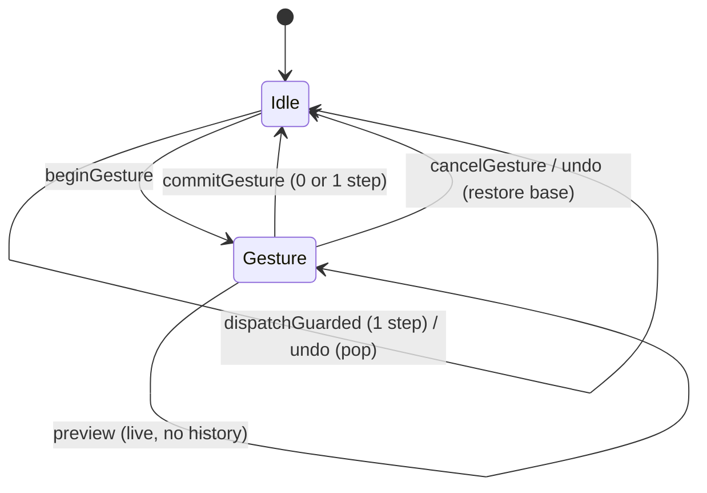

# Design Document

**Spec:** studio (the app)

## Overview

`studio` is a React + Vite single-page app in `apps/studio` that edits an engine
`Project`, previews it on a canvas via the engine's pure render path, and exports
it with `@studio/exporters`. It owns no render, schema, or encoding logic. The
design keeps a pure, DOM-free model layer (the single source of truth) separate
from a thin React shell that holds the only playback clock, so state is testable
and preview/export stay in parity. This document covers module layout, state,
the preview pipeline, fonts, the timeline, the export state machine, save/load,
CSP/security, performance measurement, correctness properties, the Playwright
plan, dependencies, and risks.

## Architecture

### Module layout (`apps/studio/src`)

```
apps/studio/src/
  model/            PURE. No DOM, no clock, no React.
    project.ts        new-project factory + ProjectDraft helpers (wraps engine Project)
    transitions.ts    pure (Project, action) -> Project reducers (layers, settings, effects, timeline)
    selectors.ts      pure derived reads (frameCount, layer by id, active layers at t, ...)
    timemap.ts        pure time<->pixel mapping for the timeline
    timeline.ts       pure frame-grid timing math (supersedes the old timeline/drag.ts)
    hit.ts            pure canvas hit boxes, hit test, client->canvas, anchor drag/nudge math
    actions.ts        the discriminated-union Action type
  ui/
    cssvars.ts        setCssVars(el, vars): CSSOM custom-property writer (CSP-safe positioning)
  playback/         The ONLY place allowed to read a clock.
    clock.ts          rAF loop; emits current time; play/pause/loop/scrub; owns requestAnimationFrame
    perf.ts           frame-interval instrument (mean + p95) for Requirement 13
  preview/
    PreviewCanvas.tsx owns the preview <canvas>, its CanvasMetricsProvider, the per-frame draw,
                      the pointer/keyboard handling, the selection outline overlay, and a
                      hit-test-only metrics provider
    draw.ts           thin: calls engine renderFrame(project, t, { ctx, metricsProvider })
  timeline/
    Timeline.tsx      ruler slider, rows, bars/handles (role=slider), playhead; pointer + key
                      handlers call model/timeline + model/timemap through the gesture API
  panels/
    SettingsPanel.tsx canvas size/presets, fps, duration, background + transparent toggle
    LayersPanel.tsx   add/edit/delete/reorder + per-layer font/size/weight/colour/align/position/timing
    EffectsPanel.tsx  preset picker from presetCatalog, param editors, granularity, remove
  fonts/
    fonts.ts          FontFace registration + readiness gate; manifest of bundled families
    fonts.css         @font-face rules (self-hosted woff2, no network)
  io/
    save.ts           serializeProject -> Blob download
    load.ts           file input -> parseProject -> typed result
  export/
    dialog.tsx        the export UI
    machine.ts        pure export state machine (idle/configuring/running/done/failed/cancelled)
    errors.ts         ErrorCode -> human message map (all 12 values)
  shell/
    App.tsx           composition root; wires store + playback + panels; holds no project state itself
    store.ts          tiny subscribe/getState store around the Project + UI state, plus the
                      undo history and the gesture API (kept in store.ts; ~60 lines. Move to
                      shell/history.ts only if store.ts grows past ~200 lines)
    StudioView.tsx    also owns the Ctrl/Cmd+Z handler
  tokens.css          design tokens extracted from design/ (no copied markup/scripts)
  main.tsx            React root
```

Intra-package imports use ESM paths with explicit `.js`/`.jsx`-less TS specifiers
per repo convention; the model layer is importable in Node for Vitest.

## Data Models

### State

- **One `Project` store** (`shell/store.ts`): holds the current `Project` plus a
  separate `UiState` (selected layer id, playhead time, loop flag, export-dialog
  state). The store is a minimal `getState` / `setState` / `subscribe` object; no
  state-management dependency.
- **Pure transitions**: every project mutation is `transitions.ts: (project,
  action) => project`. The store applies them; React never mutates the `Project`
  directly. Transitions validate against `ProjectSchema` (or a field-level guard)
  and return the unchanged input on an invalid action (surfacing an inline error
  via UI state, not by throwing).
- **Selection and playhead are NOT in the `Project`**: they live in `UiState`, so
  they never leak into saved JSON (Requirement 10.5). `serializeProject` only
  sees the `Project`.
- **React subscribes, it does not own frames**: components `useSyncExternalStore`
  over the store for structural state (layers, settings, selection). The PLAYHEAD
  during playback does NOT go through React state per frame — see Preview.

### Undo history and gestures (Requirement 16)

`Store` state becomes `{ project, ui, history }` where `history: Project[]`
(oldest first, newest last, capped at `HISTORY_LIMIT = 100`). History holds
`Project` values only; selection, playhead and loop stay in `UiState`.

**Structural sharing.** `Project` values are immutable and every transition
returns a new object that shares unchanged subtrees with the old one. The
history therefore stores references, never `structuredClone`/JSON copies. A
transition that changes nothing MUST return the same reference
(`applyAction` already does this for rejected actions; `set-anchor` and
`set-layer-timing` are verified to return the input when the values are
equal), which is how "unchanged" is detected with `!==`.

**Store API additions**

```ts
class Store {
  dispatchGuarded(action: Action): boolean;   // accepted => push previous project to history
  beginGesture(): void;                       // remember base = current project; commit any open gesture first
  preview(action: Action): boolean;           // apply live, NO history; no-op unless a gesture is open
  commitGesture(): boolean;                   // push base once if project !== base; true when a step was added
  cancelGesture(): void;                      // restore base, no history change
  undo(): boolean;                            // cancel an open gesture, else pop history
  canUndo(): boolean;
  setProject(project: Project): void;         // open / New / demo: replace project, history = []
}
```

| Event | project | history | gesture |
| --- | --- | --- | --- |
| `dispatchGuarded` accepted | new | `+ previous` (drop oldest above 100) | unchanged |
| `dispatchGuarded` rejected | same | same | unchanged |
| `beginGesture` | same | same | `base = project` |
| `preview(action)` accepted | new | same | open |
| `commitGesture`, `project !== base` | same | `+ base` (cap 100) | closed |
| `commitGesture`, `project === base` | same | same | closed |
| `cancelGesture` | `base` | same | closed |
| `undo`, gesture open | `base` | same | closed (a mid-drag Ctrl+Z is a cancel) |
| `undo`, no gesture | `history.pop()` | one shorter | closed |
| `setProject` | new | `[]` | closed |



**Selection fix-up after undo.** `undo` restores the project only. It then
sets `ui.selectedLayerId` to itself if that layer id still exists, otherwise to
`layers[0]?.id ?? null`, and clamps `ui.playhead` to the restored
`durationSeconds`. `cancelGesture` applies the same fix-up.

**Keyboard.** `StudioView` registers one `keydown` listener on `window`
(removed on unmount). It acts on `(ctrlKey || metaKey) && key.toLowerCase() === "z" && !shiftKey`
and returns early when `event.target` is an `HTMLInputElement`, `HTMLTextAreaElement`,
`HTMLSelectElement`, or has `isContentEditable`, so the browser's native text
undo keeps working in fields. Otherwise it calls `preventDefault()` and
`store.undo()`. Redo (Ctrl+Shift+Z / Ctrl+Y) is out of scope and is not bound.

**Why not undo inside `setUi`.** Selection and playhead changes are not
project edits and would flood the stack; keeping `history` project-only also
guarantees saved JSON and undo see the same data.

## Components and Interfaces

### Preview pipeline

- `PreviewCanvas` creates ONE `<canvas>` at the project canvas pixel size
  (`width`×`height`) and ONE `CanvasMetricsProvider(ctx)` bound to its 2D context.
  The provider (and thus its layout cache) is owned by the preview alone; exports
  create their own canvas + provider inside `@studio/exporters` (Requirement 1.1,
  9.3).
- The `playback/clock.ts` rAF loop computes `t` from elapsed real time (the only
  clock in the app) and calls `preview/draw.ts` directly with the current
  `Project` snapshot and `t`. Draw calls `renderFrame(project, t, { ctx,
  metricsProvider })`. This bypasses React's render cycle: a frame is a canvas
  draw, not a component re-render, so playback does not re-render React per frame.
  React re-renders only when structural state changes (a layer edited, etc.),
  which updates the snapshot the clock reads.
- **CSS fit**: the backing store stays at canvas pixels (preview pixels == export
  pixels, preserving parity); the element is scaled to fit its container via CSS
  `transform: scale(...)` / `max-width`, never by resizing the backing store.
- **Transparent background**: a CSS checkerboard sits behind the canvas element so
  transparency reads visually (Requirement 2.6); the canvas itself is cleared to
  transparent by the engine.
- **Parity test design** (Requirement 9): a Playwright test renders a fixed
  `Project` at a fixed frame index two ways — (1) the preview path
  (`renderFrame` into the preview canvas) and (2) the exporter's `FrameRenderer`
  (the same path exporters use) into its own canvas — composites both over the
  same opaque background, and asserts a per-channel diff ratio within the same
  tolerance the exporter golden uses (24/255 per channel, diffRatio <= 0.01).
  Each canvas uses its own `CanvasMetricsProvider`; no layout cache is shared.
  Because blur in both paths goes through the exporter's deterministic blur
  (the studio never sets a browser `ctx.filter` blur for final output), blurred
  frames stay in parity.

### Fonts

- **Bundled files** (self-hosted woff2; Noto Sans reused from the engine's
  vendored set, the 700 weights and the Tamil 400/700 added from the same
  OFL-1.1 source), family + weight 400 (normal) and 700 (bold) for BOTH families
  — four woff2 files:
  - `noto-sans-latin-400-normal.woff2`, `noto-sans-latin-700-normal.woff2` →
    family **"Noto Sans"** (Latin), OFL-1.1.
  - `noto-sans-tamil-tamil-400-normal.woff2`, `noto-sans-tamil-tamil-700-normal.woff2`
    → family **"Noto Sans Tamil"** (Tamil), OFL-1.1.
  Each family ships its OFL-1.1 licence file alongside the woff2. Copied into
  `apps/studio/src/fonts/` (or `public/fonts/`) at build time; no `@fontsource`
  runtime import, no CDN. These two families (weights 400/700) are the only
  `fontFamily` values offered in the layer font picker; the per-layer
  `fontWeight` control selects 400 or 700.
- **@font-face**: `fonts.css` declares both families with `font-display: block`
  and `src: url(...) format("woff2")` pointing at the bundled files.
- **Readiness gate** (`fonts/fonts.ts`): on startup the app constructs `FontFace`
  objects (or reads `document.fonts`), calls `.load()`, adds them to
  `document.fonts`, and awaits `document.fonts.ready` BEFORE the first preview
  frame (Requirement 6.3). The gate exposes `whenFontsReady(): Promise<FontStatus>`.
- **Error mapping**: the gate maps failure to the exporter error vocabulary used
  by the UI: a load timeout → `font-not-ready`; a decode failure (the woff2 fails
  to parse) → `font-decode-failed`. Export is blocked until the gate resolves
  ready; a non-ready gate shows the mapped message and does not start an export
  (Requirement 6.4, 6.5).

### Canvas hit testing (`model/hit.ts`, pure)

```ts
export type Rect = { x: number; y: number; w: number; h: number };
type Pt = { x: number; y: number };
type Size = { width: number; height: number };

/** Union of visible-cluster boxes, offset by anchor + positionOffset; null when none. */
export function layerBounds(layer: LayerState): Rect | null;
export function rectContains(r: Rect, x: number, y: number, pad: number): boolean;
/** Topmost layer id whose padded box contains (x, y); pad = 8 / displayScale. */
export function hitTest(state: FrameState, x: number, y: number, displayScale: number): string | null;
export function clientToCanvas(
  clientX: number, clientY: number,
  rect: { left: number; top: number; width: number; height: number },
  canvas: Size,
): Pt | null;
export function dragAnchor(args: {
  startAnchor: Pt; startPointer: Pt; pointer: Pt;
  shift: boolean; snap?: number; canvas: Size;
}): Pt;
export function nudgeAnchor(anchor: Pt, key: string, shift: boolean, canvas: Size): Pt | null;
```

Rules (all in CANVAS px):

- `layerBounds`: for each segment whose `text` does not match `/^[ \t\r\n]+$/`
  (visible cluster), box = `x: layoutX .. layoutX + width`,
  `y: layoutY - 0.8 * height .. layoutY + 0.2 * height`. The union is shifted by
  `layer.anchor + layer.transform.positionOffset`. `effectOverrides`, `scale`,
  `rotation`, `blur`, and `opacity` are ignored, so the box does not wobble while
  the text animates and a fully transparent active layer keeps its box. No visible
  cluster returns `null`. The 0.8/0.2 split approximates Noto Sans because
  `FrameState` carries only `height = ascent + descent`.
- `hitTest`: iterate `state.layers` from the last to the first (topmost painted
  wins), skip `null` bounds, return the first `layerId` with
  `rectContains(bounds, x, y, 8 / displayScale)`. `displayScale <= 0` or
  non-finite is treated as 1. A layer not active at `t` is not in `state.layers`,
  so it cannot be hit.
- `clientToCanvas`: `null` if `rect.width <= 0 || rect.height <= 0`; otherwise
  `x = (clientX - left) * canvas.width / rect.width` (same for y). Values are
  not clamped (a captured drag may leave the canvas); `dragAnchor` clamps.
- `dragAnchor`: `dx = pointer.x - startPointer.x`, `dy` likewise. With `shift`,
  zero the smaller `|d|` component (tie keeps x, zeroes y). Add to `startAnchor`,
  round to the grid `step = snap ?? 1` (`Math.round(v / step) * step`; a
  non-positive or non-finite `snap` falls back to 1), then clamp to
  `[0, canvas.width] x [0, canvas.height]`. Rounding happens before clamping;
  clamp bounds are whole numbers, so the result stays on the grid when
  `step = 1`. For `snap > 1`, the bound itself can be off-grid only when the
  canvas size is not a multiple of `snap`; this is accepted and the property
  (below) uses `snap` that divides both dimensions or `1`.
- `nudgeAnchor`: `ArrowLeft/Right/Up/Down` move by 1 (10 with `shift`), clamped
  to the canvas; any other key returns `null` (the handler then does nothing and
  does not call `preventDefault`).

#### Where the bounds come from (decision)

`FrameRenderer` (exporters) calls `renderFrame` and returns nothing, and it owns
its `CanvasMetricsProvider` privately, so the studio cannot read the last
painted `FrameState` or reuse that provider. Options:

| Option | Pro | Con |
| --- | --- | --- |
| A. Capture `FrameState` from the last paint | zero extra layout work | needs an exporters change (not allowed: studio owns no exporter code); stale while paused if nothing repainted |
| B. Studio computes its own `FrameState` with a hit-only provider (chosen) | no exporter change; works whenever the user clicks; same pure `computeFrameState` | one extra layout per distinct text/font (cached) |
| C. Share the renderer's provider | no duplicate layout | impossible without exposing it; would also couple cache lifetimes |

**Chosen: B.** `PreviewCanvas` creates a detached `document.createElement("canvas")`
(never attached, no markup, CSP-neutral), takes its 2D context, and wraps it in
its own `CanvasMetricsProvider`, plus its own `layoutCache` (`Map`). It is the
hit-test-only provider for that surface: one provider per canvas holds because the
provider is bound to its own canvas, and it is never shared with the paint
renderer or any export. On `pointerdown`, and when the overlay needs refreshing,
the studio calls
`computeFrameState(project, playhead, { metricsProvider: hitProvider, layoutCache: hitCache })`.

Why this agrees with the painter: layout geometry (`layoutX/Y`, `width`,
`height`) is a function of text, font family/size/weight, `align`,
`letterSpacing`, `lineHeight`, and the loaded font faces only. It does not depend
on which canvas measured it, and the engine's layout cache is keyed by those
inputs. The hit boxes also ignore every effect-driven property, so no state that
the painter alone has is needed.

Trade-offs: (1) a one-time duplicate layout per layer text/font (about the cost
of one paint, then cached); (2) if fonts load late, the hit provider must be
discarded like the renderer is: `PreviewCanvas` recreates provider and cache in
the existing `onFontsLoadingDone` callback so boxes never stay on fallback-font
metrics; (3) the studio compares nothing against the painter at runtime, so a
Playwright check (pixel bbox vs. outline) guards against drift.

### Canvas interaction model (`preview/PreviewCanvas.tsx`)

- **Surface.** The `<canvas>` is `tabindex="0"`, `aria-label="Preview canvas.
  Arrow keys move the selected layer."`, with a focus-visible outline from
  `layout.css`. Pixel `width`/`height` come from the project via
  `useStoreState` (`useSyncExternalStore`), and `data-transparent` on the stage
  follows `project.background`, so New/Open/Settings changes resize the canvas and
  toggle the checkerboard (Requirement 3.17). The existing effect re-initialises
  on `width`/`height` change, and the hit provider is recreated with it.
- **Pointer events** on the canvas, using `setPointerCapture(pointerId)`:
  - `pointerdown` (primary button only): `clientToCanvas` with
    `getBoundingClientRect()`; `displayScale = rect.width / canvas.width`;
    build the hit `FrameState`; `hitTest`. Empty canvas: return with the
    selection untouched. Hit: `store.setUi({ selectedLayerId })`, pause the clock,
    `store.beginGesture()`, remember `{ pointerId, startPointer, startAnchor }`,
    add class `is-dragging`, `canvas.focus()`.
  - `pointermove`: with a drag active, `clientToCanvas` then `dragAnchor({ ...,
    shift: e.shiftKey, canvas })` and `store.preview({ type: "set-anchor", ... })`.
    Without a drag, only the hover class (`is-over-layer`, from `hitTest`) is
    toggled; no store write.
  - `pointerup`: release capture, `store.commitGesture()` (one history step iff
    the anchor changed), remove classes.
  - `pointercancel` and `lostpointercapture` without a prior `pointerup`:
    `store.cancelGesture()` restores the start anchor.
  - Touch: `touch-action: none` on the canvas so the browser does not claim the
    gesture; capture keeps events flowing when the finger leaves the canvas.
- **Keyboard** (`keydown` on the canvas): when a layer is selected,
  `nudgeAnchor(anchor, e.key, e.shiftKey, canvas)`; non-null result calls
  `preventDefault()` and `store.dispatchGuarded(set-anchor)` (one history step per
  key press; a clamped no-op returns the same project and adds none). Other keys
  are ignored.
- **Overlay.** A sibling `<div class="selection-outline" aria-hidden="true">` in
  the stage. In a `useLayoutEffect` (on project, playhead, selection, and a
  `ResizeObserver` size) it calls
  `setCssVars(el, { "--x": b.x * s, "--y": b.y * s, "--w": b.w * s, "--h": b.h * s })`
  with `s = displayScale` and the canvas-to-stage offset. The overlay is hidden
  (`hidden` class) when no layer is selected, the selection has no bounds at `t`,
  or playback is running. It is outside the canvas, so exports and parity are
  unaffected (Requirement 3.16).
- **Cursor** is a class on the canvas: default, `is-over-layer` (`cursor: grab`),
  `is-dragging` (`cursor: grabbing`).
- **Clock coordination.** Pausing on `pointerdown` uses the existing
  `PlaybackClock` pause; repaints during the drag use the existing store
  subscription (`!clock.isPlaying` path), so no per-move React render is needed
  beyond the store notifying subscribers.

### CSS custom property helper (`ui/cssvars.ts`)

```ts
export function setCssVars(
  el: { style: { setProperty(name: string, value: string): void } },
  vars: Record<string, string | number>,
): void;
```

- Every key MUST start with `--`; a key without it throws a typed `Error`
  (programmer error, caught in tests). Numeric values are written as
  `String(value)`; non-finite numbers throw. Unit-bearing values are written as
  strings by the caller (e.g. `"12px"`), but the CSS prefers unitless variables
  multiplied in the rule.
- Components call it from `useLayoutEffect` on a ref, so the first paint already
  has the values. The parameter type is a minimal structural type so tests can
  pass a fake element (jsdom is unavailable).
- `layout.css` consumes the variables, for example
  `.tl-bar { left: calc(var(--from) * 1px); width: calc(var(--len) * 1px); }`,
  `.tl-playhead { left: calc(var(--at) * 1px); }`,
  `.selection-outline { left: calc(var(--x) * 1px); top: calc(var(--y) * 1px); width: calc(var(--w) * 1px); height: calc(var(--h) * 1px); }`.

**Why this satisfies the strict CSP.** With `style-src 'self'` (no
`'unsafe-inline'`), CSP blocks inline `<style>` elements, `style="..."`
attributes in markup, and `setAttribute("style", ...)`. It does not restrict
CSSOM mutation (`el.style.setProperty`, `el.style.left = ...`). So dynamic
geometry goes through CSSOM custom properties, and the static rules that read
them live in a bundled stylesheet served from `'self'`. JSX has no `style` prop
(this tightens the earlier note that React's `style` prop is acceptable: React
sets individual `style` properties through the CSSOM, which is allowed, but the
spec forbids it for the app to keep one auditable mechanism). Verification:
`csp.spec` runs the representative session including a canvas drag, an arrow
nudge, and a timeline drag against `vite preview`, and asserts zero
`securitypolicyviolation` events other than the single named Zod eval probe. A
unit check (grep over `apps/studio/src/**/*.tsx`) fails on `style=` JSX
attributes and on `dangerouslySetInnerHTML`.

### Timeline interaction model (`model/timeline.ts`, `model/timemap.ts`, pure)

```ts
export function toFrames(seconds: number, fps: number): number;   // round-half-away-from-zero(seconds * fps)
export function toSeconds(frames: number, fps: number): number;   // round(frames / fps, 1e-6)
export type Timing = { startSeconds: number; endSeconds: number };
export type TimingKind = "move" | "start" | "end";
export function dragTiming(kind: TimingKind, start: Timing, deltaFrames: number, fps: number, durationSeconds: number): Timing;
export function nudgeTiming(kind: TimingKind, timing: Timing, frames: number, fps: number, durationSeconds: number): Timing;
export type AxisGeometry = { axisWidthPx: number; durationSeconds: number; fps: number };
export function pxToSeconds(px: number, geometry: AxisGeometry): number;  // xToTime then snapToFrame, clamped to [0, last frame]
export function snapToFrame(seconds: number, fps: number): number;       // toSeconds(toFrames(seconds, fps), fps)
```

Definitions and exact rules. Let `N = floor(durationSeconds * fps + 1e-9)` be
the last whole frame that fits inside the duration (so `toSeconds(N) <=
durationSeconds`; plain rounding could overshoot, e.g. 0.1 s at 25 fps rounds to
3 frames = 0.12 s). `toFrames` rounds half away from zero:
`Math.sign(v) * Math.floor(Math.abs(v) + 0.5)` with `v = seconds * fps`.

1. **Snap on entry.** `s0 = clamp(toFrames(start.startSeconds), 0, N - 1)`,
   `e0 = clamp(toFrames(start.endSeconds), s0 + 1, N)`. Layers whose stored times
   are off-grid (typed in the numeric inputs, loaded from a file, or kept from an
   earlier fps) are snapped on the first timeline interaction, even when
   `deltaFrames` is 0. Nothing is rewritten until an interaction commits.
2. **`move`:** `len = e0 - s0`; `s = clamp(s0 + d, 0, N - len)`; `e = s + len`.
   Length in frames is preserved.
3. **`start`:** `s = clamp(s0 + d, 0, e0 - 1)`; `e = e0`. Only the start changes,
   the layer keeps at least 1 frame, and the start never passes the out-point.
4. **`end`:** `e = clamp(e0 + d, s0 + 1, N)`; `s = s0`.
5. Output seconds are `toSeconds(s)`, `toSeconds(e)`. `d` is truncated to an
   integer (`Math.trunc`) and a non-finite `d` is 0.
6. **Duration shorter than one frame** (`N < 1`; possible because the schema
   allows `durationSeconds` 0.1 with `fps` 1): no valid on-grid timing of at
   least 1 frame exists, so `dragTiming` returns `start` unchanged. The
   timeline rows render disabled (`aria-disabled`); the numeric inputs remain
   the way to edit. `N = 1` yields `{0, 1/fps}` for every kind.
7. **fps change.** `dragTiming` always uses the current `fps`; a layer's stored
   seconds are not rewritten when fps changes. They are re-snapped the next
   time that layer is dragged or nudged (rule 1).
8. `snapToFrame(seconds, fps)` clamps below at 0 only; `pxToSeconds` also clamps
   to `toSeconds(N)`. Ruler clicks use `pxToSeconds`; the playhead uses the same.

`timemap.ts` (existing `timeToX` / `xToTime`, inverse within one pixel) supplies
the pixel conversion. A bar drag turns pointer motion into frames with
`deltaFrames = toFrames(xToTime(px, w, dur) - xToTime(startPx, w, dur), fps)`,
computed from the pointer-down position each move (not accumulated), so there is
no drift.

### Timeline component (`timeline/Timeline.tsx`)

- **Ruler** is a `role="slider"` element (`aria-label="Playhead"`, `aria-valuemin=0`,
  `aria-valuemax=duration`, `aria-valuenow`/`aria-valuetext` in seconds). Click
  or drag scrubs via `pxToSeconds`; ArrowLeft/Right move 1 frame (10 with Shift).
  The playhead element is positioned with `--at`.
- **Rows**: one per layer. Each row has a bar (`move`), a start handle, and an
  end handle, each a focusable `role="slider"` with `aria-label` such as
  `"Title, move"`, `"Title, start"`, `"Title, end"`; `aria-valuemin`/`aria-valuemax`
  are the range the part can take (in seconds, from `dragTiming` bounds),
  `aria-valuenow` is the part's time in seconds (start, end, or start for the
  bar), and `aria-valuetext` is `"1.20 seconds"`.
- **Layout**: bars use `--from` (start px) and `--len` (length px); the playhead
  uses `--at`. All set with `setCssVars` in `useLayoutEffect`.
- **Pointer drag**: `pointerdown` on a part calls `setPointerCapture`,
  `store.beginGesture()`, selects the layer, and records `startPx` and the
  layer's timing. `pointermove` computes `deltaFrames`, calls `dragTiming`, and
  `store.preview({ type: "set-layer-timing", ... })`. `pointerup` calls
  `store.commitGesture()`: one `set-layer-timing` step. `pointercancel` calls
  `store.cancelGesture()`.
- **Keyboard**: ArrowLeft/Right on a focused part call `nudgeTiming(kind, timing,
  ±1 or ±10, ...)` and `store.dispatchGuarded(set-layer-timing)`: one step per
  press. Other keys are ignored.
- The numeric start/duration inputs in the Layers panel stay as the
  non-pointer alternative (Requirement 5.9, 12.6).

### Export dialog state machine (`export/machine.ts`, pure)

States and transitions (pure reducer; the dialog component renders them, the
shell drives side effects):

```
idle ──open──▶ configuring ──start──▶ running ──success──▶ done
                   ▲                     │  │
                   │                     │  └──error────▶ failed
                   └───reset──(done/failed/cancelled)    │
                                         └──cancel──▶ cancelled
```

- **configuring**: the dialog has a `CapabilityReport` from `detectCapabilities()`
  (called once on open). Formats offered are exactly MP4, PNG sequence, GIF
  (Requirement 8.1); a format whose `CapabilityResult.status === "unsupported"`
  is disabled with its `reason`. Per-format option fields are seeded from the
  project (MP4: `videoBitrate`, `backgroundFallback`, output size; PNG/GIF: output
  size).
- **running**: the shell calls the chosen `@studio/exporters` entry
  (`exportMp4`/`exportPngSequence`/`exportGif`) with `{ onProgress, signal }`.
  `onProgress.fraction` drives the progress bar. An `AbortController` is created
  per run; `signal` is passed to the exporter; Cancel calls `controller.abort()`.
- **done**: holds the `ExportResult` success; the dialog offers the produced
  `file` for download under `result.fileName`. If the project background is
  `transparent` and the format is MP4, the `mp4-no-transparency` note (read from
  `result.summary.notes`) is shown (Requirement 8.8).
- **failed**: holds the `ExportError`; the dialog shows `errors.ts`'s message for
  that `ErrorCode` (never a raw exception).
- **cancelled**: reached when the result is the `cancelled` error; no file.

**ErrorCode → message map** (`export/errors.ts`) covers ALL 12 values:

| ErrorCode | User-facing message (summary) |
| --- | --- |
| `browser-unsupported` | This format isn't supported by your browser. Try MP4 or PNG sequence. |
| `blur-unsupported` | This browser can't render the blur effect for export. |
| `cancelled` | Export cancelled. |
| `out-of-memory` | Ran out of memory — try a smaller size, fewer frames, or a shorter duration. |
| `invalid-options` | An export setting is out of range. (shows offending field from `fieldPaths`) |
| `audio-decode-failed` | Audio couldn't be decoded. (not reachable in v1 — no audio UI) |
| `font-decode-failed` | A font failed to load; can't export. |
| `font-not-ready` | Fonts aren't ready yet; try again in a moment. |
| `empty-frame-range` | This project has no frames to export. |
| `encoder-failure` | Encoding failed. Try again or pick another format. |
| `muxer-failure` | Writing the file failed. Try again or pick another format. |
| `project-invalid` | The project is invalid and can't be exported. |

The map is exhaustive by a `Record<ErrorCode, string>` keyed on the imported
union, so a change to `ErrorCode` fails to compile (property/unit guard).

### Save / load (`io/`)

- **Save**: `serializeProject(project)` → `Blob([json], { type: "application/json" })`
  → object-URL anchor download named `<project>.json`. The versioned
  `schemaVersion` is part of the serialized `Project` (Requirement 7.2). No
  network.
- **Load**: a hidden `<input type="file" accept="application/json,.json">`; on
  change, read the file text, call `parseProject(text)`. On a `ParseError`
  (invalid JSON, size-limit, or schema failure) show a specific message and leave
  the current project unchanged (Requirement 7.4). On success, replace the store's
  `Project` and reset `UiState` selection/playhead; panels re-render from the
  store (Requirement 7.5). The file is validated before any field is read
  (Requirement 11.4).

### CSP and security

- **No inline scripts.** Vite emits the entry as an external
  `<script type="module" src>` (no inlined script), so the CSP needs no
  `'unsafe-inline'` for scripts. The source `index.html` carries NO CSP meta; a
  build-only Vite plugin (`transformIndexHtml`, `apply: "build"`) injects the
  strict CSP meta into the EMITTED `index.html` only. The Vite DEV server runs
  with NO CSP (HMR needs inline styles + eval); the authoritative CSP check runs
  against `vite preview` of the production build (and the `vercel.json` header in
  prod). The one runtime `new Function("")` is Zod's guarded, caught `allowsEval`
  probe (see Deviations / Requirement 11.3), not app code.
- **Exact CSP** (served as an HTTP header in production and mirrored as a
  `<meta http-equiv>` for local static serving):

  ```
  default-src 'none';
  script-src 'self';
  style-src 'self';
  img-src 'self' data: blob:;
  media-src 'self' blob:;
  font-src 'self';
  connect-src 'self' blob:;
  worker-src 'self' blob:;
  base-uri 'none';
  form-action 'none';
  frame-ancestors 'none'
  ```

  Notes: there is NO `'unsafe-inline'` for scripts or styles. `index.html` and
  any server-rendered string contain no inline `<script>`, no `<style>` element,
  and no `style="..."` attribute; no code path injects `style` or `script`
  markup. Dynamic styling is applied ONLY through the CSSOM, specifically
  `ui/cssvars.ts` `setCssVars` (`el.style.setProperty` on `--` custom
  properties, read by static rules in `layout.css`), which CSP allows without
  `'unsafe-inline'`. JSX contains no `style` prop. `blob:` is
  required for the worker (`@studio/exporters` builds its worker from a bundler
  URL) and for export output object-URLs. `connect-src 'self'` with no remote
  origins, combined with the no-network test, enforces "no runtime network"
  (`img-src`/`font-src` are `'self'` only — no CDN).
- The injected META omits `frame-ancestors` (browsers ignore it in a meta —
  header-only); `vercel.json` sets the FULL CSP (incl. `frame-ancestors 'none'`)
  as an HTTP header for production, which is where clickjacking protection
  applies. design/ is excluded from the build input entirely (see risks).
- **No `innerHTML` with user text**: all user text is rendered via React text
  children (auto-escaped) or canvas `fillText`; `errors.ts` strings are static.
- **`design/` not served/bundled**: `apps/studio` has its own Vite `root`; the
  repo-root `design/` is outside it and is never imported. A unit/build check
  greps the build output and the source import graph for `design/` and
  `support.js` and fails if referenced (Requirement 11.5).

### Performance measurement (Requirement 13)

- `playback/perf.ts` records `requestAnimationFrame` timestamps during a fixed
  play window and computes the mean and 95th-percentile inter-frame interval. It
  lives only in the shell (it reads the animation clock).
- **Method**: load the standard 1280×720 / 5-layer / one-effect-each fixture,
  play for 10 s, collect intervals. PASS when mean interval ≤ `1000/fps` ms
  (33.3 ms at 30 fps) and p95 ≤ 1.5× that (50 ms). The measured numbers are
  reported (not just pass/fail) so regressions are visible. Runs as a Playwright
  test on CI's headed Chromium (indicative) and is confirmed manually on a
  mid-range laptop.

## Correctness Properties

Each property runs >= 100 fast-check iterations and is tagged
`// Feature: studio, Property N: ...`.

### Property 1: Schema-preserving transitions

For any `ProjectSchema`-valid project and any action, `applyTransition` returns a
`ProjectSchema`-valid project OR returns the input unchanged (rejected), never an
invalid project.

**Validates: Requirements 3.7, 10.1, 10.3**

### Property 2: Time-pixel round-trip

For any `t in [0, durationSeconds]` and axis width, `xToTime(timeToX(t))` equals
`t` within one pixel, and vice-versa for integer x.

**Validates: Requirements 5.3**

### Property 3: Timing drag bounds (frame-grid version)

For any layer timing, drag kind, and delta, `dragTiming` output satisfies
`0 <= startSeconds < endSeconds <= durationSeconds` on the frame grid, and `move`
preserves the length in frames. The full frame-grid statement and its
arbitraries are in the property numbered eight below; the old seconds-based
`drag.ts` statement is superseded.

**Validates: Requirements 5.2**

### Property 4: Save/load round-trip

For any valid project, `parseProject(serializeProject(p))` deep-equals `p` (and
carries `schemaVersion`); no `UiState` leaks in.

**Validates: Requirements 7.1, 7.2, 10.5**

### Property 5: ErrorCode map total

Every `ErrorCode` value has a non-empty message (exhaustive `Record` + a runtime
iteration over `ERROR_CODES`).

**Validates: Requirements 8.6**

### Property 6: Drag identity

For any in-canvas, on-grid start anchor, canvas size, and pointer position,
`dragAnchor({ startAnchor, startPointer: p, pointer: p, shift, snap, canvas })`
deep-equals `startAnchor` (with `snap` 1 or a divisor of the start anchor).

Arbitraries: canvas `fc.record({ width: fc.integer({min:1,max:7680}), height: fc.integer({min:1,max:4320}) })`;
anchor `fc.integer` within `[0, w]` / `[0, h]`; pointer `fc.double({ min: -1e4, max: 1e4, noNaN: true })`;
`shift` `fc.boolean()`. Equality uses `Object.is`-normalised values (`-0` to `0`).

**Validates: Requirements 3.12**

### Property 7: Drag stays in canvas and on the grid

For any start anchor, start and current pointers, `shift`, `snap`, and canvas
size, `dragAnchor` returns `x` in `[0, w]` and `y` in `[0, h]`, each equal to a
multiple of `snap` (or a clamp bound), and with `shift` at most one axis differs
from the start anchor (the dominant one; a tie keeps x). `nudgeAnchor` for any
arrow key returns a point inside the canvas moved by at most 1 (10 with Shift)
per axis, and `null` for every non-arrow key.

Arbitraries: as Property 6, plus `snap` `fc.constantFrom(undefined, 1, 2, 5, 10)`
and starting anchors that may lie outside the canvas (loaded files), `key`
`fc.oneof(arrowKeys, fc.string())`. Grid check: `Math.abs(v / step - Math.round(v / step)) < 1e-9`
or `v` is a bound.

**Validates: Requirements 3.12, 3.13, 3.15**

### Property 8: Timing drag stays on the frame grid

For any kind in `move | start | end`, start timing (possibly off-grid), integer
delta, `fps` in 1..120, and `durationSeconds` of at least one frame,
`dragTiming` returns `startSeconds`/`endSeconds` that are each within 1e-6 of
`k / fps` for a whole `k`, satisfy `0 <= start < end <= durationSeconds` with
length of at least 1 frame, and for `move` keep the length in frames equal to the
snapped input length (clamped by the duration). For `durationSeconds` below one
frame, the input is returned unchanged.

Arbitraries: `fps` `fc.integer({min:1,max:120})`; `durationSeconds`
`fc.double({min:0.1,max:600,noNaN:true})`; start/end `fc.double` in
`[0, duration]` with `start < end`; delta `fc.integer({min:-5000,max:5000})`. Grid
check: `Math.abs(sec * fps - Math.round(sec * fps)) < 1e-4` (1e-6 rounding of
seconds times fps up to 120 and 600 s). The `<= durationSeconds` comparison adds
`1e-9` slack for the same rounding.

**Validates: Requirements 5.1, 5.2, 5.10**

### Property 9: Undo restores

For any `ProjectSchema`-valid project and any sequence of actions, undoing once
per accepted action returns a project deep-equal to the original; rejected
actions add no step; a gesture (`beginGesture`, any number of `preview`,
`commitGesture`) adds exactly one step when the project changed and zero
otherwise; and the history length never exceeds 100.

Arbitraries: the existing `arb-project` project arbitrary and the existing
action arbitrary, interleaved with gesture groups `fc.array(action)`. Runs on a
`Store` in Node (no DOM). Deep equality is `expect(...).toEqual`.

**Validates: Requirements 16.1, 16.2, 16.3, 16.8**

## Error Handling

All failures surface as typed values, never thrown exceptions crossing the UI:
model transitions reject invalid actions and return the unchanged project with
an inline `UiState` message; `io/load.ts` returns a `ParseError` mapped to a
specific message; exports return an `ExportResult` whose `ErrorCode` is mapped
by `export/errors.ts` (the exhaustive table above). The font gate maps load
failures to `font-not-ready` / `font-decode-failed`. No code path uses
`innerHTML` with user text.

## Testing Strategy

### Unit tests (Vitest, Node only; jsdom is NOT available)

- `model/hit.test.ts`: `layerBounds` (whitespace clusters skipped, anchor and
  `positionOffset` applied, effect scale/rotation ignored, no visible cluster gives
  `null`); `hitTest` (last layer wins, 8 / displayScale pad at scales 0.25, 1, 2,
  inactive layer absent); `clientToCanvas` (scaling, zero-size rect gives `null`);
  `dragAnchor` and `nudgeAnchor` examples (Shift tie keeps x, clamping, snap,
  non-arrow key gives `null`). Properties 6 and 7 live here.
- `model/timeline.test.ts`: `toFrames` half-away-from-zero, `toSeconds` 1e-6
  rounding, `dragTiming` for each kind including off-grid input, `N < 1`, `N = 1`,
  fps change, and `pxToSeconds`/`snapToFrame` with `timemap` round-trip. Property 8.
- `ui/cssvars.test.ts`: a fake element `{ style: { setProperty: vi.fn() } }`
  receives exactly the given `--` names and stringified values; a name without
  `--` and a non-finite number throw.
- `shell/store.test.ts`: history table above row by row, cap at 100 (the 101st
  push drops the oldest), gesture commit/cancel, `setProject` clears history,
  selection fix-up after undo, structural sharing (`history[i].canvas ===
  next.canvas` for an edit that touches only layers). Property 9.
- Purity test extended to `model/hit.ts` and `model/timeline.ts`; a source audit
  fails on JSX `style=` attributes and `dangerouslySetInnerHTML`.

### Playwright test list (expected timings, bundled Chromium, localhost)

| Spec | What it asserts | ~time |
| --- | --- | --- |
| `preview.spec` | play advances, pause holds, loop wraps, scrub shows clamped frame, readout correct | ~3 s |
| `settings.spec` | presets + custom size, fps/duration bounds, transparent toggle + checkerboard, live update | ~2 s |
| `layers.spec` | add/edit/delete/reorder, draw-order follows order, font/size/colour/align/position edits | ~3 s |
| `effects.spec` | picker lists the 12 presets, apply seeds defaults, param edit updates live, remove | ~2 s |
| `timeline.spec` | bar maps start/width, ruler scrub snaps to frames, drag move/trim, end-handle drag lands on a frame (`aria-valuenow * fps` is whole), Arrow/Shift+Arrow nudges, slider ARIA attributes | ~4 s |
| `canvas-drag.spec` | click selects layer, empty click keeps selection; drag title: anchor X/Y fields change and the pixel bbox of colour `#ffcc00` follows by the same delta; Shift axis lock; pointer released outside canvas still commits; outline overlay matches the bbox | ~5 s |
| `canvas-nudge.spec` | focused canvas: ArrowRight +1 px, Shift+ArrowDown +10 px, other keys ignored; each press is one undo step | ~3 s |
| `undo.spec` | Ctrl/Cmd+Z restores a canvas drag, a nudge, a timeline end-handle drag, and a panel edit, each in one step; Ctrl/Cmd+Z inside a number input does not undo the project; Open/New clears undo | ~4 s |
| `fonts.spec` | first frame waits for fonts; Tamil glyphs render; not-ready maps to error | ~2 s |
| `saveload.spec` | download round-trips; open valid replaces project; invalid shows error, no change | ~2 s |
| `export.spec` | dialog offers MP4/PNG/GIF only; capability gating; progress; cancel→cancelled; success download; mp4-no-transparency note; error mapping | ~6 s |
| `parity.spec` | preview frame vs exporter FrameRenderer frame within tolerance (Req 9); the export parity probe still reports 0 differing pixels with a layer selected (the overlay is a DOM element, not canvas pixels) | ~3 s |
| `security.spec` | no network requests during a representative session; no design/ asset loaded | ~3 s |
| `csp.spec` | zero `securitypolicyviolation` events and no CSP console errors across a representative session that now includes a canvas drag, a nudge, and a timeline drag; only the single named Zod eval probe is allowed (Req 11.2, 11.3) | ~4 s |
| `a11y.spec` | keyboard operability, labels present, visible focus, dialog focus-trap + Escape | ~3 s |
| `perf.spec` | 1280×720 / 5-layer playback frame-interval mean + p95 (reports numbers) | ~12 s |

The existing Landing and export specs must stay green (Requirement 16.9).
All target < 10 s except `perf.spec` (a 10 s measurement window by design).

## Candidate dependencies beyond the approved list

None required. The design uses only `react`, `react-dom`, `@vitejs/plugin-react`,
`@types/react`, `@types/react-dom`, and the repo's existing tooling. Specifically
NOT proposed (and the chosen alternative):

- State management → a ~40-line `useSyncExternalStore` store, no library.
- Styling → plain CSS + design-token CSS variables, no CSS framework / CSS-in-JS.
- Icons → inline SVG in components, no icon package.
- Component testing → the pure model layer (Vitest/fast-check) + Playwright, no
  testing-library.

If any of these is later judged necessary, it will be proposed for approval
before installation (Requirement 14.4).

The approved packages' versions in the requirements table are indicative; the
actual exact versions are resolved from the npm registry at install time and
recorded in `docs/dependencies.md` (see risk 1).

## Deviations and risks

1. **Dependency versions are INDICATIVE** (the Approved-dependencies table shows
   current-stable values only). At the first task that touches `package.json`,
   each package is resolved with `npm view`, pinned to the exact latest stable
   mutually-compatible versions (`react`/`react-dom` identical; `@vitejs/plugin-react`
   compatible with the repo's Vite major; `@types` majors matching `react`), and
   its ACTUAL version/licence/publish date is recorded in `docs/dependencies.md`;
   any deviation from the table is reported.
2. **CSP: dev vs production, and one allowed probe.** No `'unsafe-inline'` for
   scripts or styles; dynamic styling is CSSOM-only. The strict CSP is injected
   into the BUILT `index.html` (build-only Vite plugin) and set as a `vercel.json`
   header; the DEV server runs with no CSP (HMR needs inline/eval). The `csp.spec`
   runs against `vite preview` of the production build and asserts ZERO
   violations EXCEPT exactly one named, caught probe: Zod `allowsEval`
   (`new Function("")`) → `script-src` / `eval`. Zod is required by the engine
   `ProjectSchema`; the probe is guarded + try/caught and falls back to the
   interpreted validator, so functionality is unaffected. `'unsafe-eval'` is NOT
   added; any other or second violation fails (Requirement 11.3).
3. **Excluding `design/` from the build**: because `apps/studio` has its own Vite
   root, the repo-root `design/` is naturally outside the build graph; the
   grep-based guard is a belt-and-suspenders check, not the primary mechanism.
4. **Perf budget on CI**: headless CI timing is indicative only; the authoritative
   Requirement 13 check is the reported numbers on a mid-range laptop (manual).
5. **Preview-without-React-per-frame**: driving canvas draws from the rAF clock
   outside React's cycle is deliberate; structural edits still flow through React.
   The risk (a stale snapshot) is handled by the clock reading the live store
   snapshot each frame rather than a captured closure.
6. **Worker + CSP `blob:`**: the exporter worker and object-URL downloads require
   `worker-src blob:` and `connect-src blob:`; these are scoped to `blob:` only,
   not remote origins, preserving the no-network guarantee.
7. **Hit box approximation.** The 0.8/0.2 vertical split is a Noto Sans
   estimate (`FrameState` carries only `ascent + descent`). Descenders or tall
   Tamil glyphs may fall slightly outside the box; the 8 CSS px pad absorbs most
   of it. The Playwright bbox check measures the real pixels against the outline.
8. **Fonts not loaded yet.** Boxes computed before the faces load use fallback
   metrics. The hit provider and its layout cache are recreated in
   `onFontsLoadingDone`, as the paint renderer is, and the overlay recomputes.
9. **Pointer capture on touch.** Without `touch-action: none` the browser may
    cancel the gesture and scroll; `pointercancel` then restores the start
    anchor, so the worst case is a no-op. Desktop is the v1 target.
10. **Ctrl+Z inside inputs.** Intercepting there would break native text undo and
    desync the field. The handler skips input, textarea, select, and
    contenteditable targets; after blur, Ctrl+Z undoes the project. A panel edit
    typed into a field is committed per accepted change, so one typing session
    can produce several steps. Coalescing typing is left out of scope.
11. **History growth.** The cap is 100 `Project` references. Structural sharing
    keeps the cost to the changed subtrees; very large projects (many layers with
    long text) cost proportionally per edit, which is acceptable for the 100 cap.
    A drag adds one step, not one per pointermove.
12. **Duplicate layout work for hit testing** (see the Option B trade-off):
    bounded by the layout cache and only run on pointerdown, hover moves, and
    overlay refresh while paused.
13. **Exporters ambient types**: `@studio/exporters` ships `gifenc`'s ambient
   `declare module` in its own `src/types`, invisible to a consumer's tsconfig.
   `apps/studio/tsconfig.json` adds `../../packages/exporters/src/types/*.d.ts`
   to its `include` (studio-only; no exporters change, no shim copy) so importing
   the exporters barrel typechecks. The shipping shell stays exporters-free until
   Group 3.
